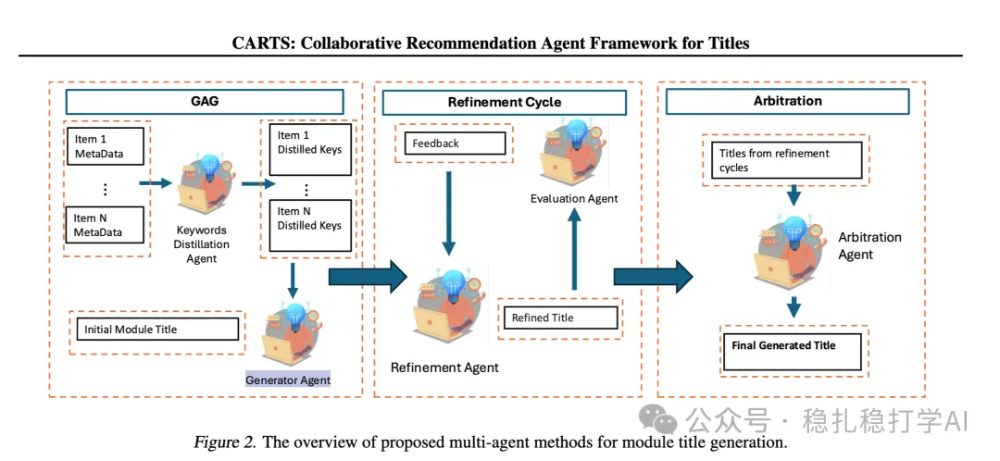

# 推荐算法(2025.6.24)：沃尔玛的LLM生成标题效果显著

> 原文：https://mp.weixin.qq.com/s?__biz=MzkzNDYyNjM1NA==&mid=2247484825&idx=1&sn=2db234a57eac403b1865372b431dcaa0&scene=21#wechat_redirect
> 作者：算法工程师刘明星（稳扎稳打学AI）| 发表于 2025-06-24

嘿，记得给“稳扎稳打学AI”添加星标

关注我，每天为你精挑细选最优质、最新鲜的推荐算法paper，陪你一起保持进步、不断精进！

👆 [本公众号paper推荐原则](https://mp.weixin.qq.com/s?__biz=MzkzNDYyNjM1NA==&mid=2247484097&idx=1&sn=18322c279290b555eb030e12953b7c7f&scene=21#wechat_redirect)

1 CARTS: Collaborative Agents for Recommendation Textual Summarization

网址：https://arxiv.org/pdf/2506.17765

公司：沃尔玛

方向：LLM

解读：

在一组相关产品的展示区域，如给用户展示多个夏装裙子，需要为其提供一个简洁的概述，突出共同特点（如多功能、时尚和舒适）。本文方法，生成与这些item高度相关且简洁的标题，且满足严格的字数限制。

（1）生成增强生成 — 通过关键词提炼和增强提示生成的初始标题是一条文本，旨在简洁地总结推荐项的共同特征，同时满足长度约束。

（2）优化循环 — 在该环节，就是评估代理（Evaluation Agent）对生成代理（Generator Agent）提出的候选标题进行的自然语言反馈。反馈内容包括：是否符合字数限制（如K个字符）；标题与各推荐项的相关性，指出哪些项未被充分覆盖；这一反馈指导生成代理迭代改进标题，以提高覆盖率和符合约束条件。

（3）仲裁 — 在优化循环中，每个周期生成的候选标题会被汇总送往Arbitration Agent。该代理会根据相关性、长度符合度等标准，从中优选出最佳标题作为最终结果。

框架中的Agent通常基于现成的预训练大语言模型（LLM），如GPT-4o，通过特定的提示（prompt）设计和角色分配实现功能，无需从头训练。

AB效果好，贴一下：生成的标题显著提升了点击率（CTR +0.8%）、加入购物车率（ATCR +6.28%）和总商品价值（GMV +3.78%）。

可信度：生产

推荐等级：推荐看看

请帮忙点赞、转发，谢谢。您认为哪篇论文最有潜力应用到实际业务中？

## 欢迎干货投稿 \ 论文宣传 \ 合作交流

推荐您继续阅读：

■ [推荐算法(2025.6.19)：字节的新物料冷启动方法](https://mp.weixin.qq.com/s?__biz=MzkzNDYyNjM1NA==&mid=2247484819&idx=1&sn=f338e3498d541197be0d4c9c21f9c3b3&scene=21#wechat_redirect)

■ [推荐算法周报(2025.6.15)：Meta独领风骚](https://mp.weixin.qq.com/s?__biz=MzkzNDYyNjM1NA==&mid=2247484811&idx=1&sn=9e7675659d15611cf53e97882b8ebce1&scene=21#wechat_redirect)

■ [推荐算法(2025.6.13)：阿里的MTL新方法非常有效](https://mp.weixin.qq.com/s?__biz=MzkzNDYyNjM1NA==&mid=2247484802&idx=1&sn=64699ffa093146caf0fa17ed1321c4f9&scene=21#wechat_redirect)

历史文章索引：https://docs.qq.com/sheet/DYXZTZ0tseHRyZGtt?tab=BB08J2

由于公众号试行乱序推送，您可能不再准时收到稳扎稳打学AI的推送。为了第一时间收到本号的干货内容， 请将本号设为星标，以及常点文末右下角的“在看”。

喜欢的话点个在看吧👇

个人观点，仅供参考
