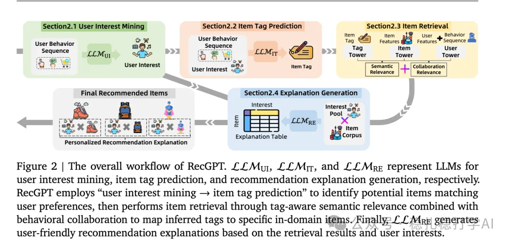

# Recommendation Algorithms (2025.8.1): How Alibaba deploys LLMs across its recommender system

> [中文版](2025-08-01-ali-recgpt.md)

1 RecGPT Technical Report

Link: https://arxiv.org/pdf/2507.19790

Company: Alibaba

Area: LLM + conventional models

Overview:

This paper uses an LLM to deliver novelty recommendation and applies it at the retrieval stage. The method complements the ordinary ranking model rather than replacing it. Concretely, it finds the user's group characteristics (in text form), has the large model predict novel item categories the user may be interested in, filters part of the candidate items according to the top-k categories, and stores them for later retrieval.

(1) User interest mining

Taking the user behavior sequence as input, it generates a structured profile, which includes:

1) Core Preferences: long-term, stable interests reflected in the user's behavior.

2) Short-Term Preferences: recent interests.

(2) Item tag prediction

This is tag prediction for the candidate items. This step runs at the same time as the user interest mining above; the two are parallel. Specifically:

1) Behavioral Profile: build item and user profiles from the user's behavior history.

2) Content Profile: content features including category, title, description and so on.

(3) Item retrieval

Combine the user interest mining and item tag prediction from the first two steps to obtain candidate items for recommendation.

Why does the generative recommendation work well?

Because the recommended items match the user's preferences. The generated items are consistent with the long-term and short-term interests obtained from user interest mining; that is, the interest preferences of the generated content agree with the results of the user interest mining.

(4) Recommendation reason generation

For the selected items, generate a reason for the recommendation. The reason should be based on the user's interests and the item's attributes, and be short and to the point. Users can use it to decide whether they like the item.

In addition, recommendation reasons generated by the large model can also increase users' trust in the system.

Takeaways:

(1) Comprehensive coverage

This paper, by contrast, uses the LLM's understanding ability in all 4 stages of recommendation. Understanding is an LLM's strength, and using that strength to help recommendation algorithms is a wise move; the A/B results are good.

The innovations in each of these stages have counterparts in what many other companies have done. The paper explains how Alibaba has deployed LLMs across its recommender system, which you can also tell from the word Report in its title.

(2) Explaining why the recommendation works well

Because the recommendation reasons are generated for items from the recommender system's ranking results, not according to the needs of users, merchants or the platform. The reason is generated from user preferences and item attributes.

(3) The role of the large model in the recommender system

The paper shows that in the recommender system the large model is not just a model but an agent that can understand user intent and item content and generate explanations. Such a system is friendlier in user experience and more trustworthy.

(4) Good A/B results

An A/B test was run on the "Guess You Like" (猜你喜欢) feed in the Taobao app. RecGPT improved significantly on several metrics: CTR +1.01%, CVR +0.32%, GMV +0.24%.

(5) The future of large models in recommender systems

The paper argues that the role of large models in recommender systems is not just generating recommendation reasons; they are agents that can understand user intent and item content and generate explanations. Such a system is friendlier in user experience and more trustworthy.

Credibility: production

Recommendation: practical value

