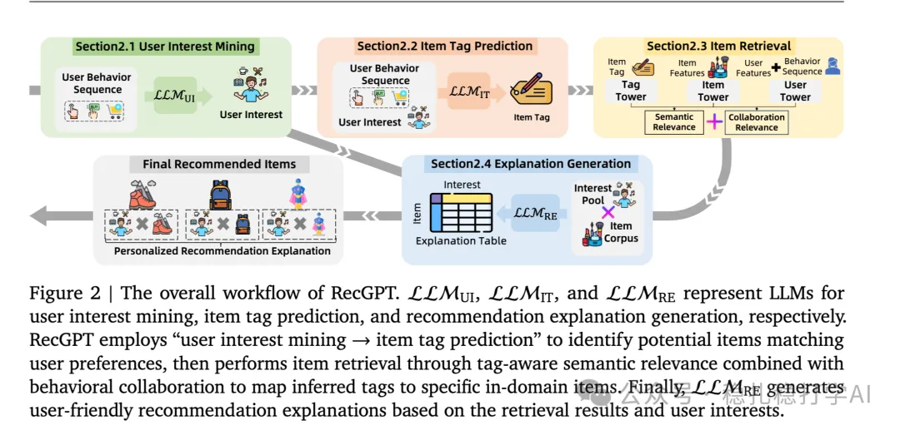

# 推荐算法(2025.8.1)：阿里如何将LLM在推荐系统上全面落地

> 原文：https://mp.weixin.qq.com/s/p7c5eHZWVbvf2Wa_LuZadA
> 作者：算法工程师刘明星（稳扎稳打学AI）| 发表于 2025-08-01

嘿，记得给“稳扎稳打学AI”添加星标

关注我，每天为你精挑细选最优质、最新鲜的推荐算法paper，陪你一起保持进步、不断精进！

> [English version](2025-08-01-ali-recgpt.full.en.md)

👆 [本公众号paper推荐原则](https://mp.weixin.qq.com/s?__biz=MzkzNDYyNjM1NA==&mid=2247484097&idx=1&sn=18322c279290b555eb030e12953b7c7f&scene=21#wechat_redirect)

1 RecGPT Technical Report

网址：https://arxiv.org/pdf/2507.19790

公司：阿里

方向：LLM+传统模型

解读：

本文通过LLM实现新颖性推荐，并用于召回环节。本文方法是普通排序模型的补充，而不是替代。具体的，是找到用户的群体特征（文本形式），让大模型预测用户感兴趣的新颖item类别，根据top-k的类别，从候选item里筛选出部分item，存储起来，用作后续的召回。

（1）用户兴趣挖掘

以用户行为序列为输入，生成一个结构化画像。它包括：

1）核心偏好（Core Preferences）：用户行为反映出来的长期稳定的兴趣。

2）短期偏好（Short-Term Preferences）：近期的兴趣。

（2）物品标签预测

就是对候选item做标签预测，这个步骤跟前一步的用户兴趣挖掘是同时进行的，是平行的。具体的：

1）行为画像（Behavioral Profile）：根据用户的行为历史，构建item和user画像。

2）内容画像（Content Profile）：包括category、title、description等内容特征。

（3）物品召回

把前两步的用户兴趣挖掘和物品标签预测结合起来，获取到推荐候选item。

为什么生成式推荐效果好？

这是因为推荐的item，跟用户的偏好对得上。生成的item，与用户兴趣挖掘获得的长期兴趣、短期兴趣保持一致，即生成内容的兴趣偏好与用户兴趣挖掘的结果一致。

（4）推荐理由生成

对筛选出来的item，生成推荐的理由，理由要基于用户的兴趣和物品属性，简明扼要。用户可以据此决定是否喜欢该item。

另外，大模型生成的推荐理由，还可以增加用户对系统的信任。

心得：

（1）全面化

而本文，在推荐的4个环节都是利用了LLM的理解能力。我们知道，LLM的理解能力是LLM的长处，利用其长处，助力推荐算法，这是明智之举，AB效果不错。

几个环节的创新，在很多其它公司的创新里也能找到类似的踪迹。本文讲解了阿里如何将LLM在推荐系统上全面落地的情况，这从本文名字里的Report也能看出。

（2）为什么推荐效果好的解释

因为这是基于推荐系统中排序结果的item生成推荐理由，而不是根据用户、商户、平台的需求生成推荐理由。这个推荐理由，是基于用户偏好和item属性生成的。

（3）大模型在推荐系统中的角色

本文展示了大模型在推荐系统中，不只是一个模型，而是一个能够理解用户意图、物品内容、并生成解释的智能体。这样的系统，在用户体验上更友好，也更可信。

（4）AB效果不错

在淘宝App上，针对“猜你喜欢”场景进行了AB测试。结果显示，RecGPT在多个指标上都有显著提升：CTR提升了 1.01%，CVR提升了 0.32%，GMV提升了 0.24%。

（5）大模型在推荐系统中的未来

本文认为，大模型在推荐系统中的作用，不只是生成推荐理由，而是能够理解用户意图、物品内容、并生成解释的智能体。这样的系统，在用户体验上更友好，也更可信。

可信度：生产

推荐等级：有实践价值

请帮忙点赞、转发，谢谢。您认为哪篇论文最有潜力应用到实际业务中？

## 欢迎干货投稿 \ 论文宣传 \ 合作交流

推荐您继续阅读：

■ [推荐算法(2025.7.31)：Snap的关于生成式推荐的发现，肯定可以帮助到您](https://mp.weixin.qq.com/s/KbRxrNMUHweQRHuSdlgh6w)

■ [推荐算法(2025.7.28)：Google的小方法大价值，AB效果在文中](https://mp.weixin.qq.com/s/TTpzAw3Y5XPkmm9vIGbZ4A)

■ [推荐算法(2025.7.24)：沃尔玛，抠啊抠，抠出GMV大涨10个点](https://mp.weixin.qq.com/s/MiLpTuUlgOXJqbLennVKnA)

历史文章索引：https://docs.qq.com/sheet/DYXZTZ0tseHRyZGtt?tab=BB08J2

请入群，群内可讨论技术方案、发招聘广告、内推和交友。

• 铁粉标准：累计10次评论或爱心、投稿1次。

• 入群方法：请您加个人微信lmxhappy，我拉您入群，请备注（只我个人看，不公开）。

由于公众号试行乱序推送，您可能不再准时收到稳扎稳打学AI的推送。为了第一时间收到本号的干货内容， 请将本号设为星标，以及常点文末右下角的“在看”。

喜欢的话点个在看吧👇

个人观点，仅供参考
