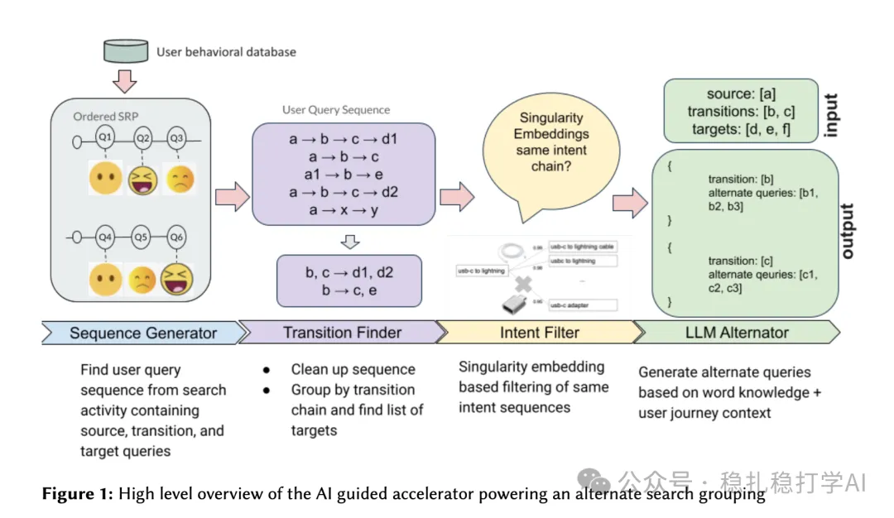

# Recommendation Algorithms (2025.9.2): eBay's LLM-based search query recommendation

> [中文版](2025-09-02-ebay-llm-search-query.md)

1 AI Guided Acceleration For Search Experience

Link: https://arxiv.org/pdf/2508.05649

Company: eBay

Area: search + LLM + query recommendation

Overview:

Use an LLM to generate diverse alternative queries to improve search relevance and user engagement.

The overall pipeline is: user behavior database → sequence generation → transition lookup → intent filtering → LLM alternative generation → show "recommended search queries" in a carousel on the search results page. Specifically:

(1) Sequence generation and transition lookup

Query sequences are mined from user session logs. A session must contain at least one "bbowac" event (buy, bid, offer, watch, ask, cart) and two queries. Sequences are split into: source query, transition queries and convergence query. For example, the session a → b → c → d (bbowac) → e → f is split into two sequences.

(2) Intent filtering

A query similarity model (based on representation learning from item interactions) filters the sequences to make sure intent stays consistent. Walking backwards from the convergence query, a query is excluded if its similarity falls below a threshold. For example, "macbook [0.6] → iphone 12 [0.9] → iphone 12 red [0.95] → iphone 12 128gb" filters out "macbook" and keeps the last three. This ensures the queries in a sequence are semantically similar.

(3) LLM alternative generation

An open-source LLM (such as Solar-10B-Instruct) uses in-context learning to generate alternative convergence queries. The input includes the full user journey, and the prompt asks for queries that are different but have the same intent, avoiding duplicates. Example: given the transition query "18k gold diamonds necklace", outputs include "18k white gold diamond necklace", "18k gold diamond necklace david yurman", and so on.

The reason transition queries are used to expand search queries is that they give a dynamic view of how user intent evolves, which helps generate richer and more diverse alternative convergence queries and promotes discovery and conversion in e-commerce search. Using the convergence query directly might limit the output to static variants and fail to capture the exploratory nature of search.

Credibility: offline

Recommendation: read it if you have time

