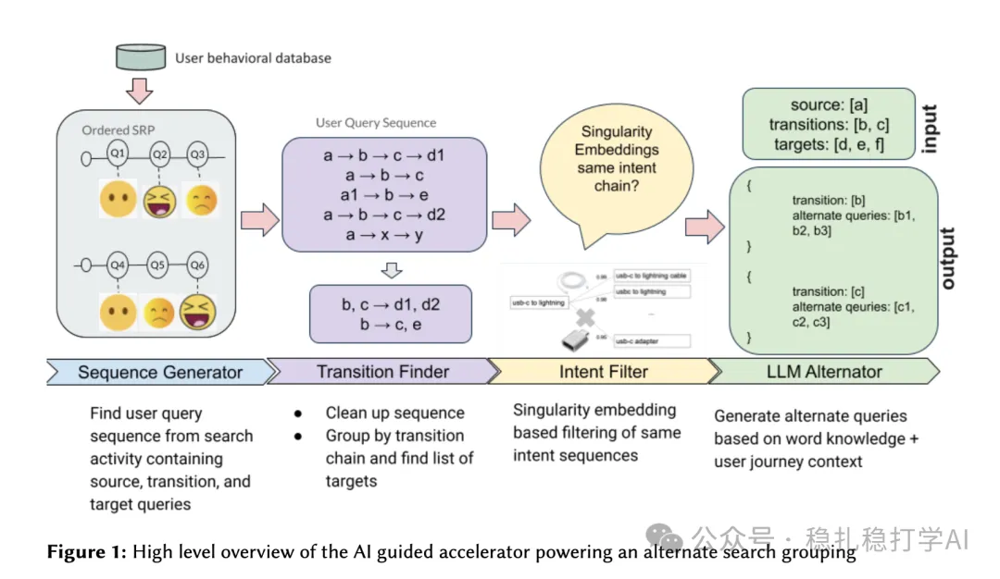

# 推荐算法(2025.9.2)：eBay的LLM搜索词推荐

> 原文：https://mp.weixin.qq.com/s/z_KjO5YcjwLRypkbVpcBeQ
> 作者：算法工程师刘明星（稳扎稳打学AI）| 发表于 2025-09-02

嘿，记得给“稳扎稳打学AI”添加星标

关注我，每天为你精挑细选最优质、最新鲜的推荐算法paper，陪你一起保持进步、不断精进！

👆 [本公众号paper推荐原则](https://mp.weixin.qq.com/s/BhVGu0qH5kTz9N5zpsD3KA)

1 AI Guided Acceleration For Search Experience

网址：https://arxiv.org/pdf/2508.05649

公司：ebay

方向：搜索+LLM+搜索词推荐

解读：

借用LLM生成多样化的备选查询，以改善搜索相关性和用户参与度。

大体流程是：用户行为数据库 → 序列生成 → 过渡查找 → 意图过滤 → LLM 备选生成 → 在搜索结果页轮播展示“推荐搜索词”。具体的，

（1）序列生成与过渡查找

从用户会话日志中挖掘查询序列。会话必须包含至少一个“bbowac”事件（buy, bid, offer, watch, ask, cart）和两个查询。序列分为：源查询、过渡查询和收敛查询。例如，会话 a → b → c → d (bbowac) → e → f 被拆分为两个序列。

（2）意图过滤

使用查询相似度模型（基于物品交互的表示学习）过滤序列，确保意图一致。从收敛查询逆向遍历，如果相似度低于阈值，则排除。例如，“macbook [0.6] → iphone 12 [0.9] → iphone 12 red [0.95] → iphone 12 128gb”会过滤掉“macbook”，保留后三者。这样保证里面的搜索词语义是相似的。

（3）LLM 备选生成

使用开源 LLM（如 Solar-10B-Instruct）通过上下文学习（in-context learning）生成备选收敛查询。输入包括完整用户旅程，提示要求生成不同但意图一致的查询，避免重复。示例：输入过渡查询“18k gold diamonds necklace”，输出如“18k white gold diamond necklace”、“18k gold diamond necklace david yurman”等。

之所以使用的是过渡查询来扩展搜素词，是因为它提供了用户意图演变的动态视角，帮助生成更丰富、多样的备选收敛查询，促进电子商务搜索的发现和转化。如果直接用收敛查询，可能会限制输出为静态变体，无法捕捉探索本质。

可信度：离线

推荐等级：有时间看看

请帮忙点赞、转发，谢谢。您认为哪篇论文最有潜力应用到实际业务中？

## 欢迎干货投稿 \ 论文宣传 \ 合作交流

推荐您继续阅读：

■ [推荐算法(2025.8.30)：微软的语义embed对齐，简单有效](https://mp.weixin.qq.com/s/aFfTgavsGzsvU9j5XYianw)

■ [推荐算法(2025.8.29)：Pinterest的Embed增强2.0，简单有效](https://mp.weixin.qq.com/s/u2VPDCyET_1Fj6SnFRwy6w)

历史文章索引：https://docs.qq.com/sheet/DYXZTZ0tseHRyZGtt?tab=BB08J2

请入微信群，群内我会给出更深入的解读，还可以共同讨论技术方案、发招聘广告、内推和交友等。

• 铁粉标准：关注一个月以上，且累计10次互动（评论、爱心、转发）、或投稿1次。

• 入群方法：请您加个人微信lmxhappy，我拉您入群，请备注（只我个人看，不公开）。

喜欢的话点个在看吧👇

个人观点，仅供参考
