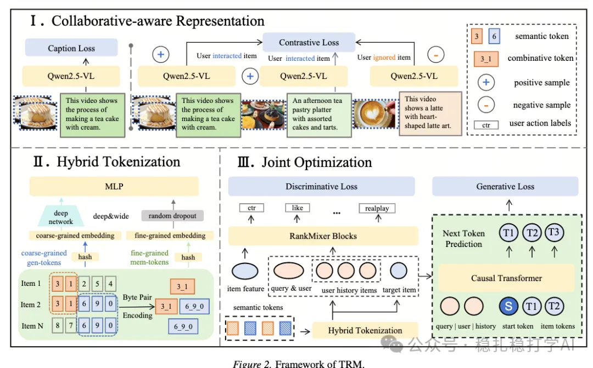

# Recommendation Algorithms (2026.2.2): ByteDance, a new way to bring multimodality into recommendation models

> [中文版](2026-02-02-bytedance-trm.md)

1 TRM: Training-free Retrieval and Generation for Controllable Recommendation with Multimodal Language Models

Link: https://arxiv.org/pdf/2601.17524

Company: ByteDance

Area: multimodal

Overview:

This ByteDance work brings multimodality into the recommendation model, and the approach is clear:

(1) First fine-tune the MLLM so that the multimodal item representations it outputs are aware of collaborative information

This fine-tuning is not for a generation task; it is to obtain multimodal item representations.

Fine-tuning has 3 objectives:
a) Contrastive loss: align the item's multimodal representation with the item's collaborative representation.
b) Item ranking loss: compute the similarity between the item's multimodal representations from multiple views and the candidates' representations, take a weighted sum to get a score, then apply a ranking loss.
c) Positive/negative alignment loss: pull the multi-view multimodal representations of positive samples as close together as possible, and push those of negative samples as far apart as possible.

(2) Fusing multimodal representations with collaborative filtering representations

This is not simple concatenation; a dedicated "collaborative filtering fuser" is designed. The method:

First, fuse the multimodal representation and the collaborative filtering representation through cross-attention, to get the item's multimodal representation for the current recommendation scenario.

Then, use the collaborative filtering representation to generate neighbor sets between items. For example, an item's neighbor set is the other items similar to it.

(3) Retrieval with the fused representation

There are 2 methods:

The first, TRM-Gen: use the multimodal representation directly as the retrieval key, and do retrieval with a trained two-tower model.

The second, TRM-Gen++: on top of TRM-Gen, aggregate the keys of similar items. That is, the neighbor sets of the user's positive-feedback items become part of the key, the neighbor sets of the user's negative-feedback items become part of the key, and merging them forms a weighted key.

(4) Ranking with the fused representation

The neighbor sets of the user's positive-feedback items become part of the key, the neighbor sets of the user's negative-feedback items become part of the key, and merging them forms a weighted key.

A/B: user active days +0.26%, query change rate -0.75%.

Takeaways:
(1) Multimodal representations and ID representations are both good approaches, and in the future they can be used together.
(2) Combining multimodal representations with ID representations is a good idea.
(3) This paper applies an MLLM in recommendation, and the results are good.

Caveats: Bringing multimodality into the recommendation model in light of your own business is genuinely good. I think it is worth trying.

Credibility: production

Recommendation: worth a look
