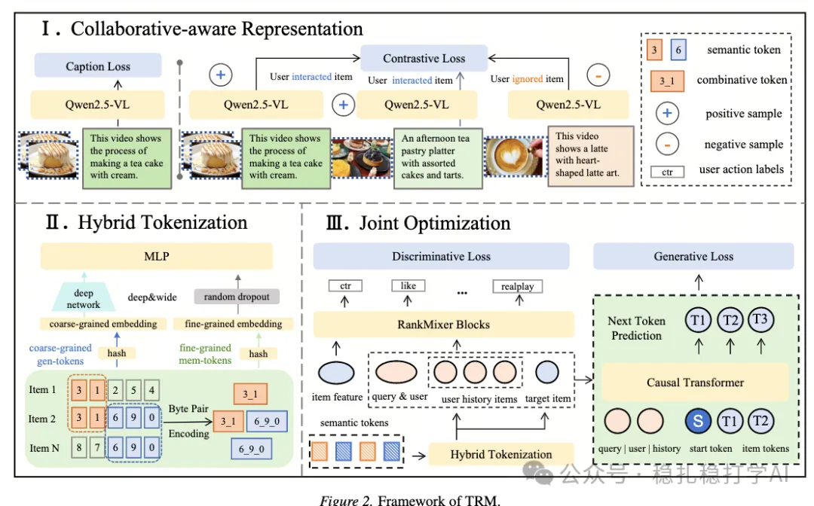

# 推荐算法(2026.2.2)：字节，多模态引入推荐模型的新方法

> 原文：https://mp.weixin.qq.com/s/E3GtWE-SMIwHkw6GoyuZ0w
> 作者：算法工程师刘明星（稳扎稳打学AI）| 发表于 2026-02-02（修改于2026年2月2日）

嘿，记得给“稳扎稳打学AI”添加星标

关注我，每天为你精挑细选最优质、最新鲜的推荐算法paper，陪你一起保持进步、不断精进！

> [English version](2026-02-02-bytedance-trm.full.en.md)

👆 [本公众号paper推荐原则](https://mp.weixin.qq.com/s/BhVGu0qH5kTz9N5zpsD3KA)

1 TRM: Training-free Retrieval and Generation for Controllable Recommendation with Multimodal Language Models

网址：https://arxiv.org/pdf/2601.17524

公司：字节

方向：多模态

解读：

字节这篇工作是多模态引入推荐模型，思路很清晰：

（1）先微调MLLM以使输出的item多模态物品表示能够感知协作信息

这个微调不是为了生成任务，而是为了得到item的多模态表示。

微调有3个目标：
a）对比损失，使item的多模态表征与item的协作表征对齐。
b）物品排序损失：计算item的多个视角的多模态表征与候选的表征相似度，加权求和得到分数后，排序损失。
c）正负样本对齐损失：使正样本的多个视角的多模态表征尽量靠近，负样本的多个视角的多模态表征尽量远离。

（2）多模态表征与协同过滤表征的融合

这里不是简单的拼接，而是专门设计了“协同过滤融合器”。做法是：

首先，将多模态表征和协同过滤表征通过一个cross-attention融合，得到物品在当前推荐场景下的多模态表征。

然后，利用协同过滤表征，生成物品之间的邻居集合。比如，一个物品的邻居集合是与它相似的其他物品。

（3）用融合后的表征做检索

方法有2种：

第一种，TRM-Gen。直接使用多模态表征作为检索的key，用训练好的双塔模型做召回。

第二种，TRM-Gen++。在TRM-Gen的基础上，把相似物品的key聚合起来，即：把用户的正反馈物品的邻居集合作为key的一部分，把用户的负反馈物品的邻居集合作为key的一部分，合并之后形成一个加权的key。

（4）用融合后的表征做排序

把用户的正反馈物品的邻居集合作为key的一部分，把用户的负反馈物品的邻居集合作为key的一部分，合并之后形成一个加权的key。

AB：用户活跃天数+0.26%，查询变更率-0.75%。

心得：
（1）多模态表征与ID表征都是很好的方式，未来可以结合起来使用。
（2）将多模态表征和ID表征结合起来，是一个很好的思路。
（3）这篇在推荐领域应用了MLLM，效果也好。

愚见：可以结合自己的业务，多模态引入推荐模型，确实不错。感觉可以做做。

可信度：生产

推荐等级：推荐看看

请帮忙点赞、转发，谢谢。

## 欢迎干货投稿 \ 论文宣传 \ 合作交流

推荐您继续阅读：

[推荐算法(2026.1.30)：字节，创新的语义ID生成方法](https://mp.weixin.qq.com/s/Ts8VSDhJPCRPzdK4skr1qQ)

[推荐算法(2026.1.29)：Meta，离线长序列建模，转化率+4.3%](https://mp.weixin.qq.com/s/cV_f_kaFIhi-fwazrhRW7w)

历史文章索引：https://docs.qq.com/sheet/DYXZTZ0tseHRyZGtt?tab=BB08J2

请入微信群，群内我会给出更深入的解读，还可以共同讨论技术方案、发招聘广告、内推和交友等。

铁粉标准：关注公众号一个月以上，且在公众号上累计15次互动（评论、爱心、转发）、或投稿1次，只欢迎技术同学。

入群方法：请您加个人微信lmxhappy，我拉您入群，请备注（只我个人看，不公开）。

喜欢的话点个在看吧👇

个人观点，仅供参考

修改于2026年2月2日
