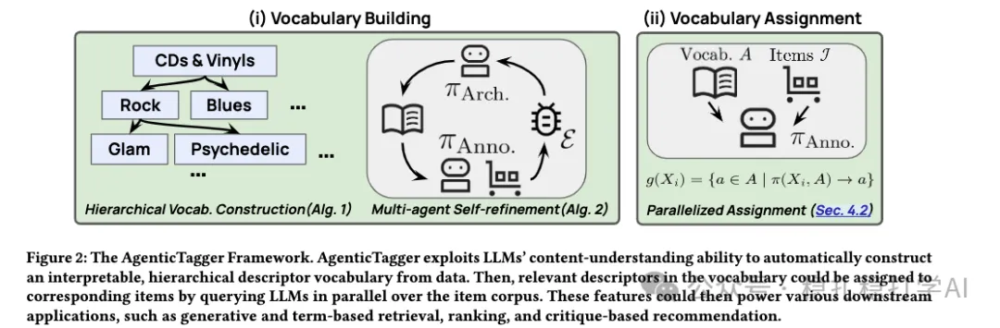

# Recommendation Algorithms (2026.2.7): Google's item-tagging agent

> [中文版](2026-02-07-google-agentic-tagger.md)

1 AgenticTagger: Leveraging LLM Agent for Vocabulary-free, Interpretable Content Tagging at Scale

Link: https://arxiv.org/pdf/2601.19619

Company: Google

Area: item tagging

Overview:

This Google work is well timed: riding the agent wave, it lands an agent in recommendation.

The work has 3 parts:

(1) Building the vocabulary

That is, building a set of item tags. This vocabulary can be thought of as a tag tree.

The method uses multiple LLM copies; each samples part of the item set and extracts item descriptors. Then category terms are derived from the descriptors: for example, if the descriptors are various kinds of "cat", the category term is "felines". These category terms make up the vocabulary.

Sampling is done by clustering the items (K-Medoids, similar to K-means) and picking the core item of each cluster.

Finally, based on these suggestions, more category terms are added to A. This is iterated several times.

(2) Refining the vocabulary

That is, polishing the vocabulary. The method: for items sampled from the item set, the LLM identifies a category term; if that category term is not in the vocabulary, it is added. This is iterated several times.

(3) Tagging

This assigns every item to categories in the vocabulary. It is a parallel process: multiple annotator LLM copies scan the whole item set and assign descriptors to each item. In implementation, it uses the LLM's long-context ability (e.g. Gemini's 72k tokens) to put the whole tag tree in the prompt and let the LLM judge the match.

The vocabulary is also called the tag set.

A/B: we believe growth of the vocabulary improves both retrieval and ranking, and there is hope it improves recommendation relevance online too.

Takeaways:
(1) The strong understanding ability of LLMs is one of the best ways to help recommendation algorithms.
(2) Agents are bound to become popular in recommendation. Prompts let you customize the output format and make process automation work well; the various human, system and subsystem roles across every stage of a recommender system can all be implemented with agents.

Credibility: offline

Recommendation: practically useful
