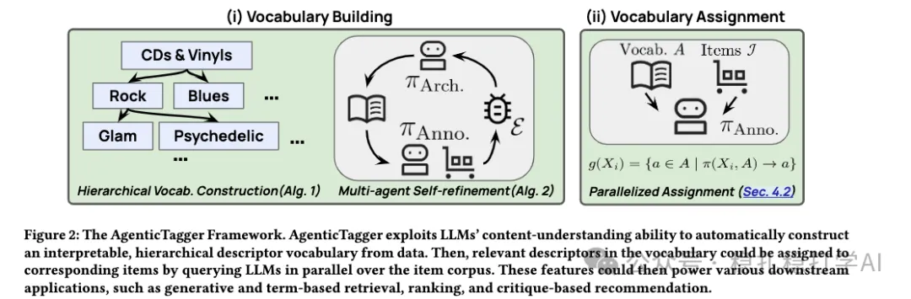

# 推荐算法(2026.2.7)：谷歌的物料打标签agent

> 原文：https://mp.weixin.qq.com/s/iRYxA_B-U7tWpYcuBx9fuQ
> 作者：算法工程师刘明星（稳扎稳打学AI）| 发表于 2026-02-07

嘿，记得给“稳扎稳打学AI”添加星标

关注我，每天为你精挑细选最优质、最新鲜的推荐算法paper，陪你一起保持进步、不断精进！

👆 [本公众号paper推荐原则](https://mp.weixin.qq.com/s/BhVGu0qH5kTz9N5zpsD3KA)

1 AgenticTagger: Leveraging LLM Agent for Vocabulary-free, Interpretable Content Tagging at Scale

网址：https://arxiv.org/pdf/2601.19619

公司：谷歌

方向：物品打标签

解读：

谷歌这篇工作很是时候，借着 agent 的东风，在推荐算法落地了 agent 。

这篇工作分为 3 部分，分别是：

（1）建词汇

即建立一套物品标签。这个词汇可以说是标签树。

建的方法是利用多个LLM拷贝，分别从物品集抽取出部分物品，提取物品描述符。然后根据描述符，获得类别词，比如描述符是各种“猫”，则类别词是“猫科动物”，这些类别词就是词汇。

抽取的方法是将item做聚类（K-Medoids，类似K-means），选取每个类的核心item。

最后，会根据这些建议，增加更多的类别词到A里。经过多次迭代。

（2）修词汇

即对词汇进行精修。方法是在物品集中抽取的物品，用LLM识别为类别词，但类别词不存在于词汇中，则将其增加到词汇中。经过多次迭代。

（3）打标签

就是将所有item归类到词汇中的类别。这是一个并行过程：多个注释者LLM拷贝扫描整个物品集，为每个物品分配描述符。实现上利用LLM的长上下文能力（e.g., Gemini的72k token），将整个标签树放进prompt中，让LLM判断匹配。

词汇又称为标签总和。

AB：我们认为，词汇的增长对检索和排序均有提升，线上也有希望提升推荐相关性。

心得：
（1）LLM很大的理解能力，是最好助力推荐算法的方式之一。
（2）agent在推荐算法上必然流行。通过prompt可以定制输出方式，可以很好的实现了流程的自动化，在推荐系统的各个流程里的各种人类、系统、子系统都可以通过agent实现的。

可信度：离线

推荐等级：有实践价值

请帮忙点赞、转发，谢谢。

## 欢迎干货投稿 \ 论文宣传 \ 合作交流

推荐您继续阅读：

[推荐算法(2026.2.6)：百度，长序列CTR建模，广告平均收入+3%](https://mp.weixin.qq.com/s/iVOIfoNyrxYrj5dZpMKu0g)

[推荐算法(2026.2.2)：字节，多模态引入推荐模型的新方法](https://mp.weixin.qq.com/s/E3GtWE-SMIwHkw6GoyuZ0w)

历史文章索引：https://docs.qq.com/sheet/DYXZTZ0tseHRyZGtt?tab=BB08J2

请入微信群，群内我会给出更深入的解读，还可以共同讨论技术方案、发招聘广告、内推和交友等。

铁粉标准：关注公众号一个月以上，且在公众号上累计15次互动（评论、爱心、转发）、或投稿1次，只欢迎技术同学。

入群方法：请您加个人微信lmxhappy，我拉您入群，请备注（只我个人看，不公开）。

喜欢的话点个在看吧👇

个人观点，仅供参考
