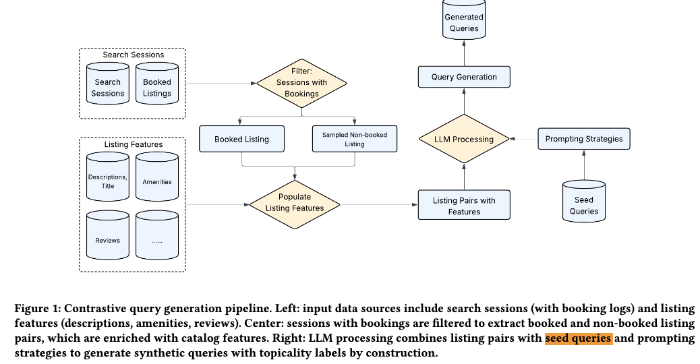

# Airbnb launches "natural language search", and synthetic data does the heavy lifting

> [中文版](airbnb-llm-synthetic-query.md)

### Paper: Bridging the Cold-Start Gap: LLM-Powered Synthetic Data Generation for Natural Language Search at Airbnb
### Link: https://arxiv.org/pdf/2605.21812
### Company: Airbnb
### Idea: the understanding ability of LLMs
### Area: cold start + LLM4rec

## Overview:
To launch natural language search on Airbnb, you need to train models to support the feature, but there is no data. So they came up with a way to generate synthetic data: have an LLM generate queries, and use them to train the model.

They use users' past search sessions, which contain real users' browsing, interaction and booking behavior. Sessions that ended in a booking are selected; in such a session, the booked listing is the positive, and listings that were only clicked are negatives. These two samples are given to the LLM in the prompt, and it is asked to generate a synthetic query. The generated queries are post-processed, and only qualified queries are kept. This forms triples (query, positive, negative). The triples are used to train the ranking model: teach the model to score positives high and negatives low, so it learns real relevance.

Post-processing includes:
- Deduplication (avoid generating duplicate queries)
- Risky-term filtering (remove platform-internal terms such as "Superhost", "entire place", etc.)
- Consistency check (attributes mentioned in the query must match the listing's actual attributes)

To make the synthetic queries closer to what humans type, the prompt is built with attention to the following:
### (1) Contrast
As said above, besides telling the LLM the booked sample, its hard negative is also given, so the generated query must be able to distinguish two real listings (one the user liked, one the user didn't). But negatives that are too easy should not be given, or the model learns less.

As a special case, if in the session the user clicked no listing other than the booked one, a negative is picked by random sampling. Outside this special case, other listings that were not booked but had other behavior (such as clicks) can be used as negatives.

### (2) Templates
In this process, to generate better queries, the prompt also includes some example queries, i.e. seed queries. Seed queries originally came from user research surveys before launch; after natural language search launched, they were gradually replaced with queries typed by real users, giving a smooth transition from cold start to warm start. Three requirement levels, from strict to loose:
* Use the seed query as a strict template and require the LLM to imitate its structure exactly. E.g. "Generate a query strictly following this sentence pattern: {seed query}. Only replace the listing-related content."
* Use seed queries as a style reference and let the LLM learn the way people talk. E.g. "Here are examples of real users' query style: {seed 1}, {seed 2}. Generate a new query in a similar style."
* Don't constrain structure at all; give only high-level guidance and encourage creativity, with no specific seed queries. E.g. "Generate a natural, diverse query that may contain multiple needs. Feel free to try different ways of expressing it."

What is actually done in production:
* When generating data each day, the three strategies are used randomly or in proportion
* The current ratio is roughly: 60-70% strict + 20-30% medium + 10-20% loose.
    - Strict templates ensure realism (close to real user queries), but being too strict leads to insufficient diversity;
    - The loose mode adds diversity, but risks generating unrealistic queries.
    - This ratio is the optimal balance point verified by A/B testing.

### (3) Listing features
Both positives and negatives are listings, so the listing features (title, description, amenity list, review summary, room type, location, price, etc.) should be fully used and put in the prompt. Only then can the LLM use these features while generating queries, so the generated queries contain this information and better match users' natural language input.
Giving the LLM very detailed structured features is meant to keep it from improvising, to prevent LLM hallucination.

After launch, seeds are gradually replaced with queries typed by real users:
* Early stage: 500 user research survey responses as seeds → generate millions of synthetic samples for training
* After launch: collect real user queries in real time → replace the seed set → regenerate daily → closed-loop improvement.

## Results

The paper validates the method by comparison:
* Query length: real users (4 words) vs baseline method (13.6 words) vs this method (6 words)
  - With seed templates, KL divergence drops from 4.95 to 0.66, **a 7.5x improvement**
* Evaluation difficulty: the baseline method reaches 87-99% accuracy (too easy); this method 76-79% (more discriminative)

## Takeaways:
* The stronger understanding ability of LLMs can be used to synthesize data, not only for cold start but also for further model enhancement.
* Structured features are the key to keeping the LLM from hallucinating
* This idea can also be used for:
  * **Item-to-item recommendation**: generate item relation pairs from user interaction history to cold-start new items quickly
  * **Cross-domain recommendation**: learning item associations across domains
  * **Multimodal embedding**: LLM-generated text descriptions of relations as a supplement to item representations

## Credibility: production

## Recommendation: practically useful

