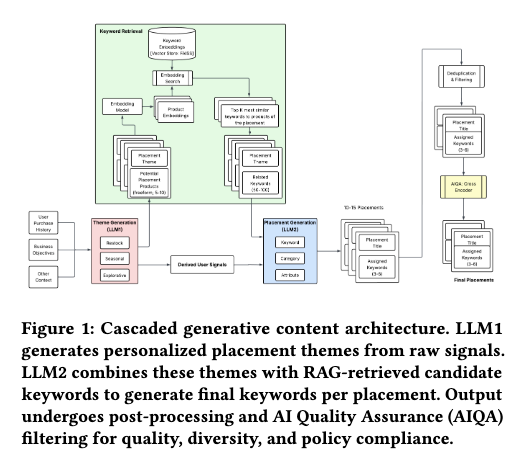

# North American retailer: cascaded generative LLMs personalize the whole homepage, add-to-cart +3%

> [中文版](instacart-cascaded-generative.md)

### Paper: A Cascaded Generative Approach for e-Commerce Recommendations
### Link: https://arxiv.org/pdf/2605.11118
### Company: Instacart (North American retailer)
### Idea: the understanding ability of LLMs
### Area: LLM-as-ranker + page layout + retrieval
## Overview:
LLMs are used to personalize the homepage both at the carousel (section) level and within each carousel: first generate the user's personalized Top-K semantic themes, then generate retrieval keywords for each theme, use the keywords to retrieve the corresponding products, drop carousels whose theme-product match is poor through quality filtering, and finally hand off to the traditional ranking system for the final presentation.

It has these 4 steps:
### (1) Carousel theme generation
An LLM takes the user context (purchase history, interaction signals, dietary preferences, household structure, seasonal/time factors, etc.) and is asked to output m ordered semantic themes. Instead of the traditional system showing everyone the same themes, it becomes finer-grained, personalized, one-per-user themes that make up a user-specific homepage. Each theme represents a coherent shopping intent and is used directly as the carousel title. These themes are no longer the traditional static "Dairy" or "Snacks", but highly personalized, context-aware semantic descriptions.

It doesn't only output themes; it also generates the following for later stages (avoiding re-inputting the raw context, which improves token efficiency):
* User profile: e.g. "busy young family cook who prefers quick, healthy meals"
* Product concepts: e.g. "low-sugar functional drinks, ingredients for quick weeknight dinners", etc.

Concretely, GPT-5 is used, with constrained decoding and structured output to keep the output format under control.
* Constrained decoding: constraining the output through the schema in the GPT API.
* Structured output: output in JSON structure, ensuring the format strictly meets downstream requirements

### (2) Keyword generation + initial retrieval
A small model turns the abstract, high-level themes from stage one into keywords the retrieval system can use directly, for retrieving products from the catalog. These keywords are immediately used to call the existing production retrieval system and retrieve an initial product candidate set. Stages one and two run only once per session, and their results are cached per session.

When the small model Llama-3.2-3B generates keywords, its prompt roughly contains:
* System prompt: task instructions (generate retrieval-compatible keywords, prefer taxonomy nodes, etc.)
* Stage one output: current carousel theme + user profile + product concepts
* RAG retrieval results: the product concepts from stage 1 are embedded and used to retrieve nearest neighbors from a keyword corpus of 300k terms; only this reduced candidate set (usually Top-20 to Top-50, the most relevant neighbors) is given to the LLM for constrained generation. The benefit is a 15-20% reduction in inference cost (no need to stuff the whole keyword corpus into the context), plus less hallucination, ensuring the generated keywords are in the catalog.

Fine-tuning the small model: GPT-5 is the teacher that generates high-quality labeled data, and a small model is fine-tuned with LoRA as the student. The core reason for using Llama-3.2-3B instead of GPT-5 is controllable cost and latency. The goal of distillation is to let the small model get close to the large model's quality while being deployable at scale in production.

Background — RAG:
* Traditional LLM generation: user question → LLM directly generates an answer (prone to making things up)
* RAG generation: user question → first retrieve relevant material → feed material + question to the LLM together → LLM generates the answer based on the material

### (3) Filtering
The keywords generated in stage two and the retrieved products go through two layers of filtering.
* Semantic duplicates: embedding-based deduplication, to avoid generating multiple semantically duplicate themes for the same user.
* Relevance judgment: a fine-tuned cross-encoder judges relevance of (theme, retrieved product) pairs and filters out themes whose overall quality is poor. The retrieved products here are not used as the final recommendations; they are used to verify theme quality.

### (4) Retrieval and ranking
The filtered keywords are used to formally retrieve products. The reason is that stages one and two are cached at the session level and the items may have changed, so retrieval has to be run again.
Two kinds of ranking are done:
* Product-level fine ranking: retrieve products again/formally with the filtered keywords, and rank the products within each carousel.
* Page-level ranking: decide the display order and weight of the carousel themes on the homepage.

### A/B:
Add-to-carts per page view up 2.7% relative to a strong baseline.

## Takeaways:
* LLM-as-ranker, an important direction in LLM4Rec, is very promising. Especially as LLMs keep getting stronger, recommendation can reap the benefits. Act quickly.
* RAG plays a pivotal role in LLM-as-ranker.

## Credibility: production

## Recommendation: practically useful

