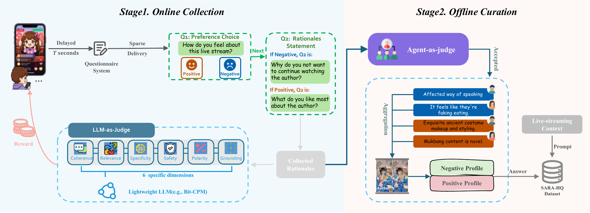
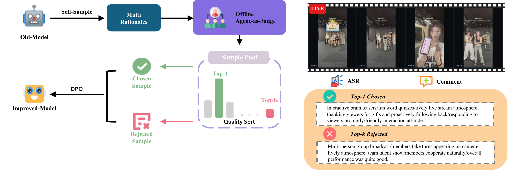
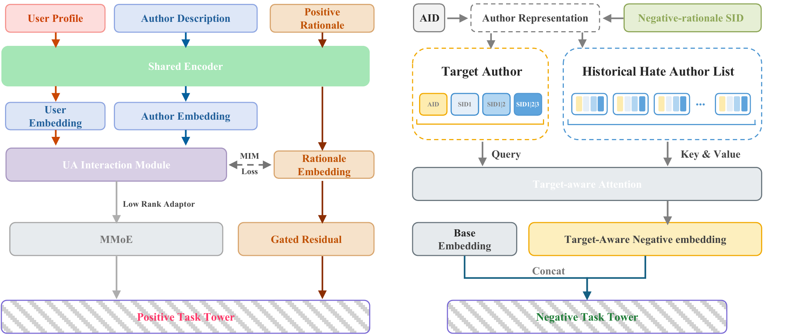

# Kuaishou: turning the "why I like it" users put into words into recommendation features, hate feedback -8.16%

> [中文版](kuaishou-sara.md)

### Paper: Scaling Articulated Rationales for MLLM-based Recommendation (SARA)
### Link: https://arxiv.org/abs/2609.17639
### Company: Kuaishou
### Idea: building features with an MLLM
### Area: llm4rec

## Overview:

Clicks, watch time and dislikes all record **what** users did. The reasons users state themselves (nostalgia for their hometown, a sense of companionship, a great performance, or dislike of over-selling and unsafe behavior) record **why**. The latter is clearly more informative; the problem is you can't get it at volume: native feedback is sparse, its quality is uneven, and it covers too few creators.

SARA's idea is to use a large model to amplify this scarce human explanation to the whole corpus. Three stages: **collect** real reasons, **expand** to tens of millions of creators, **fuse** into the ranking model.

## 1 Collection: boiling survey answers down into supervision signals

The data engine first runs surveys online, asking live-stream users to choose a preference leaning and then explain the reason in open text, with incentives based on answer quality.

Raw answers alone are not usable, so an offline Agent Judge does the screening, on six dimensions: coherence, relevance, specificity, safety, polarity consistency, and groundedness. **The pass rate is only 9.8%**: of 1.91 million candidate reasons, 187.5k remain, 107.5k positive and 80k negative, covering 86.5k creators. This dataset is called SARA-HQ.

The surviving answers are then aggregated by creator and by positive/negative polarity, and normalized into concise semantic tags. Scattered individual complaints thus become creator-centric supervision signals.

## 2 Expansion: train a dedicated MLLM, taking coverage from 86k creators to 10 million

86.5k creators is still a drop in the bucket for industrial recommendation, so the model has to extrapolate.

SARA-7B is based on Qwen2.5-VL-7B. Its inputs are sampled video frames, live-stream metadata, speech transcripts, and viewer comments, plus a task instruction stating whether a positive or negative reason is wanted. It is first SFT-ed on SARA-HQ to learn to generate preference reasons from multimodal context.

Then comes **QR-DPO (Quality-Refined Preference Optimization)**: sample several candidate reasons for the same input, have the offline Agent Judge score and rank them, take the highest- and lowest-scoring ones as a preference pair, then run DPO. This step clearly raises "specificity" and "groundedness": the generated reasons tie together specific activities, viewer interaction and viewing interests, instead of vaguely saying "the streamer is fun".

The aligned model expands reason coverage **from 86.5k creators to 10 million**.

One point that is easy to misread here: **the generated reasons are creator-level**. They describe which likable or dislikable factors this creator has, not the reason "a given user likes a given creator". So they can be computed offline for everyone and stored; the 7B model is not run online, and the personalization layer is left for the ranking model to learn itself.

## 3 Fusion: positive as an alignment signal, negative encoded into SIDs

Once the reason text is generated, how is it fed to the ranking model? The two paths are completely different.

**Positive reasons: not poured in directly as features, but used as an alignment target.** User profile, creator description and positive reason go through the same Shared Encoder, each getting its own embedding. The user and creator embeddings go into the UA Interaction Module to compute an interaction representation, and an **MIM Loss (mutual information maximization)** is attached between this interaction representation and the reason embedding, pulling "why this user and this creator match" toward the semantics the reason describes. After training, the interaction representation encodes the reason for the match. There are two outlets: the interaction representation goes through a Low Rank Adaptor into the MMoE, and the reason embedding goes through a Gated Residual directly into the positive task tower, with the gate letting the model decide how much of this signal to use.

**Negative reasons: encoded into hierarchical SIDs, used to transfer negative feedback.** Each creator's negative reason is encoded into a prefix sequence like `[AID, SID1, SID1|2, SID1|2|3]`, from coarse to fine, so semantically similar "dislike reasons" share prefixes. Then target-aware attention is done: the target creator currently being scored is the Query, and the list of creators this user has disliked in the past is the Key/Value; the output negative embedding is concatenated with the base embedding and fed into the negative task tower.

This path addresses **cold start and the long tail of negative feedback**: if a user hated creator A and an unseen creator B comes along, as long as B's dislike reasons are semantically close to A's and their SID prefixes overlap, attention can transfer that negative feedback over, without waiting for B to accumulate enough negatives. Shared prefixes also mean shared trainable parameters, so long-tail creators can borrow signal too.

## 4 Online results

The two paths are **two independent A/B tests**, each on 1% of real traffic. The baseline is an industrial MMoE ranking system that already integrates SARM multimodal features, not a bare baseline.

Positive reason embedding: watch time **+0.99%**, clicks +0.34%, effective views +0.37%, follows +0.62%.

Negative reason SID: **dislike feedback −8.16%**, reports −0.44%, LT-7 retention +0.03%.

Fully deployed for more than 30 days, supports daily updates, and fits within the existing online serving latency budget.

## Takeaways:
* The real barrier here is not the model but **that data pipeline with a 9.8% pass rate**. Filtering 1.91 million raw answers down to 187.5k takes six-dimension quality checks, online incentives and an offline Agent Judge; none can be skipped. Where most teams get stuck is not having this seed set, not being unable to train an MLLM.
* **Making the reasons creator-level rather than user-item level** is the key engineering decision that lets this launch. Creator-level reasons can be computed offline and updated daily, with zero extra online inference cost; doing it at the pair level would be 10 million creators times the number of users, which cannot be supported however you compute it.
* The gain on the negative path (−8.16%) is far larger than on the positive path (+0.99%), which is worth thinking about. Negative feedback is sparse to begin with, and "reasons for dislike" are highly classifiable: noise, over-selling, unsafe behavior, just a few categories, so after semantic clustering the transfer is very efficient. Positive preferences are much more fragmented and hard to transfer through semantic similarity.

## Caveats

* The fusion section is the most technically substantial part of the whole work, but the README gives only a three-row table; key mechanisms like the MIM Loss, Gated Residual and hierarchical SID have to be inferred from the boxes in the figure. Anyone wanting to reproduce it has to stare at the Figure and guess module by module.
* User profile, creator description and positive reason share one Shared Encoder, so all three should be in text form. But in industrial systems user profiles are usually structured features; whether they were turned into text with templates, and what model the encoder actually is, are not explained.
* The mechanism details in this write-up are mainly based on the official README and figures. The formal arXiv version (2609.17639) was only just released; defer to the paper for details.

## Credibility: production (Kuaishou live streaming, two independent 1%-traffic A/B tests, fully deployed 30+ days)

## Recommendation: practically useful
