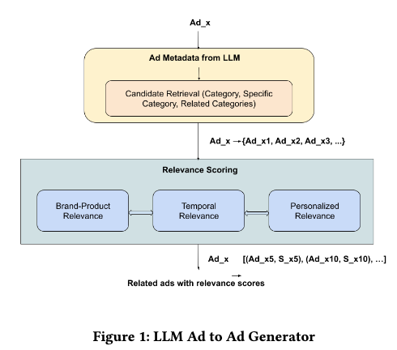

# Meta: LLM semantic retrieval solves the ad problem of "same ad, different fate"

> [中文版](meta-llm-retrieval.md)

### Paper: LLM Retrieval for Stable and Predictable Ad Recommendations
### Link: https://arxiv.org/pdf/2605.21969
### Company: Meta
### Idea: the understanding ability of LLMs
### Area: retrieval + LLM4rec + LLM as annotator

## Overview:
Current ad systems lack stability and predictability: two almost identical versions of the same ad can get hugely different impressions and conversions. To fix this, an LLM-driven semantic retrieval method is designed. Simply put, different versions are grouped into the same semantic equivalence class. This turns out to be necessary and efficient, and already achieves markedly closer impression and engagement behavior.
Here the LLM is an offline "annotation tool": extract semantic attributes from ads → build a graph → retrieve by graph traversal. Online serving does not call the LLM, which is latency friendly.

### (1) Ad semantic representation learning
It uses Meta's internal Llama3-8B Instruct model already fine-tuned for the ads scenario (fine-tuned on ads engagement data). No extra fine-tuning is done for this task; only through carefully designed prompt engineering (zero-shot inference) are raw ad creatives turned into structured, hierarchical semantic attributes.
The LLM outputs hierarchical semantic attributes:
* Level-1 attributes: broad category (footwear, beauty, automotive…)
* Level-2 attributes: brand, product model, style, scenario, audience, color, price band, etc.
* Extra output: a contextual description

### (2) Building the semantic graph
Each ad now has its hierarchical semantic attributes. Based on these, a graph whose nodes are ads is built. If two ads share enough semantic attributes, they are connected by an edge.
The edge weight is the Jaccard similarity between ads: either the Jaccard similarity of semantic attributes (when it is greater than or equal to 0), or else, as a fallback, the raw ad creative text is tokenized and the Jaccard similarity of the tokens is computed.

The semantic graph is not fully connected; only ads whose semantic attributes overlap heavily have edges. The whole graph consists of many small connected components rather than one big network.

### (3) Graph-traversal retrieval
Flow (two stages):
* Stage 1, category-level coarse filtering: first use level-1 attributes (broad category) to quickly filter a candidate ad pool, greatly reducing computation.
* Stage 2, semantic graph traversal: starting from a seed ad (the ad the user is currently seeing, or the query ad), traverse the semantic graph (with algorithms like BFS / weighted random walk / Personalized PageRank), find all semantically connected ad nodes, and return the corresponding ads as the candidate set.

Real application examples:
* u2i: the user searches "running shoes" → the system uses LLM semantic attributes to retrieve running shoe ads from Nike, Adidas, etc.
* i2i: the user is viewing a Nike Air Max ad → the system treats it as the seed ad and retrieves other Nike running shoe variants in the same semantic equivalence class (including versions where the advertiser changed the title/image)

### A newly proposed evaluation framework
To evaluate system predictability, an industrially deployable set of predictability metrics is defined, with two metrics:

* StatSigDiff (statistically significant difference): for each "primary ad + shadow ad" pair, compute whether the conversion difference is significant. Readers can look up the formula themselves. The essence of StatSigDiff's design: use a statistical significance test (Gaussian approximation + 90% CI) to filter noise, penalize only differences that are truly significant and high-value, and weight by business value so the metric aligns with actual business goals.
* MAD (median absolute deviation): measures the volatility of the daily impression difference between primary and shadow versions; lower is more stable. Computation: for each ad pair (a Primary ad + its Shadow version), collect its relative impression difference for each day in the observation period, and take the median of these T daily relative differences, denoted m. Subtract m from each day's relative impression difference; the median of this set is the MAD.

### A/B:
Core business metric +0.45%, StatSigDiff -8.62%, MAD -45%.

## Takeaways:
* The paper describes some supporting engineering work that is worth learning from, and you can imitate it when writing papers. The idea of this paper is simple, with many small innovations along the way to deployment; the Meta folks have strong summarizing skills, so they can turn it into a paper. People without that skill cannot turn their own work into a paper.
* With this method, consistency at the retrieval stage already brings a big improvement, but to make final impression and conversion behavior very close, ranking, traffic allocation, feature engineering and other stages also have to cooperate.

## Caveats
This paper and Alibaba's CQ-SID (generative retrieval) represent two completely different paradigms of LLMs in retrieval:

## Credibility: production

## Recommendation: practically useful

