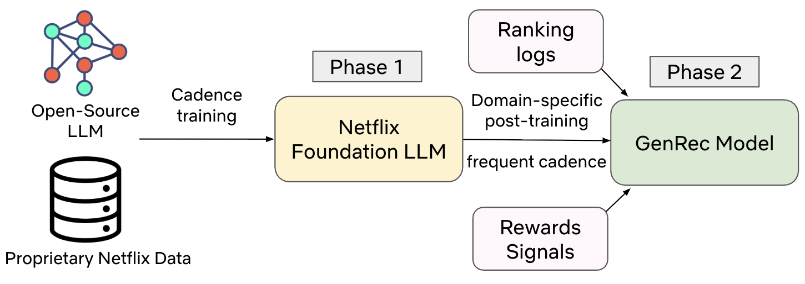
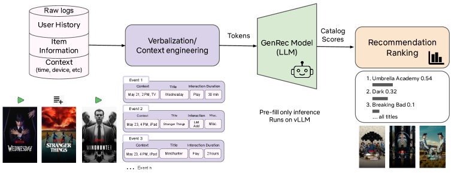

# Netflix: an LLM used directly as the ranking model, beating a mature production model with 40x less labeled data

> [中文版](netflix-genrec.md)

### Paper: GenRec: An LLM-Backed Recommendation Ranker at Netflix
### Link: https://arxiv.org/html/2608.10257
### Company: Netflix
### Idea: the understanding ability of LLMs, unified modeling
### Area: LLM-as-ranker

## Overview:
Netflix's existing ranking model (fine ranking) is built on thousands of hand-crafted features. It works well but is hard to extend: every new content type or new scenario means redoing the feature engineering. This paper replaces the ranking model entirely with an in-house LLM: user history and context are all turned into natural language and fed into a decoder-only model, which runs a single forward pass; the pooled hidden state is scored against the item embeddings of the full catalog, producing a ranking of the whole catalog in one shot. The paradigm shifts from feature engineering to context engineering.

Training has two phases. Phase 1 takes an open-source LLM and does domain adaptation on Netflix data so the model understands the catalog and members; it is updated infrequently. Phase 2 does post-training for the ranking task on top of this base, fed with ranking logs and reward signals; it is updated frequently.

### (1) Verbalize: writing logs in plain language
Instead of thousands of hand-crafted features, user history, profile, context (device, surface, locale, time) and candidate item metadata are all turned into a natural language prompt.

Structured behavior logs and item metadata are turned into natural language descriptions. The raw form is JSON like `{item_id: 987, title: "Stranger Things", play_duration: 48min, action: "complete"}`; after verbalizing it becomes "On Friday night the user watched Stranger Things to the end on TV (48 minutes); before that they watched 12 minutes of The Crown and stopped".

Training data is organized as dialogue: the user message is the context (surface, time, device, locale) + user profile and history + item metadata and popularity + task description; the assistant message is the behavior the user actually took (play, duration, abandon, thumb) as ground truth.

The token budget is limited, so context selection follows four rules: high-signal interactions (long plays, likes) are kept in full with richer metadata; recent low-signal events (very short plays, noisy clicks) are dropped; repeated behavior (binge-watching one show) is compressed into a summary; important items (newly launched, cold start) are selectively expanded with more detail.

### (2) User-item matching scores
Items are scored based on the user behavior representation. That is, given the text x verbalized in the previous step, the LLM encodes x into a d-dimensional hidden state h (taken at some pooling position), then passes it through a scoring head `score_i = φ(h, e_i)`, and finally applies softmax over the whole catalog.

Here $e_i$ is a learnable item embedding table, the same as the ID embedding in traditional models. Why not let the LLM generate the item directly? Three reasons. Efficiency: the LLM runs only once, and subsequent full-catalog scoring is just an embedding lookup plus one matrix multiply, which is the precondition for full-catalog ranking to work. Constraint: a separate table naturally restricts candidates to the real catalog, so hallucination is impossible. Optimization: the ranking loss can take gradients directly with respect to e_i and φ, so the item representation serves the ranking objective specifically.

The softmax is part of the cross-entropy at training time; at inference, just sort by score.

### (3) Training objective
`L = α·L_ranking + β·L_language + γ·L_misc`, with the three coefficients summing to 1. L_ranking is full-catalog cross-entropy; positives are high-value interactions, with different denoising logic per content type.

Keeping the language modeling objective (next-token prediction) serves two purposes: first, the model's input is all natural language, and training only for ranking would degrade it into a scorer that only knows embeddings, wearing away its text understanding; second, it preserves generation and controllability, which is what makes recommendation steering via prompts possible, e.g. "recommend more newly launched games".

In addition, multiple rewards are introduced to address over-recommending popular items and focusing only on short-term engagement: behaviors related to return rate and breadth of catalog exploration get higher reward, while exposure is balanced across movies/games/live/podcasts. Note that the weighted ranking loss is not an extra loss term; the ranking loss itself becomes a weighted version, with each sample multiplied by a scalar weight w computed from its reward. The authors tried GRPO and it worked better, but the training cost was too high, so it was set aside for now.

The misc loss is not explained by the authors; it is probably some regularization or confidential business-related loss.

### Online serving: prefill-only
Only prefill is done, no decode. Modern decoder-only inference has two steps: prefill encodes the whole prompt in parallel to produce hidden states and the KV cache; decode generates autoregressively token by token. GenRec runs only the first step: after getting h, it computes `h·E^T` to get full-catalog scores, without generating a single token. Token-by-token generation would be unaffordable at Netflix's QPS. In essence, the decoder is used as an encoder.

The serving stack is based on vLLM; the key levers are KV caching, prefix caching and prefill-only. The authors state clearly that inference cost is roughly proportional to model size times context length, so the only two ways to cut cost are distillation and shortening the context.

### A/B:
On 10% of online traffic for 4 weeks, the core metric improved by 0.006% relative (statistically significant at Netflix's scale), with both short-term and long-term metrics positive.

## Takeaways:
* LLM-as-ranker has moved from "it runs" to "it beats a strong baseline tuned for many years". This design of a generative shell with a discriminative core is easier to launch than the pure generative SID route.
* The prefill-only plus full-catalog inner product combination can be moved to any scenario whose candidate set is not too large; in scenarios with many more items, such as e-commerce and short video, use it as the ranker after retrieval.

## Credibility: production

## Recommendation: practically useful

