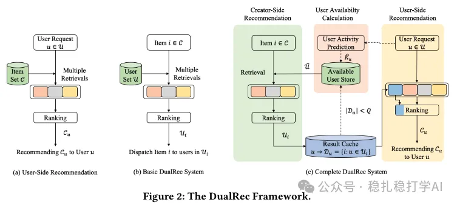

# Recommendation papers (2025.3.3): Kuaishou creator-side recommendation: finding the user group for an item
> [中文版](2025-03-03-kuaishou-creator-side-rec.md)

> Source: WeChat post https://mp.weixin.qq.com/s?__biz=MzkzNDYyNjM1NA==&mid=2247484276&idx=1&sn=134d4e8c042b893caaad63a3666429c2&scene=21#wechat_redirect, published 2025-03-03.
> Split from the roundup "Recommendation papers (2025.3.3): quick look! Two new industrial-style papers from Kuaishou"; same issue: [Kuaishou diffusion two-tower retrieval](../deep-retrieval/2025-03-03-kuaishou-diffusion-two-tower.full.en.md), [Kuaishou creator-side recommendation](../long-tail/2025-03-03-kuaishou-creator-side-rec.full.en.md).

Creator-Side Recommender System: Challenges, Designs, and Applications

Link: https://arxiv.org/pdf/2502.20497

Company: Kuaishou

Area: cold start + creator-side user growth

Overview: It reverses the usual user-side recommendation logic: for a given item, select a group of users. The method is basically the same, just applied in reverse.

Takeaways: It's good to learn how creator-side user growth is done.

This paper is not hard to understand. If you don't understand how diffusion works, just treat it as an Autoencoder black box: whatever goes in, the same thing comes out, only augmented.

Credibility: production

Recommendation: read if you have time

Figure 2: The DualRec Framework.
