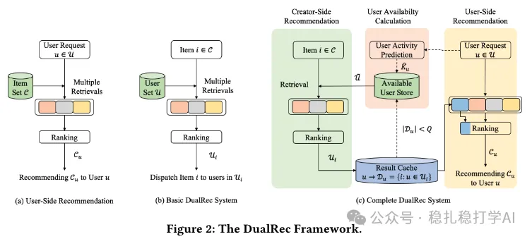

# 推荐算法(2025.3.3)：快手创作者侧推荐：为item圈user群

> 原文：https://mp.weixin.qq.com/s?__biz=MzkzNDYyNjM1NA==&mid=2247484276&idx=1&sn=134d4e8c042b893caaad63a3666429c2&scene=21#wechat_redirect
> 作者：算法工程师刘明星（稳扎稳打学AI）| 发表于 2025-03-03
> 本文拆自《推荐算法(2025.3.3)：速看！快手两篇工业风的最新研究成果》，同期 2 篇：[快手扩散双塔召回](../deep-retrieval/2025-03-03-kuaishou-diffusion-two-tower.md)、[快手创作者侧推荐](../long-tail/2025-03-03-kuaishou-creator-side-rec.md)。

关注我，每天为你精挑细选最优质、最新鲜的推荐算法paper，陪你一起保持进步、不断精进！

> [English version](2025-03-03-kuaishou-creator-side-rec.full.en.md)

Creator-Side Recommender System: Challenges, Designs, and Applications

网址：https://arxiv.org/pdf/2502.20497

公司：快手

方向：冷启动+创作者侧的用户增长

解读：将常见的用户侧推荐逻辑反过来，为某一个item圈user 群。方法基本一样，也是发过来用。

心得：了解一下创作者侧的用户增长，是怎么做的，也挺好的。

这个paper不难理解，如果客官不理解diffusion的原理，就当它为一个Autoencoder黑盒，输入什么，输出同样的东西，只是做了增强。

可信度：生产

推荐等级：有时间看看

Figure 2: The DualRec Framework.
