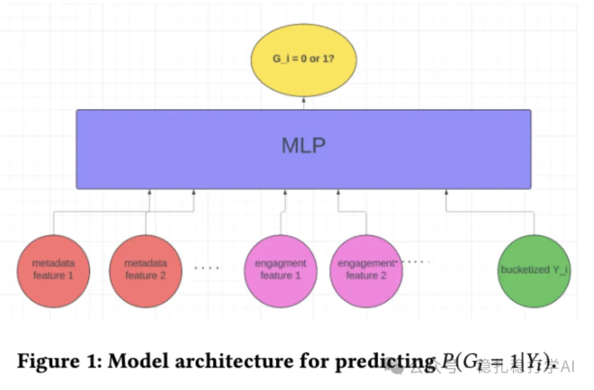

# Recommender algorithms (2025.5.15): Google's traffic allocation mechanism for new items

> [中文版](2025-05-15-google-discoverability.md)

1 Discoverability in Search and Recommendations: A Novel Approach to Item Exploration in Cold Start Systems

Link: https://arxiv.org/pdf/2505.09028

Company: Google

Area: cold start

Overview: This paper is mainly about Google's traffic allocation mechanism for new items. Using exploration traffic, the system can better learn the potential of a new item and allocate traffic according to its discoverability, improving exposure and recommendation performance for new items.

What is the basis for allocating traffic to new items? Traffic is allocated by discoverability. Based on a new item's discoverability, the system puts it into one of three groups: high, medium, and low discoverability, and gives each a different amount of traffic.

(1) High discoverability: these items are usually high quality or broadly appealing, and the recommender easily recognizes them as "discoverable". Difficulty: easy to discover. Even a small amount of exploration traffic quickly yields enough feedback data.

(2) Medium discoverability: these items are of medium quality or average appeal, and need a moderate amount of exploration traffic before the recommender recognizes them as "discoverable". Difficulty: medium. Some exploration traffic is needed to collect enough feedback data.

(3) Low discoverability: these items are usually low quality or less appealing, and it is hard for the recommender to judge them "discoverable". Even with a lot of traffic, they may not get enough user interaction. Difficulty: very hard to discover. Even with the maximum traffic, the chance of success is low.

Why not just ignore low-discoverability items? Although the probability is low, some low-discoverability items may do well with specific user groups. Ignoring them entirely could miss potentially high-value items. So the system gives low-discoverability items a small amount of exploration traffic so as not to miss potential opportunities.

Question: is an item's discoverability the same as its quality level? Answer: no. An item's discoverability refers to whether, after exploration traffic, the item can be effectively recommended by the system (reaching the recommendation engine's minimum number of recommendations); it is not the same as the item's quality. Quality is one factor affecting discoverability, but discoverability is also affected by user interest, feedback data, and system context.

Credibility: production

Recommendation: worth a look if you have time

