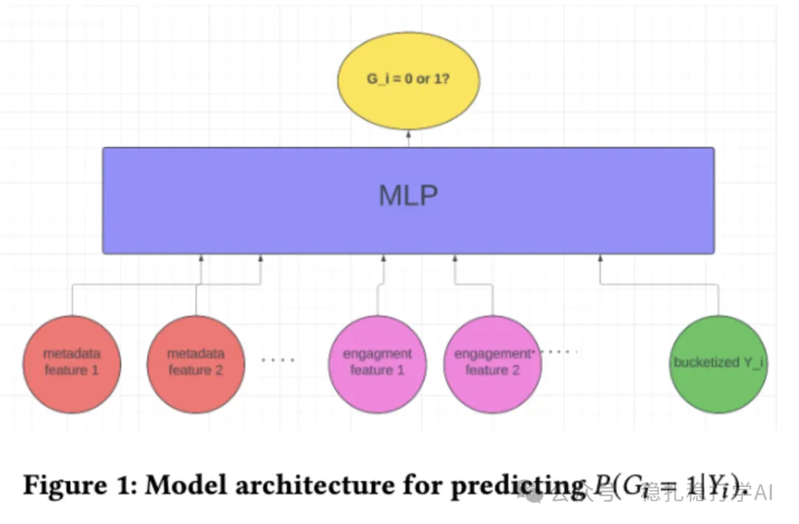

# 推荐算法(2025.5.15)：Google的新物料流量分配机制

> 原文：https://mp.weixin.qq.com/s?__biz=MzkzNDYyNjM1NA==&mid=2247484660&idx=1&sn=af9370e1a5b04b9996b5ad0d4a7ecd56&scene=21#wechat_redirect
> 作者：算法工程师刘明星（稳扎稳打学AI）| 发表于 2025-05-15

嘿，记得给“稳扎稳打学AI”添加星标

关注我，每天为你精选最优质、最新鲜的推荐算法paper，陪你一起保持进步、不断精进！

> [English version](2025-05-15-google-discoverability.full.en.md)

📄 [本公众号paper推荐原则](https://mp.weixin.qq.com/s?__biz=MzkzNDYyNjM1NA==&mid=2247484097&idx=1&sn=18322c279290b555eb030e12953b7c7f&scene=21#wechat_redirect)

1 Discoverability in Search and Recommendations: A Novel Approach to Item Exploration in Cold Start Systems

网址：https://arxiv.org/pdf/2505.09028

公司：Google

方向：冷启动

解读：本文主要讲的是 Google 的新物料流量分配机制。通过探索流量（exploration traffic），系统可以更好地了解新物料的潜力，并根据其可发现性（discoverability）来分配流量，从而提高新物料的曝光和推荐效果。

新物料的分配依据是什么？根据其可发现性（discoverability）来分配流量。系统会根据新物料的可发现性，将其分为高可发现性、中等可发现性和低可发现性三类，并分别分配不同的流量。

（1）高可发现性 这些项目通常高质量或具有广泛吸引力，容易被推荐系统识别为“可发现”。难易程度：容易发现。即使少量探索流量，也能快速获得足够的反馈数据。

（2）中等可发现性 这些项目质量中等或吸引力一般，需要中等探索流量才能被推荐系统识别为“可发现”。难易程度：中等难度。需要一定的探索流量才能获得足够的反馈数据。

（3）低可发现性 这些项目通常是低质量或吸引力较差，很难被推荐系统认定为“可发现”。即使投入大量流量，也可能无法获得足够的用户互动。难易程度：很难被发现。即使分配最大流量，成功的可能性也很低。

为什么不直接忽略低可发现性项目？尽管概率低，某些低可发现性项目可能在特定用户群体中表现良好。如果完全忽略，可能会错失潜在的高价值项目。因此，系统会为低可发现性项目分配少量探索流量，以确保不会错过潜在的机会。

问题：item的可发现性，是不是就是item的质量水平呢？回答：不是。item的可发现性（discoverability）指的是项目在推荐系统中通过探索流量后能否被有效推荐（满足推荐引擎的最小推荐次数），而非直接等同于item的质量水平。质量是影响可发现性的因素之一，但可发现性还受用户兴趣、反馈数据和系统上下文等影响。

可信度：生产

推荐等级：有时间看看

请帮忙点赞、转发，谢谢。您认为哪篇论文最有潜力应用到实际业务中？

## 欢迎干货投稿 \ 论文宣传 \ 合作交流

推荐您继续阅读：

■ [推荐算法(2025.5.14)：网易的分组泛化创新](https://mp.weixin.qq.com/s?__biz=MzkzNDYyNjM1NA==&mid=2247484654&idx=1&sn=d9f296188e2dba7d153c7ac6f41223db&scene=21#wechat_redirect)

■ [推荐算法(2025.5.13)：淘宝、沃尔玛的AB效果不错](https://mp.weixin.qq.com/s?__biz=MzkzNDYyNjM1NA==&mid=2247484648&idx=1&sn=ba92085c8ad14ae822333e6dd23a00b3&scene=21#wechat_redirect)

■ [推荐算法(2025.5.12)：Pinterest的小发现](https://mp.weixin.qq.com/s?__biz=MzkzNDYyNjM1NA==&mid=2247484641&idx=1&sn=f9eb875e09957224758daf49b3536b24&scene=21#wechat_redirect)

历史文章索引：https://docs.qq.com/sheet/DYXZTZ0tseHRyZGtt?tab=BB08J2

由于公众号试行乱序推送，您可能不再准时收到稳扎稳打学AI的推送。为了第一时间收到本号的干货内容，请将本号设为星标，以及常点文末右下角的“在看”。

喜欢的话点个在看吧👇

个人观点，仅供参考
