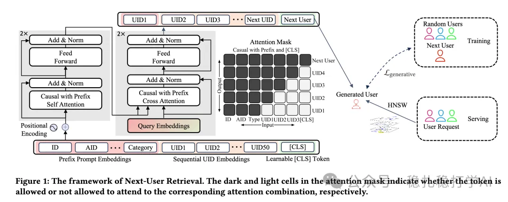

# Recommender algorithms (2025.6.19): ByteDance's cold-start method for new items

> [中文版](2025-06-19-bytedance-next-user-retrieval.md)

1 Next-User Retrieval: Enhancing Cold-Start Recommendations via Generative Next-User Modeling

Link: https://arxiv.org/pdf/2506.15267

Company: ByteDance

Area: item cold start

Overview:

Using generative next-user modeling, the method finds, for a cold-start new item (e.g. a new short video on Douyin), the users most likely to interact with it, and recommends the item to those users, improving cold-start recommendation.

(1) Input

Similar-user sequence: users who had the same positive interaction (e.g. like, comment) with the item are defined as a similar-user sequence. A real-time, impression-level feature system is built to strengthen the weak ID representations of cold-start items. Only the IDs of users with positive interactions are stored, and sequence length is capped at 50 to meet real-time and storage constraints.

Additional item features are concatenated in front of the recent interacting-user sequence, used to generate the next interacting user. Finally, a learnable [CLS] token is appended.

(2) Network: generative modeling. A Transformer-based model captures the unidirectional relations in the user sequence and generates the next potential user. Three dedicated losses (contrastive loss, cross-entropy loss, auxiliary loss) are introduced to optimize the model.

Contrastive loss: increases the separation between positive users and randomly sampled users, making the generated user embedding more similar to the embeddings of users who actually interacted and less similar to random users.

Cross-entropy loss: uses samples that were exposed but had no interaction for binary classification, making better use of high-quality negatives.

Auxiliary loss: serves as the loss of mainstream generative models, strengthening user-ID representation learning and improving sequence generation.

Takeaways: the paper uses a Transformer to predict other users with similar interests from the users who interacted positively with the same video. Quite interesting.

Credibility: production

Recommendation: recommended reading

