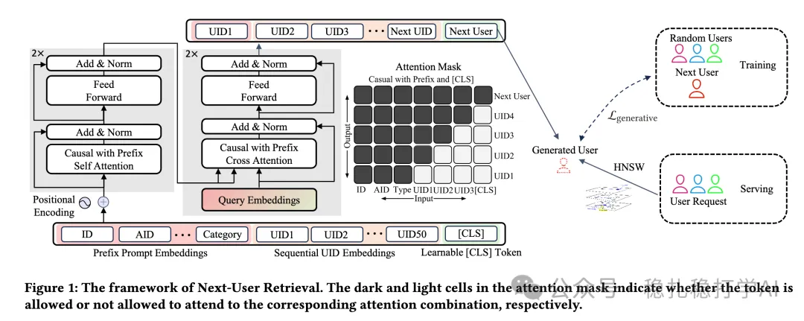

# 推荐算法(2025.6.19)：字节的新物料冷启动方法

> 原文：https://mp.weixin.qq.com/s?__biz=MzkzNDYyNjM1NA==&mid=2247484819&idx=1&sn=f338e3498d541197be0d4c9c21f9c3b3&scene=21#wechat_redirect
> 作者：算法工程师刘明星（稳扎稳打学AI）| 发表于 2025-06-19

嘿，记得给“稳扎稳打学AI”添加星标

关注我，每天为你精挑细选最优质、最新鲜的推荐算法paper，陪你一起保持进步、不断精进！

> [English version](2025-06-19-bytedance-next-user-retrieval.full.en.md)

👆 [本公众号paper推荐原则](https://mp.weixin.qq.com/s?__biz=MzkzNDYyNjM1NA==&mid=2247484097&idx=1&sn=18322c279290b555eb030e12953b7c7f&scene=21#wechat_redirect)

1 Next-User Retrieval: Enhancing Cold-Start Recommendations via Generative Next-User Modeling

网址：https://arxiv.org/pdf/2506.15267

公司：字节

方向：物料冷启动

解读：

通过生成式下一用户建模，为冷启动的新物料（新物品，如抖音上的短视频）找到最可能与之交互的合适用户，并将这些物料推荐给这些用户，从而提升冷启动推荐的效果。

（1）输入

定义相似用户序列：将具有相同正向交互（如点赞、评论）的用户定义为相似用户序列，开发实时曝光粒度特征系统，增强冷启动物品的弱ID表示。仅存储正向交互的用户ID，限制序列长度为50，以满足实时性和存储约束。

额外的物品特征，拼接到近期交互用户序列之前，用于生成下一个交互用户。最后，拼接可学习[CLS] token。

（2）网络 — 生成式建模：使用基于Transformer的模型捕捉用户序列的单向关系，生成下一潜在用户。引入三种专用损失函数（对比损失、交叉熵损失、辅助损失）优化模型。

对比损失：增加正向用户与随机sampling用户区分度，增强生成用户嵌入与真实交互用户嵌入的相似性，降低与随机用户的相似性。

交叉熵损失：利用暴露但无交互的样本，做二分类，提高模型对高质量负样本的利用。

辅助损失：作为主流生成模型的Loss，增强用户ID表示学习，改善序列生成能力。

心得： 本文用Transformer，通过对同一视频产生正向交互的用户，预测具有相似兴趣的其他用户，很有趣。

可信度：生产

推荐等级：推荐看看

请帮忙点赞、转发，谢谢。您认为哪篇论文最有潜力应用到实际业务中？

## 欢迎干货投稿 \ 论文宣传 \ 合作交流

推荐您继续阅读：

■ [推荐算法周报(2025.6.15)：Meta独领风骚](https://mp.weixin.qq.com/s?__biz=MzkzNDYyNjM1NA==&mid=2247484811&idx=1&sn=9e7675659d15611cf53e97882b8ebce1&scene=21#wechat_redirect)

■ [推荐算法(2025.6.13)：阿里的MTL新方法非常有效](https://mp.weixin.qq.com/s?__biz=MzkzNDYyNjM1NA==&mid=2247484802&idx=1&sn=64699ffa093146caf0fa17ed1321c4f9&scene=21#wechat_redirect)

■ [推荐算法(2025.6.12)：Meta的生成式推荐方法](https://mp.weixin.qq.com/s?__biz=MzkzNDYyNjM1NA==&mid=2247484793&idx=1&sn=68ca1d3f310adf309060ac20f949daa4&scene=21#wechat_redirect)

历史文章索引：https://docs.qq.com/sheet/DYXZTZ0tseHRyZGtt?tab=BB08J2

由于公众号试行乱序推送，您可能不再准时收到稳扎稳打学AI的推送。为了第一时间收到本号的干货内容， 请将本号设为星标，以及常点文末右下角的“在看”。

喜欢的话点个在看吧👇

个人观点，仅供参考
