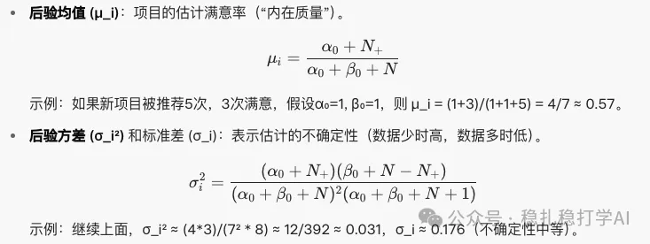

# Recommender algorithms (2025.7.28): Google's small method with big value, A/B results inside

> [中文版](2025-07-28-google-item-centric-cold-start.md)

1 Item-centric Exploration for Cold Start Problem

Link: https://arxiv.org/pdf/2507.09423

Company: Google

Area: item cold start

Overview:

Add a filtering step for new items in the ranking results.

Background: in a recommender, when a user sends a request, the system selects candidate items from the item pool (based on user interest), then ranks and displays them. But new (cold-start) items have almost no data, so they are easily ignored or recommended to the wrong users, leading to low click-through rate and popularity bias (popular items get pushed more and more).

Idea of the new method: introduce an "item-centric" filtering layer. After ranking, the system checks each new candidate item: is this user a good fit for this new item? If not, filter it out and don't show it. This way, a new item is only recommended to its potential "best users", speeding up its data accumulation.

Concretely, a system based on a Bayesian model dynamically estimates a new item's "intrinsic quality" (user satisfaction) and decides whether to recommend it to a given user. Key points:

(1) Bayesian model

Why a Bayesian model?

New items have little data, so a plain average is unreliable. The Bayesian approach combines "prior knowledge" (an initial assumption) with a small amount of data to dynamically update the item's "satisfaction estimate". It works like a "learning machine": the more data, the more accurate the estimate.

(2) Beta distribution

The Beta distribution suits binary outcomes (a user is "satisfied" or "not satisfied", e.g. click / no click). It describes the distribution with two parameters (α and β): α is the "weight" of satisfied counts, β the "weight" of unsatisfied counts.

Why does it work?

The Beta distribution is cheap to compute: you only store α and β, not the whole history. It updates in real time, which suits online systems. From α and β, the posterior mean and variance are easy to compute.

Exploration-exploitation trade-off

(3) Filtering

A filter condition decides whether to "explore" this item with this user.

The filter rule uses the item's posterior mean minus 2 standard deviations (both computed above) as the threshold. If the predicted satisfaction (the ranking model's predicted CTR or similar score) is below this threshold, the item is filtered out and not recommended to that user.

A/B:

(1) Total impressions of explored items dropped by 20%.

(2) The size of the recommendable item pool grew significantly, by 10%.

(3) Two satisfaction metrics improved dramatically, see the figure below.

<!-- Second image (satisfaction metrics chart): the page element did not return an image link, so it could not be archived -->

Takeaways:

(1) The ranking model's predictions for new items are inaccurate because their interaction features are inaccurate. The model is still used despite this because the method's goal is to find, for each new item, the users with high predicted satisfaction, not to find matching items for a user. Even if the prediction isn't perfect, it can do a first screening of potential users, and combined with the filter rule it optimizes exploration and gradually becomes more accurate.

In other words, the method mitigates the ranking model's inaccurate predictions.

(2) The two A/B metrics show this paper is a major breakthrough. For example, with less exploration volume, wasted traffic can be cut substantially: you can either insert more ads to raise ad revenue, or recommend better content to raise satisfaction.

Credibility: production

Recommendation: practically useful
