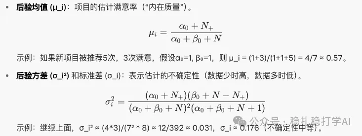

# 推荐算法(2025.7.28)：Google的小方法大价值，AB效果在文中

> 原文：https://mp.weixin.qq.com/s?__biz=MzkzNDYyNjM1NA==&mid=2247484930&idx=1&sn=7ce9120b699e50717652f615a921ece2&scene=21#wechat_redirect
> 作者：算法工程师刘明星（稳扎稳打学AI）| 发表于 2025-07-28（标题已修改；修改于 2025-07-28）

嘿，记得给“稳扎稳打学AI”添加星标

关注我，每天为你精挑细选最优质、最新鲜的推荐算法paper，陪你一起保持进步、不断精进！

👆 [本公众号paper推荐原则](https://mp.weixin.qq.com/s?__biz=MzkzNDYyNjM1NA==&mid=2247484097&idx=1&sn=18322c279290b555eb030e12953b7c7f&scene=21#wechat_redirect)

1 Item-centric Exploration for Cold Start Problem

网址：https://arxiv.org/pdf/2507.09423

公司：Google

方向：物料冷启动

解读：

对排序结果的新item添加一个过滤操作。

背景：在推荐系统中，用户请求推荐时，系统从Item池中选出候选Item（基于用户兴趣），然后排序显示。但新Item（cold-start）几乎没数据，容易被忽略或推荐给错的用户，导致低点击率和流行度偏差（热门项目越推越热）。

新方法思路：引入“以Item为中心”的过滤层。在排序后，系统检查每个新候选item：这个用户是否适合这个新Item？如果不适合，就过滤掉，不显示。这样，新Item只被推荐给潜在“最佳用户”，加速其数据积累。

具体的，通过一个基于贝叶斯模型的系统，动态评估新Item的“内在质量”（用户满意度），并决定是否推荐给特定用户。重点包括：

（1）贝叶斯模型

为什么用贝叶斯模型？

新项目数据少，传统平均值不靠谱。贝叶斯方法用“先验知识”（初始假设）结合少量数据，动态更新项目的“满意度估计”。它像一个“学习机器”，数据越多，估计越准。

（2）与Beta分布

Beta分布适合二元结果（如用户“满意”或“不满意”，例如点击/不点击）。它用两个参数（α 和 β）表示分布：α：满意次数的“权重”。β：不满意次数的“权重”。

为什么有效？

Beta分布计算简单，只存α和β，不需存所有历史数据。实时更新，适合在线系统。从α 和 β，可以很容易计算出来后验的均值和方差。

探索-利用权衡（Exploration-Exploitation Trade-off）

（3）过滤

用过滤条件决定是否“探索”这个Item给这个用户。

过滤规则是用Item的后验均值减去2个标准差（这两个上面已经计算），作为阈值。如果预测满意度（排序模型的ctr等预测分数）低于这个阈值，项目就被过滤，不推荐给该用户。

贴AB：

（1）探索物品的总展示量减少了 20%。

（2）可推荐物品库的规模显著增加了 10%。

（3）两个满意指标炸裂，如下图。

<!-- 第二张图（满意指标图）：页面元素未返回图片链接，未能存档 -->

心得：

（1）排序模型的预测因为新item的互动特征不准，所以预测不准。预测不准但仍用模型，是因为方法的目标是为每个新 item 找到预测满意度高的user，而不是为 user 找匹配 item。即便预测不完美，它能初步筛选潜在用户，结合过滤规则优化探索，逐步提高准确性。

换句话说，本文方法缓解了ranking模型预测不准的问题。

（2）AB的两个指标表明本paper的重大突破。比如探索量减少，那么就可以大幅度减少流量的浪费，既可以通过插入更多广告提高广告收入，也可以推荐更优质的内容而增加满意度。

可信度：生产

推荐等级：有实践价值

请帮忙点赞、转发，谢谢。您认为哪篇论文最有潜力应用到实际业务中？

## 欢迎干货投稿 \ 论文宣传 \ 合作交流

推荐您继续阅读：

■ [推荐算法(2025.7.24)：沃尔玛，抠啊抠，抠出GMV大涨10个点](https://mp.weixin.qq.com/s?__biz=MzkzNDYyNjM1NA==&mid=2247484923&idx=1&sn=09efe810597012d381d8efa1bfa56ded&scene=21#wechat_redirect)

■ [推荐算法(2025.7.23)：Meta的解藕实践取得很大成绩](https://mp.weixin.qq.com/s?__biz=MzkzNDYyNjM1NA==&mid=2247484917&idx=1&sn=7825158d39731034eb3945c1888a9fe4&scene=21#wechat_redirect)

■ [推荐算法(2025.7.22)：字节的推荐算法“大模型”有效果](https://mp.weixin.qq.com/s?__biz=MzkzNDYyNjM1NA==&mid=2247484910&idx=1&sn=0c9cbccf760fa125033ea9b918dbda79&scene=21#wechat_redirect)

历史文章索引：https://docs.qq.com/sheet/DYXZTZ0tseHRyZGtt?tab=BB08J2

请入群，群内可讨论技术方案、发招聘广告、内推和交友。

• 铁粉标准：累计10次评论或爱心、投稿1次。

• 入群方法：请您加个人微信lmxhappy，我拉您入群，请备注（只我个人看，不公开）。

由于公众号试行乱序推送，您可能不再准时收到稳扎稳打学AI的推送。为了第一时间收到本号的干货内容， 请将本号设为星标，以及常点文末右下角的“在看”。

喜欢的话点个在看吧👇

个人观点，仅供参考

修改于 2025-07-28
