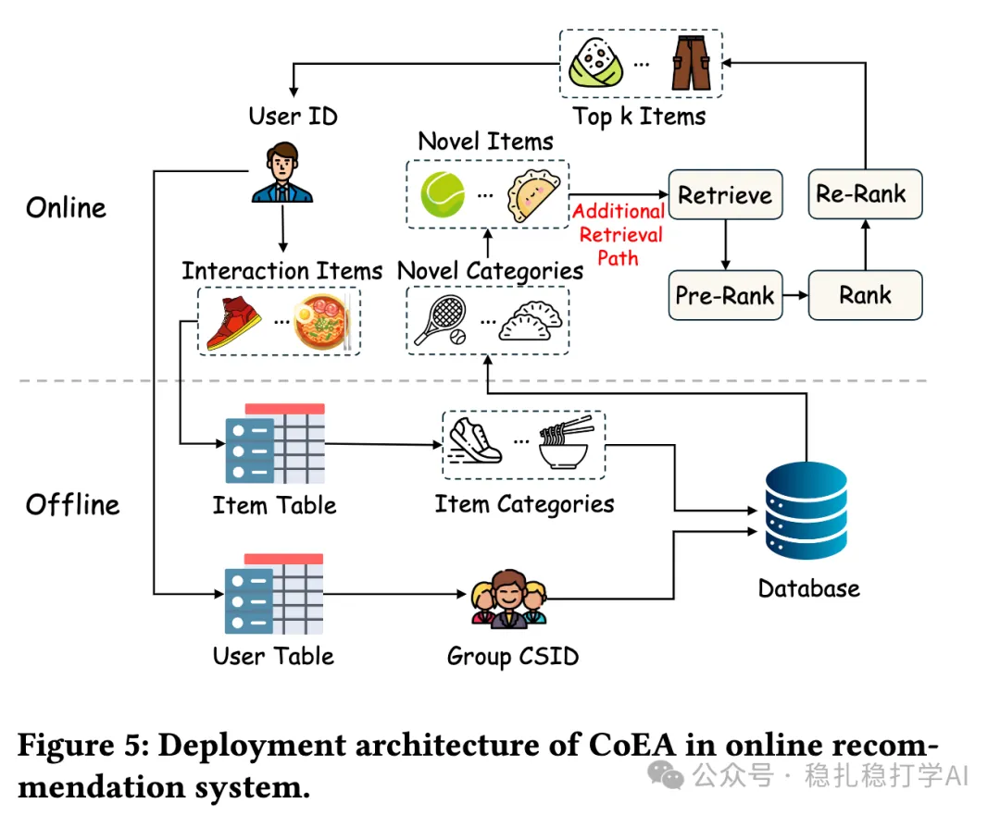
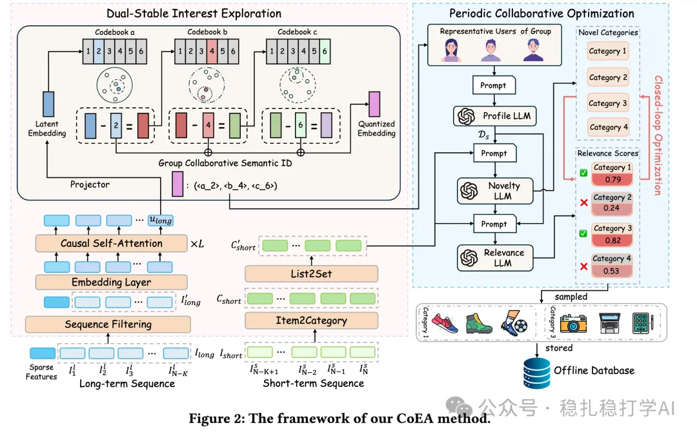

# Recommender algorithms (2025.8.4): Meituan uses LLMs for novelty recommendation, with good A/B results

> [中文版](2025-08-04-meituan-coea-novelty.md)

1 CoEA: Context-Aware Exploration of Category-Level Novelty in Recommender Systems

Link: https://arxiv.org/pdf/2507.21608

Company: Meituan

Area: novelty exploration

Overview:

(1) Long-term and short-term behavior sequences are handled differently: the long sequence is grouped. Two-level clustering is done first: categories are clustered, and users are segmented into groups, each group representing a theme or a population. From the long-term behavior sequence, category-level information is obtained.

(2) Selecting representative users:

For the current user, all users under the corresponding group ID can be found, and a representative user is picked from them.

How it is chosen: take the tag set of each group ID; each user has a tag set too; by comparing it with the group ID's tag set, find the best-matching user under that group ID.

(3) An LLM that generates the novelty prompt

An LLM is used. Its input includes the user's long-term and short-term behavior sequences, the representative user's behavior sequence, and candidate category information. Example: from the long-term and short-term behavior sequences, a user prompt is generated and fed into an LLM that has not been pre-trained, which makes the novelty judgment. For example: "Outdoor sports enthusiasts: Prefer outdoor activities, hiking, skiing, and camping; recently interested in high-quality outdoor gear, such as lightweight backpacks and professional hiking shoes."

(4) Post-processing

The novel categories returned by the LLM are filtered and deduplicated, removing categories that are too niche or don't fit the category attributes, giving the final categories, which serve as one retrieval channel.

Based on the top novel categories identified above, some items are selected from the candidate items and stored for later retrieval.

A/B:

Deployed in the homepage recommender of the Meituan app. In a 20-day test, Gross Transaction Value (GTV): +1.203%; 7-Day Novel Item Exposure Proportion (7D-NIEP): +2.364%.

Takeaways:

(1) To use an LLM for recommendation, remember you need a prompt first. The long- and short-term behavior sequence modeling in this paper exists to generate the prompt.

(2) This paper belongs to the "understanding school": give the LLM some information and let its understanding and reasoning produce its judgment of novelty. In effect, it treats the LLM like a person. Anyone who has used LLMs for a while knows their understanding and reasoning are already very strong.

(3) Clustering users into groups and finding representative users is a good idea. A possibly better approach is to count the tags of all users and take the top-k tags as the group's tags. The paper takes the few users closest to the cluster centroid, and it's hard to say how well they represent the group; their representativeness is not necessarily high.

(4) For a single retrieval channel to get such a large A/B gain is already very good.

Credibility: production

Recommendation: practically useful

