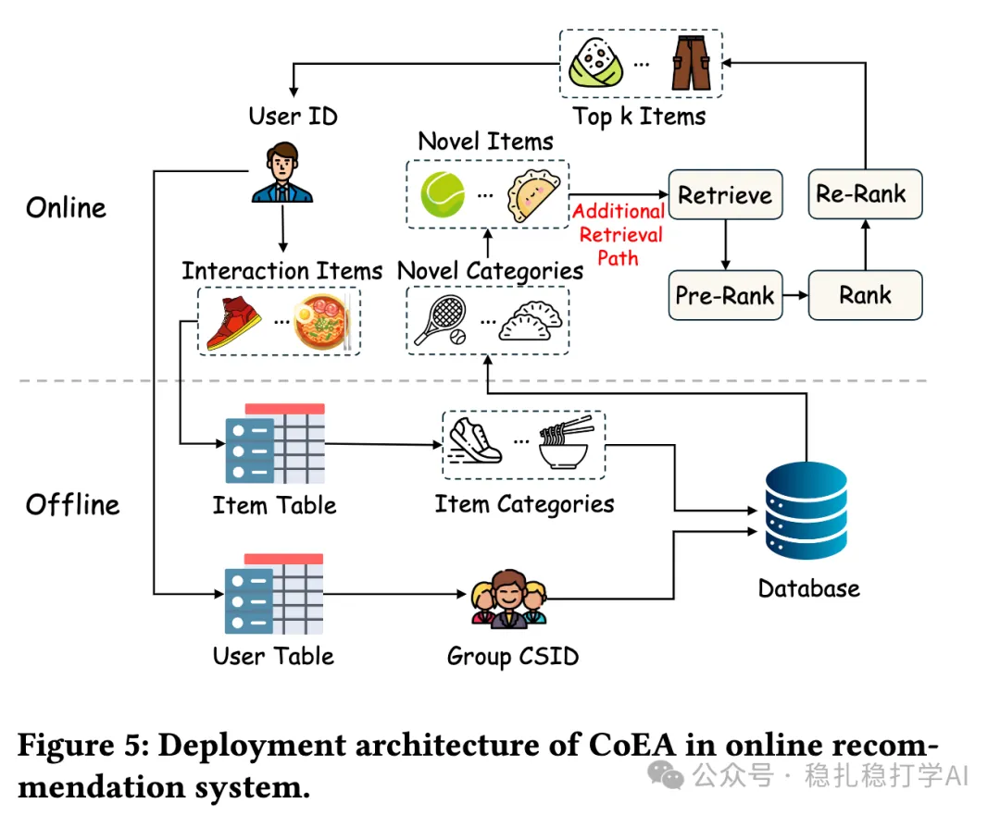
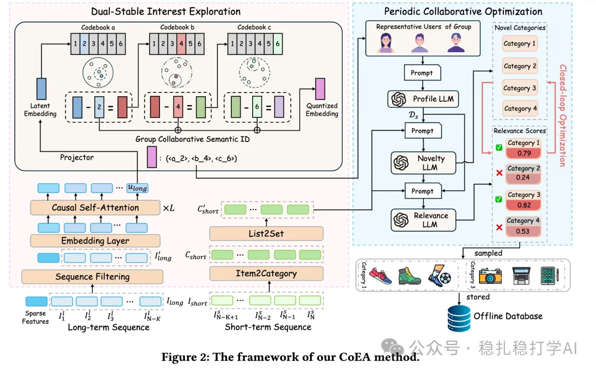

# 推荐算法(2025.8.4)：美团的大模型助力新颖性推荐，AB效果不错

> 原文：https://mp.weixin.qq.com/s/BvdEgX02zTyB1RqnuWi3Xw
> 作者：算法工程师刘明星（稳扎稳打学AI）| 发表于 2025-08-04（标题已修改；修改于 2025-08-07）

嘿，记得给“稳扎稳打学AI”添加星标

关注我，每天为你精挑细选最优质、最新鲜的推荐算法paper，陪你一起保持进步、不断精进！

> [English version](2025-08-04-meituan-coea-novelty.full.en.md)

👆 [本公众号paper推荐原则](https://mp.weixin.qq.com/s?__biz=MzkzNDYyNjM1NA==&mid=2247484097&idx=1&sn=18322c279290b555eb030e12953b7c7f&scene=21#wechat_redirect)

1 CoEA: Context-Aware Exploration of Category-Level Novelty in Recommender Systems

网址：https://arxiv.org/pdf/2507.21608

公司：美团

方向：新颖性探索

解读：

（1）长期行为序列和短期行为序列，处理方式是不同的：对长序列做分组。先做两级聚类：先对品类做聚类，先对用户做分群，每群代表一个主题或人群。长期行为序列，获得一个品类的类目信息。

（2）圈定代表用户：

对于当前用户，就能找到对应groupID所有的用户，从所有用户中找出代表性用户。

确定的方法是：取出每个groupID的标签集合，每个用户会有一个标签集合，通过与groupID的标签集合比较，找到这个groupID下最匹配的那个用户。

（3）生成新颖性prompt的LLM

使用的是LLM，输入包括用户长期、短期行为序列，代表性用户行为序列，以及候选类别信息。示例内容：长期行为序列和短期行为序列，生成一个用户的prompt，然后输入到一个未经过预训练的LLM大模型，用于做新颖性判断。例如 "Outdoor sports enthusiasts: Prefer outdoor activities, hiking, skiing, and camping; recently interested in high-quality outdoor gear, such as lightweight backpacks and professional hiking shoes."

（4）后续处理

对LLM反馈的新颖性类别进行过滤、去重，去掉过于小众、不符品类属性的类别，获得最终类别，作为一路召回。

根据上面画出来的top新颖性类别，从候选item里筛出部分item，存储起来，用作后续的召回。

AB：

部署在美团App的主页推荐系统中，为期20天的测试中，Gross Transaction Value (GTV)：提升 +1.203%；7-Day Novel Item Exposure Proportion (7D-NIEP)：提升 +2.364%。

心得：

（1）大模型助力推荐，记得需要先有prompt。本文的长期、短期行为序列建模就是为了生成prompt。

（2）本文是“理解派”作品，告知大模型一些信息，让大模型的理解能力、推理能力，给出它的新颖性认知判断。实际上，拿大模型当人看了。用大模型久的人都知道，大模型的理解能力和推理能力是很强的了。

（3）聚类分群获得群组user，并获得代表性，是一个不错的idea。或许更好的做法是，统计所有用户的标签，取出top-k的标签作为群组的标签。因为本文取出来离cluster centroid最近的几个用户，他们能代表这个group的能力有多大，很难说，即代表性不一定很大。

（4）作为一路召回能够取得这么大的AB效果，已经很不错了哈。

可信度：生产

推荐等级：有实践价值

请帮忙点赞、转发，谢谢。您认为哪篇论文最有潜力应用到实际业务中？

## 欢迎干货投稿 \ 论文宣传 \ 合作交流

推荐您继续阅读：

■ [推荐算法(2025.8.1)：阿里如何将LLM在推荐系统上全面落地](https://mp.weixin.qq.com/s/p7c5eHZWVbvf2Wa_LuZadA)

■ [推荐算法(2025.7.31)：Snap的关于生成式推荐的发现，肯定可以帮助到您](https://mp.weixin.qq.com/s/KbRxrNMUHweQRHuSdlgh6w)

■ [推荐算法(2025.7.28)：阿里如何将大模型用于推荐，LLM+传统模型的融合](https://mp.weixin.qq.com/s/hKVHKXM90eFxHcuYnDaZpw)

历史文章索引：https://docs.qq.com/sheet/DYXZTZ0tseHRyZGtt?tab=BB08J2

请入群，群内我会给出更深入的解读，还可以共同讨论技术方案、发招聘广告、内推和交友等。

• 铁粉标准：累计10次评论或爱心、投稿1次。

• 入群方法：请您加个人微信lmxhappy，我拉您入群，请备注（只我个人看，不公开）。

由于公众号试行乱序推送，您可能不再准时收到稳扎稳打学AI的推送。为了第一时间收到本号的干货内容， 请将本号设为星标，以及常点文末右下角的“在看”。

喜欢的话点个在看吧👇

个人观点，仅供参考

修改于 2025-08-07
