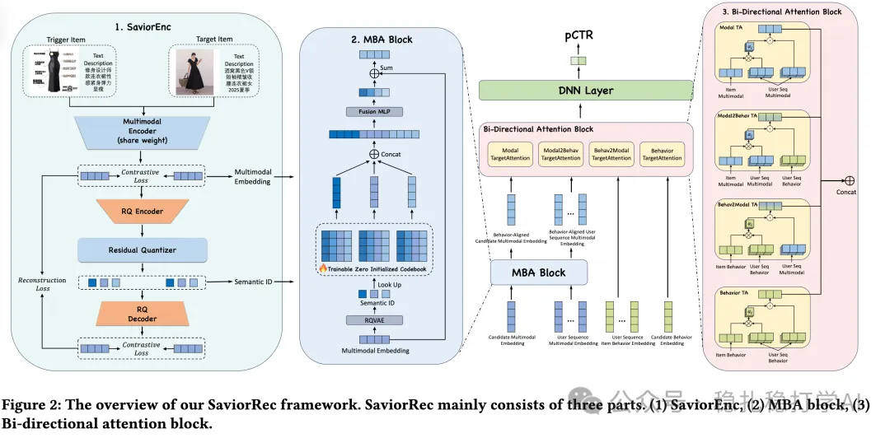

# Recommender algorithms (2025.8.5): Taobao's item cold start, big gains from "group information enhancement"

> [中文版](2025-08-05-taobao-saviorrec-cold-start.md)

1 SaviorRec: Group-Aware Multi-Modal Enhancement for Long-tail Item Recommendation

Link: https://arxiv.org/pdf/2507.19308

Company: Taobao

Area: item cold start

Overview:

(1) Group-aware embedding: the multimodal vector is the base; the item's own multimodal projection vector plus a group projection vector serves as the item representation.

(2) Group information enhancement via RQ-VAE

First run RQ-VAE on items to get their codebook. The codebook can be understood as groups. Question: how to inject this codebook information into the main model? Method: project the item's own multimodal representation onto the distribution of the groups it belongs to. Concretely: project the item's multimodal vector onto a group distribution to get a projection vector, then add this projection vector to the item's own multimodal vector as the final representation.

Question: how to understand this literally? The item's own multimodal representation is the item's own representation; the projection vector is effectively the embedding of the group it belongs to. The multimodal vector stands for the item itself.

(3) Bi-Directional Attention Block

A bidirectional attention mechanism is introduced into the CTR prediction model, jointly using the user behavior sequence and the candidate item representation. By fusing user-side and item-side cross-attention information, it improves prediction accuracy and model interpretability.

A/B:

On Taobao's "Guess You Like" service, for cold-start items: clicks +13.31%, orders +13.44%, CTR +12.80%.

Takeaways:

(1) The main role of RQ-VAE is to obtain an item's group information to supplement its own information. For hot items with enough interactions it helps very little; it helps relatively more for cold items. This paper applies it to cold start, aiming straight at the target. Many other papers that get results with RQ-VAE don't say explicitly that the gains come from cold items or cold users, which leaves readers puzzled.

Credibility: production

Recommendation: practically useful

