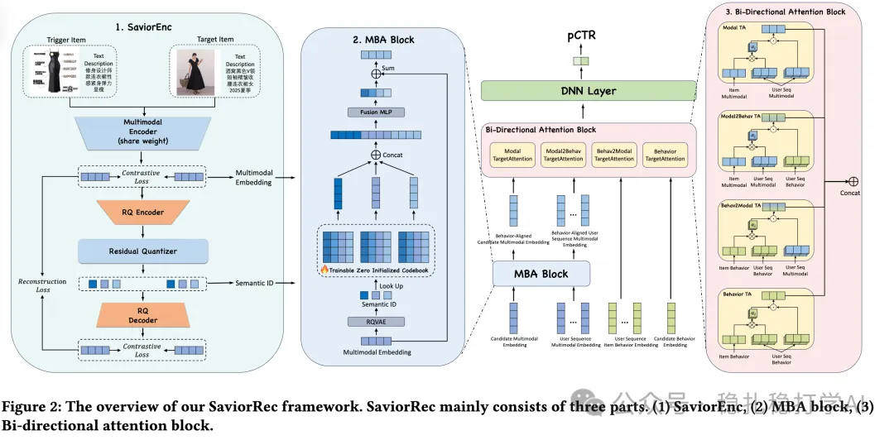

# 推荐算法(2025.8.5)：淘宝的物料冷启动，使用“群组信息增强”取得巨大效果

> 原文：https://mp.weixin.qq.com/s/92DARCpzTOZCX-UTgz29Eg
> 作者：算法工程师刘明星（稳扎稳打学AI）| 发表于 2025-08-05（标题已修改；修改于 2025-08-06）

嘿，记得给“稳扎稳打学AI”添加星标

关注我，每天为你精挑细选最优质、最新鲜的推荐算法paper，陪你一起保持进步、不断精进！

👆 [本公众号paper推荐原则](https://mp.weixin.qq.com/s?__biz=MzkzNDYyNjM1NA==&mid=2247484097&idx=1&sn=18322c279290b555eb030e12953b7c7f&scene=21#wechat_redirect)

1 SaviorRec: Group-Aware Multi-Modal Enhancement for Long-tail Item Recommendation

网址：https://arxiv.org/pdf/2507.19308

公司：淘宝

方向：物料冷启动

解读：

（1）GroupAware的embedding：多模态向量是基础，把自己的多模态映射向量加上群组映射向量，作为item的表征。

（2）RQ-VAE的group信息增强

先对物料做RQ-VAE，获得其codebook。codebook可以理解为群组。问题：如何把这些codebook信息注入到主模型？方法：把物料自身的多模态表征，映射到其所在群组的分布上。具体做法：把自己的多模态向量，映射到一个群组的分布上，得到一个映射向量，再把自己的多模态向量加上这个映射向量，作为最终表征。

问题：从字面意思，怎么理解？自己的多模态表征，就是物料自身的表征，映射向量就相当于其所在群组的embedding。多模态向量代表自身的表征。

（3）双向注意力机制（Bi-Directional Attention Block）

在CTR预测模型中引入双向注意力机制，联合用户行为序列与候选物料表征，通过融合用户侧与物料侧的交叉注意力信息，提升预测精度与模型的可解释性。

AB：

在淘宝“猜你喜欢”服务上，针对冷启动物品：点击+13.31%、订单+13.44%、CTR+12.80%。

心得：

（1）RQ-VAE的主要作用就是获取item的group信息，补充其自身的信息，对于互动量足够的热物料，帮助很小，对冷物料帮助才相对大。本文用到冷启动上，是直指目标的。其它很多使用RQ-VAE取得成果的paper，并不明说效果是来自冷物料、冷用户，让读者不明就理。

可信度：生产

推荐等级：有实践价值

请帮忙点赞、转发，谢谢。您认为哪篇论文最有潜力应用到实际业务中？

## 欢迎干货投稿 \ 论文宣传 \ 合作交流

推荐您继续阅读：

■ [推荐算法(2025.8.4)：美团的大模型助力新颖性推荐，AB效果不错哈](https://mp.weixin.qq.com/s/BvdEgX02zTyB1RqnuWi3Xw)

■ [推荐算法(2025.8.1)：阿里如何将LLM在推荐系统上全面落地](https://mp.weixin.qq.com/s/p7c5eHZWVbvf2Wa_LuZadA)

■ [推荐算法(2025.7.31)：Snap的关于生成式推荐的发现，肯定可以帮助到您](https://mp.weixin.qq.com/s/KbRxrNMUHweQRHuSdlgh6w)

历史文章索引：https://docs.qq.com/sheet/DYXZTZ0tseHRyZGtt?tab=BB08J2

请入微信群，群内我会给出更深入的解读，还可以共同讨论技术方案、发招聘广告、内推和交友等。

• 铁粉标准：关注一个月以上，且累计10次互动（评论、爱心、转发）、投稿1次。

• 入群方法：请您加个人微信lmxhappy，我拉您入群，请备注（只我个人看，不公开）。

由于公众号试行乱序推送，您可能不再准时收到稳扎稳打学AI的推送。为了第一时间收到本号的干货内容， 请将本号设为星标，以及常点文末右下角的“在看”。

喜欢的话点个在看吧👇

个人观点，仅供参考

修改于 2025-08-06
