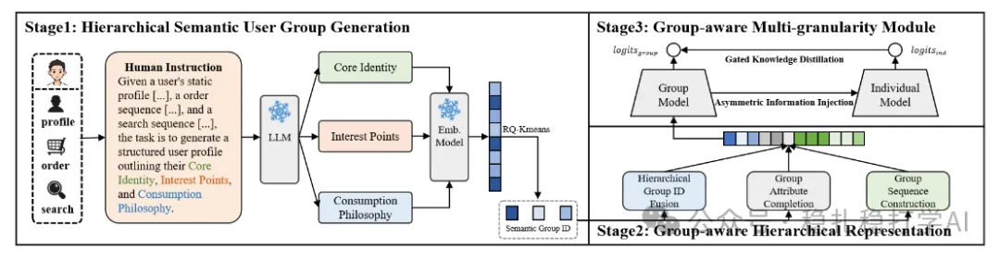
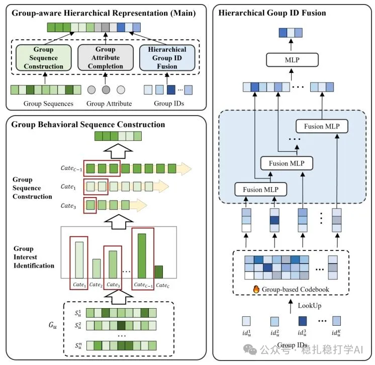
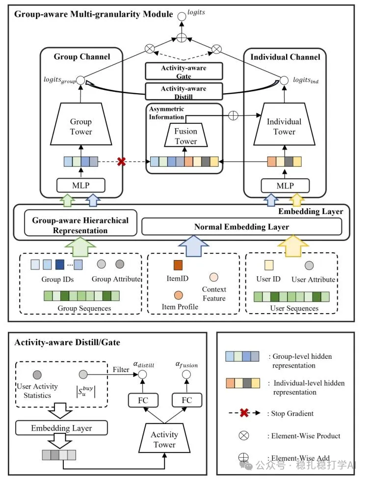

# Recommender algorithms (2025.11.5): Alibaba pushes group information for low-activity users to the limit, GMV +3.10%

> [中文版](2025-11-05-ali-choirrec.md)

1 ChoirRec: Bridging the Activity Gap in CTR Prediction with Hierarchical Group Representation

Link: https://arxiv.org/pdf/2510.09393

Company: Alibaba

Idea: group information (group behavior, group embedding, user segmentation, hierarchical representation, multi-tower, distillation, gating)

Area: CTR modeling for low-activity users

Overview: the paper is about solving CTR prediction for low-activity users. In industry, low-activity users have always been a hard problem: their behavior data is very sparse, so the model struggles to learn useful features from it. For example, if a user logs in only once a month and clicks only 1-2 products, the model can hardly infer the user's interests from such sparse behavior. The paper's solution is to strengthen low-activity users' representations with group information. Specifically:

(1) Group definition

Users are segmented into groups by certain rules. The rules include the user's behavior sequence, user attributes, user interests, and so on. For example, all users who bought maternal and baby products can go into one group, and all users who bought electronics into another. Each user thus belongs to one or more groups.

(2) Group representation

For each group, a group representation is learned. It can be understood as the group's "profile", containing the common features and interests of the users in the group. Concretely: aggregate the behavior sequences of all users in the group into a group behavior sequence, then feed it into a model to get the group representation.

(3) Hierarchical representation

The paper also proposes a hierarchical representation. Concretely: groups are divided into levels, giving groups at different levels. For example, users can be layered by interest: level 1 is coarse interest (e.g. maternal and baby, electronics), level 2 is fine interest (e.g. infant formula, diapers). A representation is learned for the groups at each level. The benefit: the model can learn richer features from group information at different levels.

(4) Multi-tower structure

The paper also proposes a multi-tower structure. Concretely: several towers model different information separately. For example, one tower models group information, another models user information, and a third models the interaction between group and user. The outputs of the towers are then fused into the final prediction.

(5) Distillation and gating

The paper also introduces distillation and gating to further improve the model. Concretely: a large model (teacher) guides the learning of a small model (student), so the small model can learn the large model's knowledge; meanwhile, a gating mechanism controls the weights of different information, letting the model adaptively pick the most useful information.

A/B: on Taobao, versus the baseline, low-activity users' GMV +3.10%, CTR +0.97%.

Takeaways: (1) The idea is very clear: strengthen low-activity users' representations with group information. This is a very practical method, because low-activity users are a common problem in industry, and group information is a very easy feature to obtain. (2) The hierarchical representation and multi-tower structure are also well worth borrowing. Hierarchical representation lets the model learn richer features from group information at different levels, and the multi-tower structure lets the model model different information separately and then fuse it. (3) The distillation and gating methods are also very practical. Distillation lets the small model learn the large model's knowledge, and gating lets the model adaptively pick the most useful information.

Credibility: production

Recommendation: practically useful

<!-- ChoirRec architecture figure (top / middle / bottom parts): on 2026-11-08 the three separate image URLs were retrieved from the original WeChat post and all localized. -->
