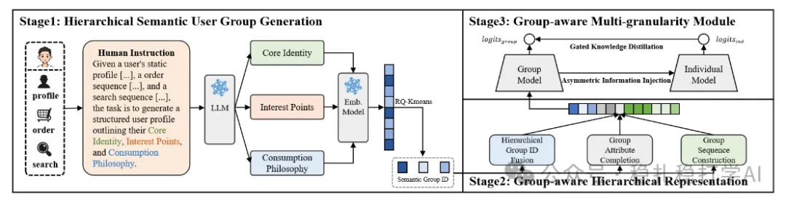
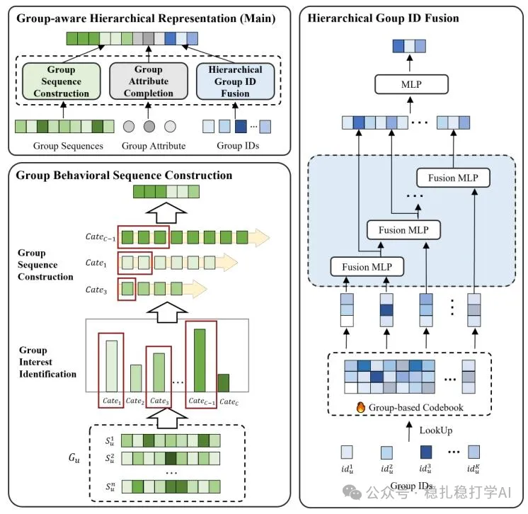
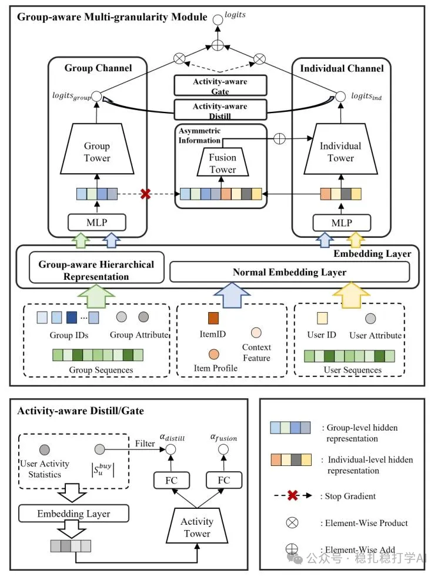

# 推荐算法(2025.11.5)：阿里的群组信息增强低活用户，做到了极致，GMV+3.10%

> 原文：https://mp.weixin.qq.com/s/URp-Ars7BTULYmrNDg29CA
> 作者：算法工程师刘明星（稳扎稳打学AI）| 发表于 2025-11-05

嘿，记得给“稳扎稳打学AI”添加星标

关注我，每天为你精挑细选最优质、最新鲜的推荐算法paper，陪你一起保持进步、不断精进！

> [English version](2025-11-05-ali-choirrec.full.en.md)

👆 [本公众号paper推荐原则](https://mp.weixin.qq.com/s/BhVGu0qH5kTz9N5zpsD3KA)

1 ChoirRec: Bridging the Activity Gap in CTR Prediction with Hierarchical Group Representation

网址：https://arxiv.org/pdf/2510.09393

公司：阿里

思想：群组信息（群组行为、群组embedding、用户分群、分层表征、多tower、蒸馏、门控）

方向：低活用户CTR建模

解读：本文主要介绍如何解决低活用户的CTR预估问题。在工业界中，低活用户一直是一个难点，因为他们的行为数据非常稀疏，模型很难从他们的行为中学习到有效的特征。举一个例子：如果一个用户一个月只登录一次，并且只点击了1-2个商品，那么模型很难从这些稀疏的行为中推断出用户的兴趣。而本文的解决方案是：用群组信息来增强低活用户的表征。具体的：

（1）群组定义

本文将用户按照一定的规则进行分群，得到不同的群组。分群的规则包括：用户的行为序列、用户的属性、用户的兴趣等。举一个例子：可以将所有购买过母婴用品的用户分到一个群组中，将所有购买过电子产品的用户分到另一个群组中。这样，每个用户都会属于一个或多个群组。

（2）群组表征

对于每个群组，本文都会学习一个群组表征。这个表征可以理解为群组的“画像”，它包含了群组内用户的共同特征和兴趣。具体做法是：将群组内所有用户的行为序列进行聚合，得到群组的行为序列；然后，将群组的行为序列输入到一个模型中，得到群组的表征。

（3）分层表征

本文还提出了一个分层表征的方法。具体做法是：将群组按照一定的层级进行划分，得到不同层级的群组。例如，可以将用户按照兴趣进行分层：第一层是粗粒度的兴趣（如母婴、电子产品），第二层是细粒度的兴趣（如奶粉、纸尿裤）。然后，对于每个层级的群组，都学习一个表征。这样的好处是：模型可以从不同层级的群组信息中学习到更丰富的特征。

（4）多tower结构

本文还提出了一个多tower的结构。具体做法是：用多个tower来分别建模不同的信息。例如，可以用一个tower来建模群组信息，用另一个tower来建模用户信息，用第三个tower来建模群组和用户之间的交互信息。最后，将多个tower的输出进行融合，得到最终的预测结果。

（5）蒸馏和门控

本文还引入了蒸馏和门控的方法，来进一步提升模型的效果。具体做法是：用一个大模型（教师模型）来指导小模型（学生模型）的学习，让小模型能够学习到大模型的知识；同时，用门控机制来控制不同信息的权重，让模型能够自适应地选择最有用的信息。

AB：在淘宝上，相比基线，低活用户的GMV +3.10%，CTR +0.97%。

心得：（1）本文的思路非常清晰：用群组信息来增强低活用户的表征。这是一个非常实用的方法，因为在工业界中，低活用户是一个普遍存在的问题，而群组信息是一个非常容易获取的特征。（2）本文的分层表征和多tower结构也非常值得借鉴。分层表征可以让模型从不同层级的群组信息中学习到更丰富的特征，而多tower结构可以让模型分别建模不同的信息，最后进行融合。（3）本文的蒸馏和门控方法也非常实用。蒸馏可以让小模型学习到大模型的知识，而门控可以让模型自适应地选择最有用的信息。

可信度：生产

推荐等级：有实践价值

<!-- ChoirRec 架构图（上/中/下三部分）：2026-11-08 回微信原文取到三个独立图片地址，已全部本地化。 -->

请帮忙点赞、转发，谢谢。

## 欢迎干货投稿 \ 论文宣传 \ 合作交流

推荐您继续阅读：

■ [推荐算法paper](https://mp.weixin.qq.com/s?__biz=MzkzNDYyNjM1NA==&mid=2247484024&idx=1&sn=b6c0bc04592d62da52ce1cfe36e84d1a&scene=21#wechat_redirect)

历史文章索引：https://docs.qq.com/sheet/DYXZTZ0tseHRyZGtt?tab=BB08J2

请入微信群，群内我会给出更深入的解读，还可以共同讨论技术方案、发招聘广告、内推和交友等。

• 铁粉标准：关注公众号一个月以上，且在公众号上累计15次互动（评论、爱心、转发）、或投稿1次，只欢迎技术同学。

• 入群方法：请您加个人微信lmxhappy，我拉您入群，请备注（只我个人看，不公开）。

喜欢的话点个在看吧👇

个人观点，仅供参考
