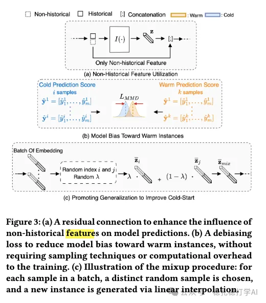

# Recommender algorithms (2025.12.23): Pinterest, item cold start, engagement +10%

> [中文版](2025-12-23-pinterest-cold-start.md)

1 Warmer for Less: A Cost-Efficient Strategy for Cold-Start Recommendations at Pinterest

Link: https://arxiv.org/pdf/2512.17277

Company: Pinterest

Idea: ResNet + same distribution + synthesized data

Area: item cold start

Overview:

The paper proposes a solution for cold-start items, to predict how a new item will perform when it has no historical data. The core idea is to address the data scarcity of cold-start items with residual connections, distribution alignment and data augmentation.

Specifically:

(1) Residual connection

A new item's features are fused with features of existing items through a residual connection, using knowledge from existing items to help predict for the new item.

(2) Distribution alignment

The data distributions of new and existing items differ; for example, new items have little data while existing items have a lot. To address this, the paper proposes a distribution alignment method: transform the new item's features so their distribution aligns with that of existing items, reducing the effect of the distribution gap.

(3) Data augmentation

Augment the new items' data to generate more training samples, balancing the data volume between new and existing items. This includes:

1) randomly perturbing new items' features to generate new training samples;

2) mixing new items with existing items to generate new training samples;

3) generating new training samples with a generative model.

A/B: new-item engagement +10%, with overall engagement and cost neutral.

Takeaways:

(1) The paper considers several angles together and achieves a large gain.

(2) Cold start is a good direction for both research and work.

Credibility: production

Recommendation: practically useful

Figure 3: (a) A residual connection concatenates content features and ID embedding as an input to the feature tower. (b) A debiasing loss is added to improve the quality of embeddings under sampling bias. (c) Illustration of the mixup procedure between an old and new pin.
