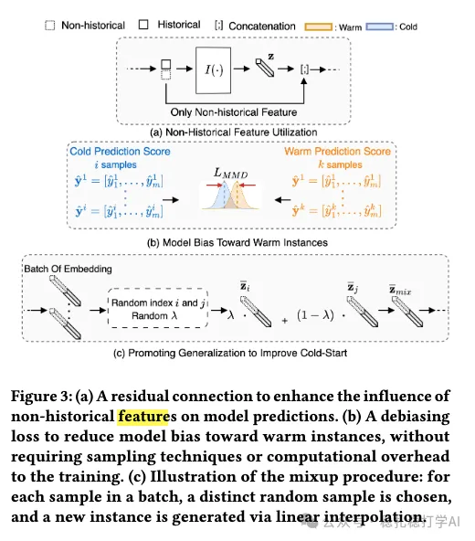

# 推荐算法(2025.12.23)：Pinterest，物料冷启动，互动10%

> 原文：https://mp.weixin.qq.com/s/TEaQPAsJkMWsy0Yp8CeNAQ
> 作者：算法工程师刘明星（稳扎稳打学AI）| 发表于 2025-12-23（标题已修改；修改于2025年12月23日）

嘿，记得给“稳扎稳打学AI”添加星标

关注我，每天为你精挑细选最优质、最新鲜的推荐算法paper，陪你一起保持进步、不断精进！

> [English version](2025-12-23-pinterest-cold-start.full.en.md)

👆 [本公众号paper推荐原则](https://mp.weixin.qq.com/s/BhVGu0qH5kTz9N5zpsD3KA)

1 Warmer for Less: A Cost-Efficient Strategy for Cold-Start Recommendations at Pinterest

网址：https://arxiv.org/pdf/2512.17277

公司：Pinterest

思想：resnet+分布相同+造数据

方向：物料冷启动

解读：

本文提出了一种冷启动物料的解决方法，用来在新物料没有历史数据的情况下，预测其推广效果。核心思想是通过残差连接、分布对齐和数据增强，来解决冷启动物料的数据稀缺问题。

具体来说，

（1）残差连接

将新物料的特征，通过一个残差连接，与已有物料的特征进行融合，从而利用已有物料的知识来帮助新物料的预测。

（2）分布对齐

新物料和已有物料的数据分布存在差异，例如新物料的数据量较小，而已有物料的数据量较大。为了解决这个问题，本文提出了一种分布对齐的方法：通过对新物料的特征进行变换，使其分布与已有物料的分布对齐，从而减少分布差异带来的影响。

（3）数据增强

通过对新物料的数据进行增强，生成更多的训练样本，从而平衡新物料和已有物料的数据量。具体包括：

1）对新物料的特征进行随机扰动，生成新的训练样本；

2）将新物料与已有物料进行混合，生成新的训练样本；

3）通过生成模型，生成新的训练样本。

AB：新物料互动+10%，整体互动和成本中性。

心得：

（1）本文在多个角度上综合考虑，实现了较大的效果。

（2）冷启动是一个好的研究和工作方向。

可信度：生产

推荐等级：有实践价值

Figure 3: (a) A residual connection concatenates content features and ID embedding as an input to the feature tower. (b) A debiasing loss is added to improve the quality of embeddings under sampling bias. (c) Illustration of the mixup procedure between an old and new pin.

请帮忙点赞、转发，谢谢。

## 欢迎干货投稿 \ 论文宣传 \ 合作交流

推荐您继续阅读：

[推荐算法(2025.12.12)：阿里，挖掘其它域的增量样本，大幅提升召回效果，交易量提升1.2%](https://mp.weixin.qq.com/s/VEse6yYsvYQfNR0YOCVeXg)

[Meta的one model，全链路gpu算子化](https://mp.weixin.qq.com/s/yvaTutx8PiMoS184ts_Tew)

历史文章索引：https://docs.qq.com/sheet/DYXZTZ0tseHRyZGtt?tab=BB08J2

请入微信群，群内我会给出更深入的解读，还可以共同讨论技术方案、发招聘广告、内推和交友等。

• 铁粉标准：关注公众号一个月以上，且在公众号上累计15次互动（评论、爱心、转发）、或投稿1次，只欢迎技术同学。

• 入群方法：请您加个人微信lmxhappy，我拉您入群，请备注（只我个人看，不公开）。

喜欢的话点个在看吧👇

个人观点，仅供参考

修改于2025年12月23日
