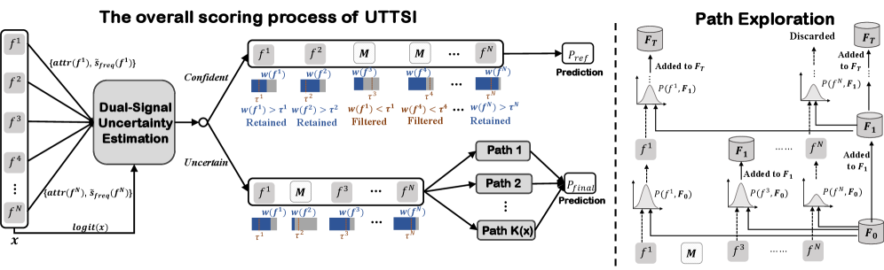

# Alibaba: random feature dropping + ensembling fixes unreliable predictions on sparse samples, online CTR +5.3%

> [中文版](uttsi.md)

### Paper: Selective Test-Time Compute Scaling for Click-Through Rate Prediction via Uncertainty-Triggered Feature Path Exploration
### Link: https://arxiv.org/html/2605.24989
### Company: Alibaba
### Idea: test-time compute scaling
### Area: long tail

## Overview:
The paper targets the problem that sparse or unseen feature combinations give unreliable CTR predictions at inference time. It proposes a framework that, at serving time, uses uncertainty estimation to adaptively explore multiple feature paths for high-uncertainty samples, and improves prediction robustness with consistency-weighted ensembling.

CTR prediction has a fundamental asymmetry: **during training the model sees rich feature combinations, but at inference many combinations are sparse or have never appeared**, so the reliability of the model's predictions varies a lot across samples. The traditional fix is adaptive gating during training, but the gating itself is affected by the sparsity problem, and after deployment it can't adjust dynamically per instance.

The framework has two stages: **offline precomputation** (one-off) and **online inference** (run independently per sample).

---

### Offline precomputation (one-off, deployed with the model)

**① Feature frequency table**
Scan the training set with a Count-Min Sketch to count occurrences of each feature value, and normalize to get a frequency prior $\tilde{s}_{\text{freq}}(f^i) \in [0,1]$. The higher the frequency, the more common the feature value, the more often the model has seen it, and the more reliable the prediction.

**② Normalization baseline $\gamma$**
Run once over the validation set and take the 95th percentile of $|\text{logit}|$ across all samples as $\gamma$, used later to normalize the model signal.

Once fixed, these two values go online with the model and are not updated during online inference.

---

### Online inference (run independently per sample)

**(1) Uncertainty estimation → decide how many paths to allocate**

For each request sample, first run a normal forward pass, plus one backward pass, to get two signals:

* **Model signal**: a large absolute logit = confident, normalized by the offline $\gamma$:
$$s_{\text{model}}(x) = \min\left(\frac{|\text{logit}(x)|}{\gamma}, 1\right)$$

* **Data signal**: use the gradient norm of each feature embedding from the backward pass (feature attribution $\text{attr}(f^i)$) as weights for a weighted average over the **offline feature frequency table**. The features the model currently relies on most are less reliable the lower their frequency:
$$s_{\text{freq}}(x) = \frac{\sum_i \text{attr}(f^i) \cdot \tilde{s}_{\text{freq}}(f^i)}{\sum_i \text{attr}(f^i)}$$

Fuse the two into an uncertainty score ($\alpha=0.05$, relying almost entirely on the data signal):

$$u(x) = 1 - \left[\alpha \cdot s_{\text{model}}(x) + (1-\alpha) \cdot s_{\text{freq}}(x)\right]$$

The number of paths is allocated accordingly: $K(x) = \lfloor K_{\max} \cdot u(x) \rfloor$, $K_{\max}=8$.

**(2) Feature filtering (done for all samples)**

Score each feature by combining the **offline frequency prior** and the **current sample's feature attribution**:

$$w(f^i) = \beta \cdot \tilde{s}_{\text{freq}}(f^i) + (1-\beta) \cdot \text{attr}(f^i), \quad \beta=0.4$$

Set an independent quantile threshold $\tau^i$ for each field; a feature is removed only if it is low on both dimensions (frequency + attribution), a conservative strategy. Run one forward pass with the filtered feature set to get the base prediction $P_{\text{ref}}$.

**(3) Path-exploration ensemble for high-uncertainty samples (only samples with $K(x)>0$)**

Generate $K(x)$ paths in parallel. Each path randomly samples a feature subset with probability $p_i \propto w(f^i)$ and runs an independent forward pass to get $P_i$. Paths farther from the mean get lower weights, suppressing outlier paths:

$$\bar{P} = \frac{1}{K}\sum_i P_i, \quad w_i = \exp(-\lambda \cdot |P_i - \bar{P}|), \quad \hat{P} = \frac{\sum_i w_i P_i}{\sum_i w_i}$$

$\hat{P}$ replaces $P_{\text{ref}}$ as the final prediction for high-uncertainty samples.

### A/B:
Versus the production model, CTR +5.3% relative.

## Takeaways:
* Moving the LLM "test-time compute scaling" paradigm to CTR prediction is the paper's biggest highlight; the idea is novel.
* The dual signal (model confidence + frequency prior × attribution) addresses the fact that a single logit can't tell epistemic uncertainty from aleatoric uncertainty, and using Count-Min Sketch is very practical from an engineering standpoint.
* 62% of samples don't trigger multiple paths at all; only truly "uncertain" samples spend extra compute, a good balance between latency and effectiveness.

## Caveats
* The paper presents "dual-signal fusion" as a core contribution, but $\alpha=0.05$ means the model signal's weight is only 5%, so it effectively degenerates into a single signal (data frequency).
* **Using gradient attribution on uncertain samples is circular reasoning**: using "the current model's gradients" to judge which features matter most requires the model to have a reliable judgment on this sample. But for high-uncertainty samples with sparse features, the model's gradient direction itself can't be trusted. Using untrustworthy gradients to assess untrustworthiness is logically circular.

## Credibility: production

## Recommendation: practically useful

