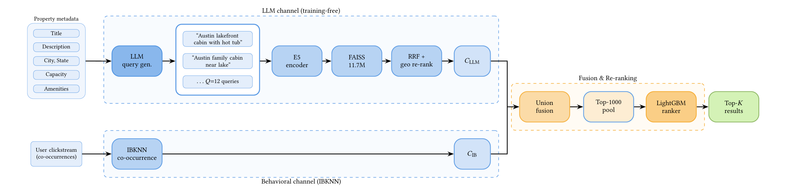

# Vrbo long-tail retrieval: LLM-generated queries fill ItemCF's gaps, no training

> [中文版](vrbo-llm-candidate-gen.md)

### Paper: Serving the Long Tail: Training-Free LLM Candidate Generation for Vacation Rental Marketplaces (arXiv 2026)
### Link: https://arxiv.org/abs/2607.09877
### Company: Expedia Group (Vrbo)
### Idea: LLM query generation, dense retrieval, append-only multi-channel fusion, training-free
### Area: long tail, cold start, i2i retrieval

## Overview:
Vrbo is Expedia's vacation rental marketplace, and its property pages show a "similar properties" carousel. The main retrieval channel for it is IBKNN: similarity between two properties is how often users viewed them together in clickstreams, boosted by amenity overlap; in other words, ItemCF. It is accurate and cheap on popular properties, but it can't cover the long tail:
1. **Cold-start properties get no candidates.** Newly listed properties, seasonal inventory that is dormant, and properties in emerging markets have no co-occurrence data, so IBKNN returns nothing, about 3.2% of them.
2. **Low-interaction properties get noisy neighbors.** About 22% of properties get 5 or fewer interactions a month, together under 1% of all interactions, and neighbors computed from a handful of co-occurrences are unreliable.
3. **Properties that are semantically similar but never viewed together can never be retrieved.**

The paper adds an LLM retrieval channel that doesn't depend on behavioral data: using only a property's static information, an LLM generates search queries, which are then run against the full property catalog. When merged with IBKNN, the new candidates are only appended, never reordering the original list, so popular properties can't get worse. The LLM retrieval channel trains no model at all; the LLM and the encoder are off-the-shelf, and only the final LightGBM re-ranker is trained. The paper has offline experiments only.

### (1) The LLM channel: from property information to candidates (top half of the figure)
**Query generation.** A property's title, description (truncated to 300 characters), structure type, city, capacity, up to 15 amenities and rating are put into one block of text, and LLaMA-3.2-3B generates 12 queries a traveler might search for, such as "Austin lakefront cabin with hot tub" and "Austin family cabin near lake". The prompt has three hard rules: every query must include the city name, otherwise retrieval drifts across the globe; each query highlights a different facet (location plus property type, location plus amenities, location plus experience); 5 to 12 words, no prices. Malformed queries are filtered out, and if fewer than 12 remain, template queries built from the metadata (e.g. "Austin cabin rental") fill the gap.

**Why 12 queries instead of encoding the property as one vector?** One vector squeezes all facets of a property into a single point; split into several queries, each retrieves a different slice of the catalog, which covers more ground.

**Retrieval.** The text of all 11.7M properties is encoded in advance with an off-the-shelf E5-large-v2 and indexed in FAISS. The 12 queries are encoded with the same E5 (property text gets a `passage:` prefix and queries a `query:` prefix, which is how E5 tells documents and queries apart), and each retrieves its 50 nearest properties, and the lists are merged with RRF (Reciprocal Rank Fusion: each property's score is the sum of the reciprocals of its ranks across the lists). Finally the list is re-ranked by 0.7 × semantic similarity plus 0.3 × geographic distance, giving the LLM channel's candidate list.

### (2) Union fusion: append only, never reorder (Union fusion in the figure)
IBKNN's candidates go in first, in their original order; then the LLM channel's candidates are walked in order and any not already present are appended, until there are K. So for properties where IBKNN already fills all K slots, the result is exactly the same as before; only where IBKNN can't fill them does the LLM fill the empty slots. On this basis the paper proves that for every property and every K, recall after fusion is never below IBKNN's.

Compare the common RRF fusion: RRF interleaves the two channels, so LLM candidates push out IBKNN's good top results. On a 10K-property subset, RRF's R@1000 is about 41%, Union's about 59%.

### (3) LightGBM re-ranking (LightGBM ranker in the figure)
The top 1000 fused candidates are re-ranked with LightGBM (LambdaRank). Features include each channel's rank and score, geographic distance, co-occurrence strength, text embedding similarity, property demand features and so on. Labels have three grades: 4 if both were booked in the same session, 1 if viewed together, 0 otherwise.

### Results (offline only)
The evaluation uses the following month's clickstream as the answer key: properties appearing in the same session count as relevant, and recall is measured. On the 1.5M properties where both channels have candidates, Union beats IBKNN by 0.24 percentage points at R@100 and 1.40 at R@1000, with only 4% overlap between the two channels. The gain concentrates in the long tail: for properties with 1–5 interactions a month, R@300 is 4.34 percentage points higher; for popular properties with 100+ interactions, only 0.14. All of the 3.2% cold-start properties now get candidates. LightGBM re-ranking adds another 1.69 percentage points at R@100.

Used on its own, queries from the 3B small model retrieve 27–46% less than those from GPT-4o and GPT-5.2; once fused into Union, the gap shrinks to under 1%.

## Takeaways:
* When plugging a new retrieval channel into a mature system, fuse it "append only, never reorder": zero risk at the head, all the gain in the long tail.
* A new channel's value is in what it adds, not in its own accuracy: with only 4% overlap, a 3B small model is nearly as good as the GPT series after fusion, so a self-hosted small model is enough.
* Rewriting an item description into several queries retrieved separately covers more than encoding it as one vector; forcing hard constraints such as the city into the queries keeps retrieval from drifting.

## My take
* Offline experiments only; the authors list an online A/B test as future work. The evaluation's "appeared in the same session" is exactly the behavioral signal IBKNN is good at, and for cold-start properties only coverage is reported, with no way to assess candidate quality.
* The "never worse" guarantee holds only at the candidate-set level; LightGBM re-ranking can reorder, so the final results shown to users carry no such guarantee.
* Queries are generated offline once a day and are the same for every user, with no personalization and no use of the user's current session.

## Credibility: offline

## Recommendation level: worth a look if you have time
