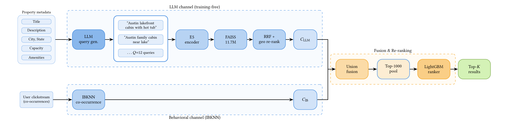

# Vrbo 长尾房源召回，LLM 生成查询补 ItemCF 的空，免训练

关注我，每天为你精挑细选最优质、最新鲜的推荐算法paper，陪你一起保持进步、不断精进！

> [English version](vrbo-llm-candidate-gen.full.en.md)

### 论文：Serving the Long Tail: Training-Free LLM Candidate Generation for Vacation Rental Marketplaces
### 网址：https://arxiv.org/abs/2607.09877
### 公司：Expedia Group（Vrbo）
### 思想：LLM 生成查询、稠密检索、只追加的多路融合、免训练
### 方向：长尾、冷启动、i2i 召回

## 解读：
Vrbo 是 Expedia 旗下的度假房源平台，房源详情页旁边有一栏「相似房源」。这一栏的召回主力是 IBKNN：按用户点击流里两个房源被一起浏览的次数算相似度，再加上设施重合度，也就是 ItemCF。它在热门房源上又准又便宜，但长尾覆盖不了：
1. **冷启动房源没有候选。** 新上架、淡季休眠、新开拓市场的房源没有共现数据，IBKNN 直接返回空，约占 3.2%。
2. **低互动房源的邻居很吵。** 约 22% 的房源每月互动不超过 5 次，合计不到总互动的 1%，几次共现算出来的邻居不可靠。
3. **语义相似但没被一起看过的房源，永远召不回来。**

本文加了一条不依赖行为数据的 LLM 召回通道：只用房源的静态信息，让 LLM 生成搜索查询，再去全量房源库里检索。和 IBKNN 合并时只往后追加、不动原来的顺序，保证头部房源不变差。LLM 召回通道全程不训练任何模型，LLM 和编码器都是现成的；只有最后的 LightGBM 重排需要训练。全文只有离线实验。

### （1）LLM 通道：从房源信息到候选（图上半部分）
**生成查询。** 把房源的标题、描述（截断到 300 字）、房型、城市、容量、最多 15 项设施、评分拼成一段文本，让 LLaMA-3.2-3B 生成 12 条旅客可能会搜的查询，比如「Austin lakefront cabin with hot tub」「Austin family cabin near lake」。提示词有三条硬规定：每条必须带城市名，否则检索会漂到全球范围；每条突出一个不同的侧面（位置加房型、位置加设施、位置加体验）；5 到 12 个词，不带价格。生成不合格的查询会被过滤，不够 12 条就用元数据拼的模板查询补齐（如「Austin cabin rental」）。

**为什么是 12 条查询，而不是把房源编成一个向量？** 一个向量会把房源的各个侧面压成一个点；拆成多条查询，每条检索出房源库的一个不同切面，覆盖面更广。

**检索。** 1170 万房源的文本提前用现成的 E5-large-v2 编码好，建 FAISS 索引。12 条查询也用同一个 E5 编码（房源文本加 `passage:` 前缀、查询加 `query:` 前缀，这是 E5 区分文档和查询的方式），各取最近的 50 个房源，用 RRF 合并（Reciprocal Rank Fusion：每个房源按它在各个列表里名次的倒数加总得分）。最后按 0.7 的语义相似度加 0.3 的地理距离重排，得到 LLM 通道的候选列表。

### （2）Union 融合：只追加，不重排（图中 Union fusion）
先原样放入 IBKNN 的候选，顺序一个不动；再按顺序遍历 LLM 通道的候选，没出现过的追加到后面，凑够 K 个为止。所以 IBKNN 已经填满 K 个位置的房源，结果和原来完全一样；IBKNN 填不满的，空位才由 LLM 补。论文据此证明：每个房源、每个 K，融合后的召回率都不低于 IBKNN。

对比常见的 RRF 融合：RRF 会把两路候选混排，LLM 的候选会挤掉 IBKNN 靠前的好结果。在 1 万房源的子集上，RRF 的 R@1000 约 41%，Union 约 59%。

### （3）LightGBM 重排（图中 LightGBM ranker）
对融合后的前 1000 个候选再用 LightGBM（LambdaRank）重排。特征包括两路通道各自的名次和分数、地理距离、共现强度、文本向量相似度、房源的需求特征等。标签分三档：同一会话里都被预订记 4 分，一起被浏览记 1 分，其它记 0 分。

### 效果（只有离线）
评估方式是：用后一个月的点击流当答案，同一会话里一起出现过的房源算相关，看召回率。在两路都有候选的 150 万房源上，Union 比 IBKNN 的 R@100 高 0.24 个百分点，R@1000 高 1.40 个百分点，两路候选只有 4% 重叠。收益集中在长尾：每月 1–5 次互动的房源，R@300 高 4.34 个百分点；100 次以上的热门房源只高 0.14 个百分点。那 3.2% 的冷启动房源全部有了候选。LightGBM 重排后，R@100 再高 1.69 个百分点。

单独用的时候，3B 小模型生成的查询，召回比 GPT-4o、GPT-5.2 低 27–46%；融合进 Union 后，差距缩到 1% 以内。

## 心得：
* 新召回通道接进成熟系统时，用「只追加不重排」的方式融合：头部零风险，增量全在长尾。
* 新通道的价值在于补充，不在于自身精度：两路只有 4% 重叠，融合后 3B 小模型和 GPT 系列几乎一样，自部署小模型就够用。
* 把物品描述改写成多条查询分别检索，比编成一个向量覆盖面更广；查询里强制带上城市这类硬约束，能防止检索漂移。

## 愚见
* 只有离线实验，作者把线上 A/B 列为未来工作。评估用的「同会话一起出现」恰好是 IBKNN 擅长的行为信号；冷启动房源只报告了覆盖率，没法评估候选质量。
* 「不变差」的保证只在候选集层面，LightGBM 重排后可以打乱顺序，最终展示给用户的结果没有这个保证。
* 查询每天离线生成一次、对所有用户都一样，没有个性化，也不看用户当前的会话。

## 可信度：离线

## 推荐等级：有时间看看

**请帮忙点赞、转发，谢谢。欢迎干货投稿 \ 论文宣传\ 合作交流**

### 【铁粉】请入微信群，群内我会给出更深入的解读，还可以共同讨论技术方案、发招聘广告、内推和交友等。
* 铁粉标准：关注公众号一个月以上，且在公众号上累计15次互动（评论、爱心、转发）、或投稿1次，只欢迎技术同学。
* 入群方法：请您加个人微信lmxhappy，我拉您入群，请备注【公司】（只我个人看，不公开）。

## 推荐您继续阅读：
