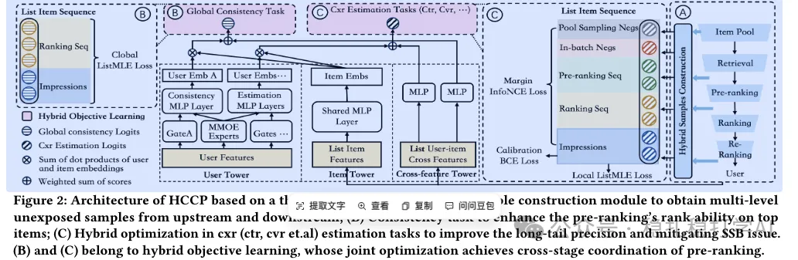

# Recommendation papers (2025.2.17): JD uses hybrid cross-stage samples to ease sample selection bias in pre-ranking
> [中文版](2025-02-17-jd-pre-ranking-ssb.md)

> Source: WeChat post https://mp.weixin.qq.com/s?__biz=MzkzNDYyNjM1NA==&mid=2247484154&idx=1&sn=8f21bd9302b484f856855241759ca345&scene=21#wechat_redirect, published 2025-02-17.
> Split from the roundup "Must-read recommendation papers! Recommendation borrows deeply from DeepSeek for the first time, starting a journey of innovation"; same issue: [NetEase Cloud Music resource-optimal scaling law](../behavior-sequence-modeling/2025-02-17-netease-resource-optimal-scaling.full.en.md), [Meituan SessionRec](../generative-recommendation/2025-02-17-meituan-sessionrec.full.en.md), [JD hybrid cross-stage pre-ranking](../loss-func/2025-02-17-jd-pre-ranking-ssb.full.en.md).

A Hybrid Cross-Stage Coordination Pre-ranking Model for Online Recommendation Systems

Link: https://arxiv.org/pdf/2502.10284

Company: JD

Area: pre-ranking

Overview: This work addresses the sample selection bias (SSB) problem that pre-ranking models face, i.e., the training samples and test samples have different distributions, so the model performs poorly. Specifically:

(1) Hybrid sample construction

The key part of the model: it collects diverse data from upstream and downstream stages and reprocesses it to provide high-quality "ground truth" for pre-ranking learning, which effectively improves model performance.

(2) Hybrid objective optimization

It learns from these hybrid unexposed samples, improving overall performance and mitigating the SSB problem.

Takeaways: SSB can be mitigated by supplementing samples; this is an industry consensus.

Credibility: production

Recommendation: worth reading

