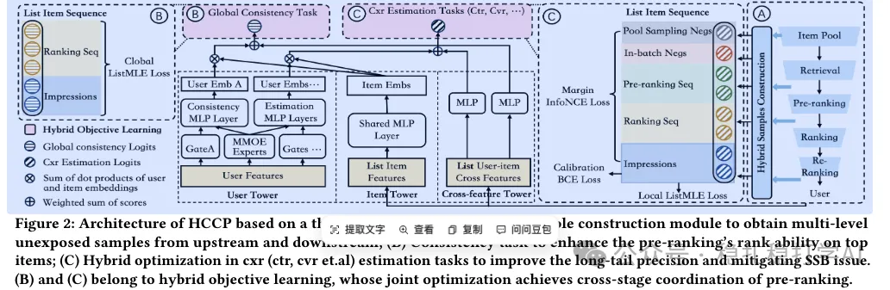

# 推荐算法(2025.2.17)：京东用跨阶段混合样本缓解粗排的样本选择偏差

> 原文：https://mp.weixin.qq.com/s?__biz=MzkzNDYyNjM1NA==&mid=2247484154&idx=1&sn=8f21bd9302b484f856855241759ca345&scene=21#wechat_redirect
> 作者：算法工程师刘明星（稳扎稳打学AI）| 发表于 2025-02-17
> 本文拆自《推荐算法paper必看！推荐界首次深度借鉴 DeepSeek，开启创新探索之旅》，同期 3 篇：[网易云音乐资源最优 Scaling Law](../behavior-sequence-modeling/2025-02-17-netease-resource-optimal-scaling.md)、[美团 SessionRec](../generative-recommendation/2025-02-17-meituan-sessionrec.md)、[京东跨阶段协同粗排](../loss-func/2025-02-17-jd-pre-ranking-ssb.md)。

关注我，每天为你精挑细选最优质、最新鲜的推荐算法paper，陪你一起保持进步、不断精进！

> [English version](2025-02-17-jd-pre-ranking-ssb.full.en.md)

A Hybrid Cross-Stage Coordination Pre-ranking Model for Online Recommendation Systems

网址：https://arxiv.org/pdf/2502.10284

公司：京东

方向：粗排

解读：这个工作，是为了解决一个粗排模型面临的样本选择偏差（SSB）问题。也就是，训练样本和测试样本的分布不一致，模型效果不佳。具体地说，

（1）混合样本构建

模型的关键部分，通过从上下游获取多样数据并重新处理，为预排序学习提供优质 "ground truth"，有效提升模型性能。

（2）混合目标优化

从这些混合的未曝光样本中学习，从而提高整体性能并缓解 SSB 问题。

心得：SSB可以通过样本补充得到缓解，这个是业界共识。

可信度：生产

推荐等级：推荐看看

