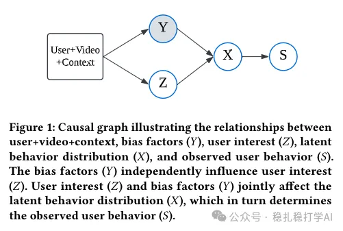

# Daily pick (2025.3.11): another strong piece from Kuaishou, the debiasing specialist

> [中文版](2025-03-11-kuaishou-alignpxtr.md)

1 AlignPxtr: Aligning Predicted Behavior Distributions for Bias-Free Video Recommendations

Link: https://arxiv.org/pdf/2503.06920

Company: Kuaishou

Area: causal inference + debiasing

Overview:

In recommender systems, the various biases have a very large effect on results, for example position bias and popularity bias. These biases are mixed into users' behavior signals, so the model has a hard time telling whether a user really likes the content or was just influenced by bias. This paper proposes a method called AlignPxtr to separate bias from user interest and get a more genuine user interest signal. Simply put, it separates "bias" from "interest".

The idea is to assume bias and interest are independent, and use a technique called "quantile mapping" to normalize the behavior distributions under different bias conditions onto a common [0, 1] scale, which in theory guarantees zero mutual information between bias and interest. It handles continuous signals (like watch time) as well as discrete ones (like likes), and can deal with several biases at once. For real-time needs, they also built a simplified "mean alignment" version that is more efficient.

Takeaways: bold assumption, brave separation. The paper assumes bias and interest are independent. Whether or not the assumption is right, if there is a method that does the separation well, it may just work, because most disentanglement work in recent years has worked. Put another way: disentangling matters a lot; the assumption matters relatively little, and the theory doesn't matter much either. (Friends, if you disagree, just consider it me rambling.)

Credibility: production

Recommendation: worth a look

Figure 1: Causal graph illustrating the relationships between user+video+context, bias factors (Y), user interest (Z), latent behavior distribution (X), and observed user behavior (S). The bias factors (Y) independently influence user interest (Z). User interest (Z) and bias factors (Y) jointly affect the latent behavior distribution (X), which in turn determines the observed user behavior (S).
