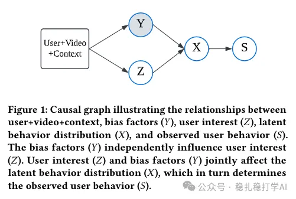

# 推荐算法(2025.3.11)：去偏专业户快手的又一力作

> 原文：https://mp.weixin.qq.com/s?__biz=MzkzNDYyNjM1NA==&mid=2247484316&idx=1&sn=76c0bbf3c3310a6366d7cd0ca13c6d83&scene=21#wechat_redirect
> 作者：算法工程师刘明星（稳扎稳打学AI）| 发表于 2025-03-11（标题已修改；修改于 2025-03-12）

嘿，记得给“稳扎稳打学AI”添加星标

关注我，每天为你精挑细选最优质、最新鲜的推荐算法paper，陪你一起保持进步、不断精进！

📄 [本公众号paper推荐原则](https://mp.weixin.qq.com/s?__biz=MzkzNDYyNjM1NA==&mid=2247484097&idx=1&sn=18322c279290b555eb030e12953b7c7f&scene=21#wechat_redirect)

1 AlignPxtr: Aligning Predicted Behavior Distributions for Bias-Free Video Recommendations

网址：https://arxiv.org/pdf/2503.06920

公司：快手

方向：因果推断+debias

解读：

在推荐系统中，各种bias对效果的影响非常大。比如位置偏见，流行度偏见等。这些bias混在用户的行为信号里，让模型很难分清用户到底是真的喜欢这个内容，还是只是被偏见影响了。这篇paper提出了一个叫AlignPxtr的方法，用来把bias从用户兴趣里分离出来，拿到更真实的用户兴趣信号。简单来说，就是要把"偏见"和"兴趣"这两件事分开。

它的思路是假设偏见和兴趣独立，用一个叫'分位数映射'的技术，把不同偏见条件下的行为分布标准化到统一的[0, 1]尺度，理论上能保证偏见和兴趣的互信息为零。既能处理连续信号（像时长），也能搞定离散信号（像点赞），还能同时对付多种偏见。考虑到实时性，他们还搞了个'均值对齐'的简化版，效率更高。

心得：大胆假设，勇敢分离。本paper假设bias与兴趣是独立的，不管假设对否，如果有方法做好分离，可能就work。因为这些年很多解藕的工作大都是work的。或者说解藕很重要，假设相对不重要，理论也不重要。——朋友们，如果不认同，就当我在瞎说。

可信度：生产

推荐等级：推荐看看

Figure 1: Causal graph illustrating the relationships between user+video+context, bias factors (Y), user interest (Z), latent behavior distribution (X), and observed user behavior (S). The bias factors (Y) independently influence user interest (Z). User interest (Z) and bias factors (Y) jointly affect the latent behavior distribution (X), which in turn determines the observed user behavior (S).

请帮忙点赞、转发，谢谢。您认为哪篇论文最有潜力应用到实际业务中？

## 欢迎干货投稿 \ 论文宣传 \ 合作交流

推荐您继续阅读：

■ [推荐算法周报(2025.3.10)：华为验证大模型显著提升推荐算法效能](https://mp.weixin.qq.com/s?__biz=MzkzNDYyNjM1NA==&mid=2247484308&idx=1&sn=9c5c81f83473f52f1024be583cac16f2&scene=21#wechat_redirect)

■ [推荐算法周报(2025.3.8)：行为序列与大模型领衔，亮点纷呈](https://mp.weixin.qq.com/s?__biz=MzkzNDYyNjM1NA==&mid=2247484301&idx=1&sn=ed438d08ec7160e42fffec7c27891f62&scene=21#wechat_redirect)

■ [推荐算法(2025.3.7)：腾讯再次证明相似用户和物料提升推荐效果](https://mp.weixin.qq.com/s?__biz=MzkzNDYyNjM1NA==&mid=2247484296&idx=1&sn=f24a6d6b38309f620ccbc5041cc1f32e&scene=21#wechat_redirect)

历史文章索引：https://docs.qq.com/sheet/DYXZTZ0sseHRyZGtt?tab=BB08J2

由于公众号试行乱序推送，您可能不再准时收到稳扎稳打学AI的推送。为了第一时间收到本号的干货内容， 请将本号设为星标，以及常点文末右下角的“在看”。

喜欢的话点个在看吧👇

个人观点，仅供参考

修改于2025年3月12日
