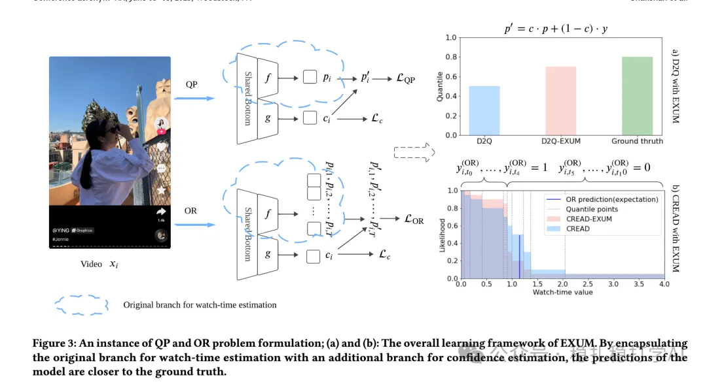

# Recommendation papers (2025.4.12): Kuaishou models uncertainty explicitly to handle noisy watch-time labels
> [中文版](2025-04-11-kuaishou-watch-time-uncertainty.md)

> Source: WeChat post https://mp.weixin.qq.com/s?__biz=MzkzNDYyNjM1NA==&mid=2247484455&idx=1&sn=e3a5e18fad5984711098d3536b05d326&scene=21#wechat_redirect, published 2025-04-11.
> Split from the roundup "Recommendation papers (2025.4.12): look! A major work from Google"; same issue: [Google user feedback alignment for satisfaction](../multi-task-learning/2025-04-11-google-user-feedback-alignment.full.en.md), [Tencent BI-GNAS multi-task architecture search](../multi-task-learning/2025-04-11-tencent-bi-gnas-mtl.full.en.md), [Kuaishou EXUM watch-time uncertainty modeling](../loss-func/2025-04-11-kuaishou-watch-time-uncertainty.full.en.md), [Kuaishou unified generative search and recommendation](../generative-recommendation/2025-04-11-kuaishou-unified-search-rec.full.en.md).

Explicit Uncertainty Modeling for Watch-time Estimation with Noisy Labels

Link: https://arxiv.org/pdf/2504.07575

Company: Kuaishou

Area: watch-time estimation

Overview:

This paper proposes Explicit Uncertainty Modeling (EXUM) to deal with label noise in watch-time estimation. The core idea is to model uncertainty explicitly instead of fitting the noisy labels directly, which makes watch-time prediction more accurate.

Method:

(1) Explicit uncertainty modeling: uncertainty is modeled as part of the model. Specifically, a normal distribution models the uncertainty of the watch-time estimate; the model represents its watch-time prediction by learning the mean and variance of that normal distribution.

(2) Confidence-based loss: a confidence-based loss gives higher weight to high-confidence samples, which makes the model more robust to noisy labels. The loss is designed as:

QP problem: watch-time prediction is formulated as a Quadratic Programming (QP) problem to optimize the prediction. Specifically, the model finds the optimal watch-time prediction by minimizing the QP objective.

OR problem: by introducing an Ordinal Regression (OR) problem, the model can model watch time in segments, further improving accuracy.

(3) Unbiased estimator: by building an unbiased estimator, EXUM gives more accurate watch-time predictions in the presence of label noise. The unbiased estimator corrects the noisy labels so the model's predictions get closer to the true watch time.

Takeaways: uncertainty modeling is a good method.

Credibility: production

Recommendation: worth reading

Figure 3: An instance of QP and OR problem formulation; (a) and (b): The overall learning framework of EXUM. By encapsulating the original branch for watch-time estimation with an additional branch for confidence estimation, the predictions of the model are closer to the ground truth.
