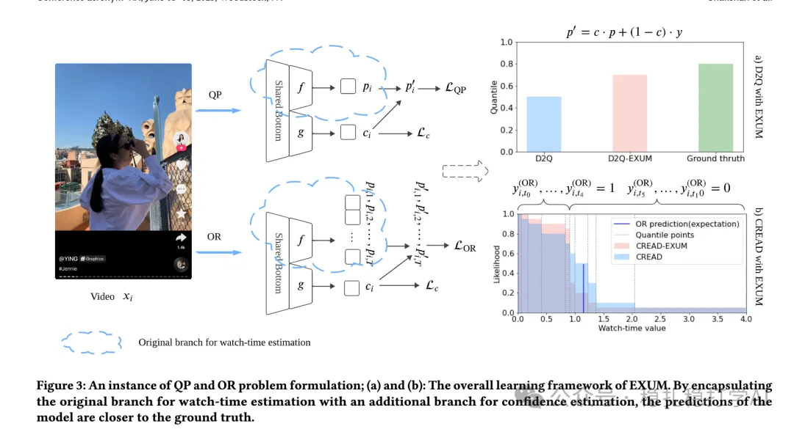

# 推荐算法(2025.4.12)：快手显式不确定性建模应对时长预估标签噪声

> 原文：https://mp.weixin.qq.com/s?__biz=MzkzNDYyNjM1NA==&mid=2247484455&idx=1&sn=e3a5e18fad5984711098d3536b05d326&scene=21#wechat_redirect
> 作者：算法工程师刘明星（稳扎稳打学AI）| 发表于 2025-04-11
> 本文拆自《推荐算法(2025.4.12)：看！谷歌的大作》，同期 4 篇：[谷歌用户反馈对齐满意度](../multi-task-learning/2025-04-11-google-user-feedback-alignment.md)、[腾讯 BI-GNAS 多任务架构搜索](../multi-task-learning/2025-04-11-tencent-bi-gnas-mtl.md)、[快手 EXUM 时长预估不确定性建模](../loss-func/2025-04-11-kuaishou-watch-time-uncertainty.md)、[快手统一生成式搜推](../generative-recommendation/2025-04-11-kuaishou-unified-search-rec.md)。

关注我，每天为你精挑细选最优质、最新鲜的推荐算法paper，陪你一起保持进步、不断精进！

> [English version](2025-04-11-kuaishou-watch-time-uncertainty.full.en.md)

Explicit Uncertainty Modeling for Watch-time Estimation with Noisy Labels

网址：https://arxiv.org/pdf/2504.07575

公司：快手

方向：时长估计

解读：

本文提出了一种显式不确定性建模（EXUM）方法，用于解决观看时长估计中的标签噪声问题。核心思想是显式地对不确定性进行建模，而不是直接拟合噪声标签，从而提高模型在观看时长预测中的准确性。

方法：

（1）显式不确定性建模：将不确定性作为模型的一部分进行建模，具体来说，使用正态分布来建模观看时长的估计不确定性。模型通过学习正态分布的均值和方差来表示观看时长的预测。

（2）基于置信度的损失函数：引入基于置信度的损失函数，通过对高置信度样本赋予更高权重，从而提高模型对噪声标签的鲁棒性。损失函数设计为：

QP问题：通过将观看时长预测建模为二次规划（Quadratic Programming, QP）问题，优化模型的预测效果。具体来说，模型通过最小化二次规划问题的目标函数，找到最优的观看时长预测值。

OR问题：通过引入顺序回归（Ordinal Regression, OR）问题，模型能够对观看时长进行分段建模，进一步提高预测的准确性。

（3）无偏估计器：通过构建无偏估计器，EXUM能够在存在标签噪声的情况下，提供更准确的观看时长预测。无偏估计器通过对噪声标签进行校正，使得模型的预测结果更加接近真实的观看时长。

心得：不确定性建模是一个好方法。

可信度：生产

推荐等级：推荐看看

Figure 3: An instance of QP and OR problem formulation; (a) and (b): The overall learning framework of EXUM. By encapsulating the original branch for watch-time estimation with an additional branch for confidence estimation, the predictions of the model are closer to the ground truth.
