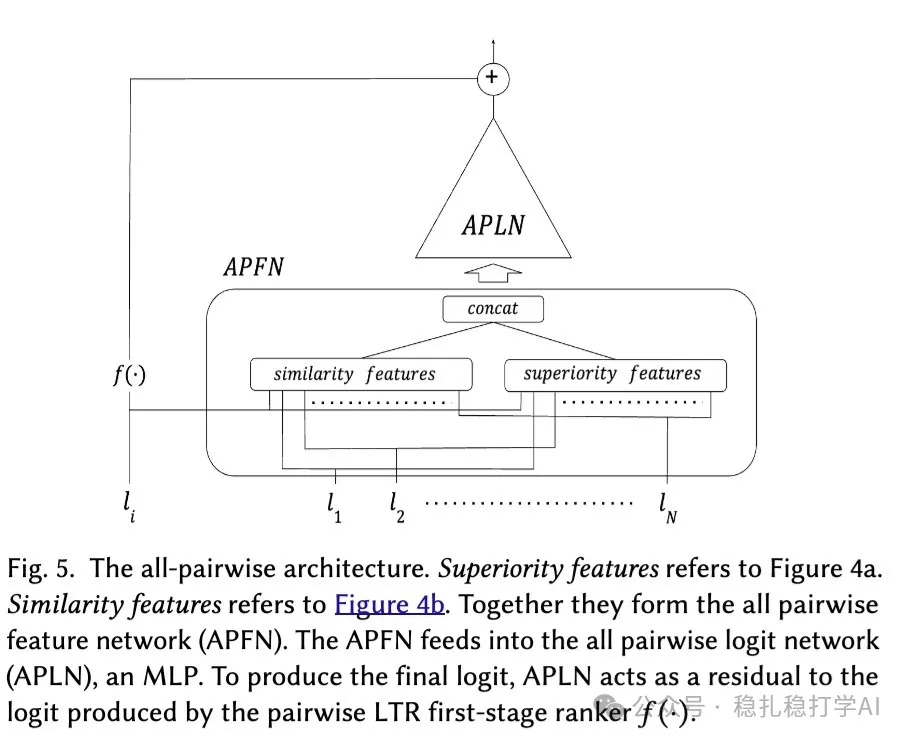

# Daily pick (2025.5.16): Airbnb's fully deployed search rerank model

> [中文版](2025-05-16-airbnb-all-pairwise.md)

1 True-Pairwise and All-Pairwise Learning to Rank

Link: https://arxiv.org/pdf/2505.10233

Company: Airbnb

Area: search, ranking

Overview: The paper proposes a new rerank framework that goes beyond traditional pairwise learning to rank (pairwise LTR): computing each item's score takes the other items into account. It proposes two concrete methods, True-Pairwise and All-Pairwise LTR models, and finally deployed All-Pairwise LTR in production. True-Pairwise LTR is an intermediate, transitional method that leads up to All-Pairwise LTR.

Why do "True-Pairwise LTR"? Traditional pairwise LTR compares two listings (say A and B), but it still scores each listing on its own (A gets 8, B gets 7) and then sorts by score. It assumes a listing's attractiveness depends only on itself and ignores the influence of the other listings as context (for example, B and C are very similar, which may make B less attractive). So it misses the interactions between listings. True-Pairwise LTR compares two restaurants directly ("this Italian place is better than that Japanese place because it's cheaper"): more precise, but slower.

(1) True-Pairwise LTR: within a ranked list of N items, recompute a score for each item. The way to compute it is to pair the item with each of the other items, pass each pair through an MLP to get a score, and fuse all these scores in some way into a final score for the item. Then sort the N items by this score from high to low. Because the complexity is O(n^2), it is only used in the last stage of multi-stage ranking, on a small number of items (about 10).

(2) All-Pairwise LTR: an efficiency optimization of True-Pairwise LTR. Instead of pairwise comparisons, it computes scores over all items through a learnable similarity function. A neural network called APLN (APLN is a multilayer perceptron (MLP), i.e. a simple neural network with several layers of neurons) combines a listing's Superiority and Similarity features into a final score (logit) that decides the listing's position in the search results. It helps the model account for a listing's interactions with all other listings in the shortlist, improving ranking accuracy. To make sure the ranking does not depend on the order in which listings are fed in, APLN adds a permutation-invariance mechanism, done by making the weights depend on the listing features (modeled by another MLP).

A/B: in online A/B tests, search result CTR rose 2.5% and search result conversion rate rose 1.8%.

Takeaways:

(1) True-Pairwise LTR has O(n^2) complexity, so it is only used in the last stage of multi-stage ranking, on a small number of items (about 10).

(2) All-Pairwise LTR is an efficiency optimization of True-Pairwise LTR: instead of pairwise comparisons, it computes scores over all items through a learnable similarity function.

Credibility: production

Recommendation: practically useful

