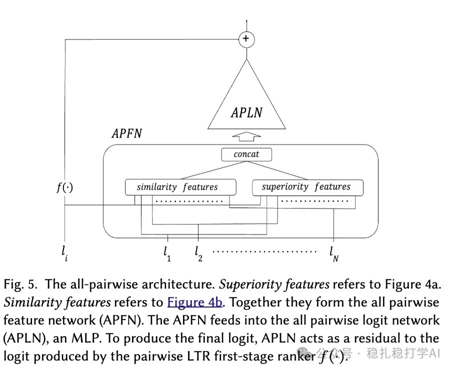

# 推荐算法(2025.5.16)：Airbnb的搜索Rerank全量模型

> 原文：https://mp.weixin.qq.com/s?__biz=MzkzNDYyNjM1NA==&mid=2247484666&idx=1&sn=86cad0ea9efa3094e18303eee515c905&scene=21#wechat_redirect
> 作者：算法工程师刘明星（稳扎稳打学AI）| 发表于 2025-05-16

嘿，记得给“稳扎稳打学AI”添加星标

关注我，每天为你精选最优质、最新鲜的推荐算法paper，陪你一起保持进步、不断精进！

📄 [本公众号paper推荐原则](https://mp.weixin.qq.com/s?__biz=MzkzNDYyNjM1NA==&mid=2247484097&idx=1&sn=18322c279290b555eb030e12953b7c7f&scene=21#wechat_redirect)

1 True-Pairwise and All-Pairwise Learning to Rank

网址：https://arxiv.org/pdf/2505.10233

公司：Airbnb

方向：搜索、排序

解读：本文提出了一种超越传统成对学习排序 (Pairwise LTR) 的rerank新框架，计算每个item的分数是要考虑其他item。提出了两个具体的方法——真成对 (True-Pairwise) 和 全成对 (All-Pairwise) LTR 模型，最终将全成对LTR在实际生产环境中成功部署，真成对 LTR是为了引出全程对LTR的中间过渡方法。

为什么要做“真成对 LTR”？传统的成对学习排序虽然比较两个房源（比如 A 和 B），但它只给每个房源单独打分（比如 A 得 8 分，B 得 7 分），然后按分数排序。它假设房源的吸引力只取决于自身，没考虑其他房源的上下文影响（比如 B 和 C 很像，可能降低 B 的吸引力）。这导致它忽略了房源之间的相互作用。真成对 LTR：直接比较两家餐厅（“这家意餐比那家日料好，因为更便宜”），更精准，但比较慢。

（1）真成对 LTR：就是在一个N个item的排序结果里，为每个item重新计算一个分数，计算的方法是与其它 的item两两经过一个MLP算一个分数，将计算的所有分数按照一定的方式融合为一个最终的得分，作为该item的得分，按照这个得分从高到低对N个item排序。因计算复杂度为O(n^2)，仅用于多阶段排序的最后阶段，处理少量物品（约 10 个）。

（2）全成对 LTR：是对真成对 LTR 的效率优化，不再是两两比较，而是通过一个可学习的相似性函数对所有item的分数进行计算。用一个叫APLN 的神经网络（APLN 是一个 多层感知机 (MLP)，即一个简单的神经网络，包含多层神经元），把房源的 优越性 (Superiority) 和 相似性 (Similarity) 特征整合成一个最终的得分（logit），用来决定房源在搜索结果中的排名。它帮助模型考虑一个房源与短名单中所有其他房源的交互，提升排序的准确性。为了确保排序结果不受房源输入顺序影响，APLN 加入了 排列不变性 机制，通过让权重依赖于房源特征（用另一个 MLP建模）来实现。

AB：线上AB实验中，搜索结果的点击率提升了 2.5%，搜索结果的转化率提升了 1.8%。

心得：

（1）真成对 LTR 的计算复杂度为O(n^2)，仅用于多阶段排序的最后阶段，处理少量物品（约 10 个）。

（2）全成对 LTR 是对真成对 LTR 的效率优化，不再是两两比较，而是通过一个可学习的相似性函数对所有item的分数进行计算。

可信度：生产

推荐等级：有实践价值

请帮忙点赞、转发，谢谢。您认为哪篇论文最有潜力应用到实际业务中？

## 欢迎干货投稿 \ 论文宣传 \ 合作交流

推荐您继续阅读：

■ [推荐算法(2025.5.15)：Google的新物料流量分配机制](https://mp.weixin.qq.com/s?__biz=MzkzNDYyNjM1NA==&mid=2247484660&idx=1&sn=af9370e1a5b04b9996b5ad0d4a7ecd56&scene=21#wechat_redirect)

■ [推荐算法(2025.5.14)：网易的分组泛化创新](https://mp.weixin.qq.com/s?__biz=MzkzNDYyNjM1NA==&mid=2247484654&idx=1&sn=d9f296188e2dba7d153c7ac6f41223db&scene=21#wechat_redirect)

■ [推荐算法(2025.5.13)：淘宝、沃尔玛的AB效果不错](https://mp.weixin.qq.com/s?__biz=MzkzNDYyNjM1NA==&mid=2247484648&idx=1&sn=ba92085c8ad14ae822333e6dd23a00b3&scene=21#wechat_redirect)

历史文章索引：https://docs.qq.com/sheet/DYXZTZ0tseHRyZGtt?tab=BB08J2

由于公众号试行乱序推送，您可能不再准时收到稳扎稳打学AI的推送。为了第一时间收到本号的干货内容，请将本号设为星标，以及常点文末右下角的“在看”。

喜欢的话点个在看吧👇

个人观点，仅供参考
