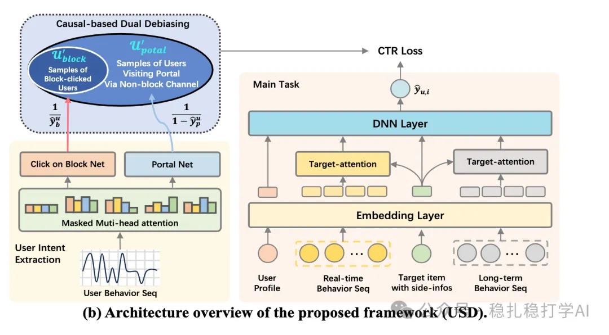

# Daily pick (2025.7.10): Taobao's intent-modeling debiasing method, double-digit A/B gains

> [中文版](2025-07-10-taobao-usd-intent-debiasing.md)

1 USD: User-intent-driven Sampling and Debiasing for Taobao Homepage Recommendations

Link: https://arxiv.org/pdf/2507.11242

Company: Taobao

Area: intent modeling + sample debiasing

Overview:

Background and motivation: the Taobao homepage recommender faces mixed intents in user behavior, which leads to data noise and model bias. In particular, user behavior contains samples with "unclear intent" (accidental taps, browsing rather than buying, etc.), and these samples easily disturb model training. Traditional methods usually ignore the diversity of user intent, or simply treat all behaviors as homogeneous signals.

Core method: the USD framework filters and debiases samples from the perspective of user intent, aiming to improve the model's ability to model users' real intent. Specifically:

(1) Intent modeling: identify users' short-term and long-term intent from the behavior sequence and context. Short-term intent is captured from recent behavior; long-term intent is modeled from historical behavior.

(2) Sample filtering and debiasing: based on the identified intent, select positive samples consistent with the current intent, and down-weight or drop inconsistent samples. At the same time, use causal inference to correct sample selection bias so the training data is representative.

(3) Model training and optimization: train the recommendation model on the filtered samples, jointly optimizing with intent features. The model uses a multi-task learning framework that predicts CTR and CVR at the same time, to capture user intent fully.

A/B: on Taobao homepage recommendation, CTR +15.3%, CVR +18.2%, GMV +12.6%. The online experiment ran for two weeks and covered tens of millions of users.

Credibility: production

Recommendation: practically useful

