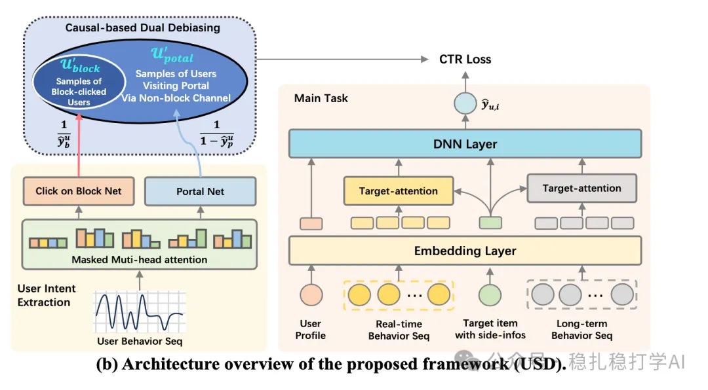

# 推荐算法(2025.7.10)：淘宝的意图建模纠偏方法AB效果两位数

> 原文：https://mp.weixin.qq.com/s?__biz=MzkzNDYyNjM1NA==&mid=2247484884&idx=1&sn=8a0e3c23281188cab8a4660ece028c23&scene=21#wechat_redirect
> 作者：算法工程师刘明星（稳扎稳打学AI）| 发表于 2025-07-10

嘿，记得给“稳扎稳打学AI”添加星标

关注我，每天为你精挑细选最优质、最新鲜的推荐算法paper，陪你一起保持进步、不断精进！

> [English version](2025-07-10-taobao-usd-intent-debiasing.full.en.md)

👆 [本公众号paper推荐原则](https://mp.weixin.qq.com/s?__biz=MzkzNDYyNjM1NA==&mid=2247484097&idx=1&sn=18322c279290b555eb030e12953b7c7f&scene=21#wechat_redirect)

1 USD: User-intent-driven Sampling and Debiasing for Taobao Homepage Recommendations

网址：https://arxiv.org/pdf/2507.11242

公司：淘宝

方向：意图建模+样本纠偏

解读：

背景和动机：淘宝首页推荐系统面对用户行为中意图的混杂，导致数据噪声和模型偏差。尤其是用户行为中存在“意图不明”的样本（如误触、浏览而非购买等），这些样本容易干扰模型训练。传统方法通常忽略用户意图的多样性，或简单地将所有行为视为同质信号。

核心方法：USD框架从用户意图的视角出发，对样本进行筛选和纠偏，旨在提升模型对用户真实意图的建模能力。具体包括：

（1）意图建模：通过用户行为序列和上下文信息，识别用户的短期意图和长期意图。短期意图通过近期行为捕捉，长期意图通过历史行为建模。

（2）样本筛选与纠偏：基于意图识别结果，筛选出与当前意图一致的正样本，并对不一致样本进行降权或剔除。同时，通过因果推断方法，纠正样本选择偏差，确保训练数据的代表性。

（3）模型训练与优化：在筛选后的样本上训练推荐模型，并结合意图特征进行联合优化。模型采用多任务学习框架，同时预测点击率和转化率，以全面捕捉用户意图。

贴AB：淘宝首页推荐，CTR提升15.3%，CVR提升18.2%，GMV提升12.6%。在线实验持续两周，覆盖数千万用户。

可信度：生产

推荐等级：有实践价值

请帮忙点赞、转发，谢谢。您认为哪篇论文最有潜力应用到实际业务中？

## 欢迎干货投稿 \ 论文宣传 \ 合作交流

推荐您继续阅读：

■ [推荐算法(2025.7.8)：华为的特征选择的新方法](https://mp.weixin.qq.com/s?__biz=MzkzNDYyNjM1NA==&mid=2247484878&idx=1&sn=d1e5248e2caad9e02911c41eac83df8f&scene=21#wechat_redirect)

■ [推荐算法(2025.7.3)：快看Tiktok是怎么审核你的视频的](https://mp.weixin.qq.com/s?__biz=MzkzNDYyNjM1NA==&mid=2247484873&idx=1&sn=cfd6a674121ce40b7de334885b4d4b80&scene=21#wechat_redirect)

■ [推荐算法(2025.7.1)：Pinterest的兴趣聚类召回](https://mp.weixin.qq.com/s?__biz=MzkzNDYyNjM1NA==&mid=2247484867&idx=1&sn=33c9c879ca6f9282601c2709750f69dc&scene=21#wechat_redirect)

历史文章索引：https://docs.qq.com/sheet/DYXZTZ0tseHRyZGtt?tab=BB08J2

由于公众号试行乱序推送，您可能不再准时收到稳扎稳打学AI的推送。为了第一时间收到本号的干货内容， 请将本号设为星标，以及常点文末右下角的“在看”。

喜欢的话点个在看吧👇

个人观点，仅供参考
