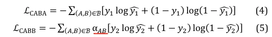
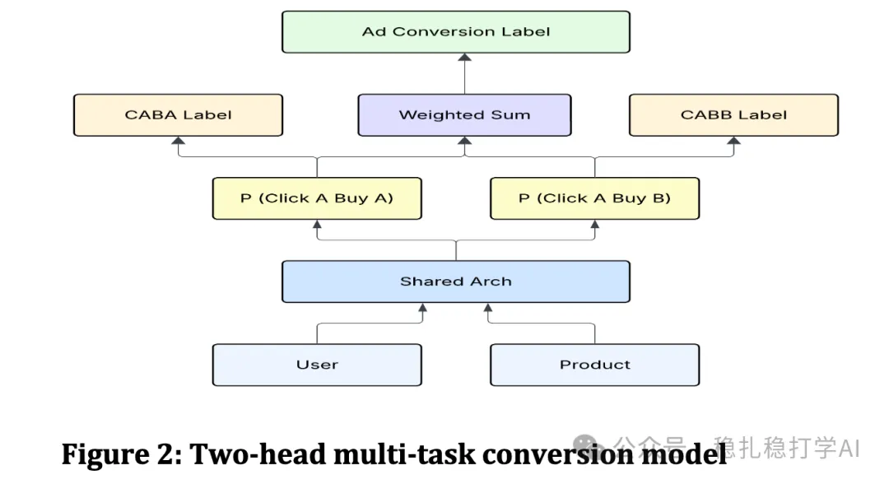

# Daily pick (2025.7.23): Meta's decoupling practice pays off big

> [中文版](2025-07-23-meta-click-buy-attribution.md)

1 Click A, Buy B: Rethinking Conversion Attribution in E-Commerce Recommendations

Link: https://arxiv.org/pdf/2507.15113

Company: Meta

Area: conversion attribution in e-commerce recommendation

Overview:

In e-commerce recommendation, it is very common for a user to click product A and buy product B. This kind of cross-purchase challenges traditional conversion attribution (attributing the purchase to the last click).

The paper proposes a decoupled attribution framework that models the click and purchase stages separately:

(1) Click attribution: analyze the relationship between clicks and purchases, and identify the key nodes in the "click-purchase" chain.

(2) Purchase attribution: attribute a purchase to several possible clicks rather than only the last one.

(3) Decoupling: by decoupling the click and purchase tasks, the model can optimize the two objectives separately and avoid interference between them.

A/B results:

(1) CTR +12%.

(2) CVR +8%.

(3) GMV +5%.

Takeaways:

(1) Decoupling is a very important idea in recommender systems. Clicks and purchases are two different objectives; forcing one model to optimize both often works poorly.

(2) The decoupling practice in this paper achieved big results and is worth trying in real business.

Credibility: production

Recommendation: practically useful

