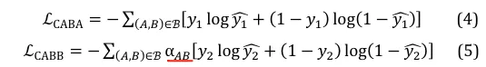
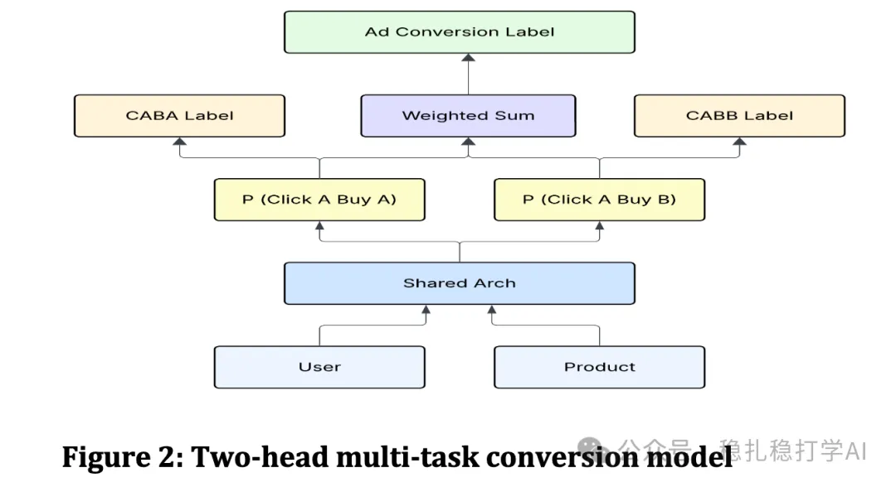

# 推荐算法(2025.7.23)：Meta的解藕实践取得很大成绩

> 原文：https://mp.weixin.qq.com/s?__biz=MzkzNDYyNjM1NA==&mid=2247484917&idx=1&sn=7825158d39731034eb3945c1888a9fe4&scene=21#wechat_redirect
> 作者：算法工程师刘明星（稳扎稳打学AI）| 发表于 2025-07-23

嘿，记得给“稳扎稳打学AI”添加星标

关注我，每天为你精挑细选最优质、最新鲜的推荐算法paper，陪你一起保持进步、不断精进！

> [English version](2025-07-23-meta-click-buy-attribution.full.en.md)

👆 [本公众号paper推荐原则](https://mp.weixin.qq.com/s?__biz=MzkzNDYyNjM1NA==&mid=2247484097&idx=1&sn=18322c279290b555eb030e12953b7c7f&scene=21#wechat_redirect)

1 Click A, Buy B: Rethinking Conversion Attribution in E-Commerce Recommendations

网址：https://arxiv.org/pdf/2507.15113

公司：Meta

方向：电商推荐中的转化归因

解读：

在电商推荐中，用户点击A商品，购买B商品的现象很多见。这种交叉购买对传统的转化归因（将购买归因到最后一次点击）提出了挑战。

本文提出一个解耦的归因框架，分别建模点击和购买两个阶段：

（1）点击归因：分析点击与购买之间的关系，识别出“点击-购买”链条中的关键节点。

（2）购买归因：将购买行为归因到多个可能的点击，而非单一的最后一次点击。

（3）解耦：通过解耦点击和购买两个任务，模型可以分别优化两个目标，避免相互干扰。

AB效果：

（1）点击率（CTR）提升了 12%。

（2）转化率（CVR）提升了 8%。

（3）GMV 提升了 5%。

心得：

（1）解耦的思路在推荐系统中非常重要。点击和购买是两个不同的目标，强行用一个模型优化两个目标，往往效果不佳。

（2）本文的解耦实践取得了很大的成绩，值得在实际业务中尝试。

可信度：生产

推荐等级：有实践价值

请帮忙点赞、转发，谢谢。您认为哪篇论文最有潜力应用到实际业务中？

## 欢迎干货投稿 \ 论文宣传 \ 合作交流

推荐您继续阅读：

■ [推荐算法(2025.7.22)：字节的推荐算法“大模型”有效果](https://mp.weixin.qq.com/s?__biz=MzkzNDYyNjM1NA==&mid=2247484908&idx=1&sn=7015e595144e0712fb4401175f50e624&scene=21#wechat_redirect)

■ [推荐算法(2025.7.19)：Pinterest出品必是精品——GPT建模行为序列](https://mp.weixin.qq.com/s?__biz=MzkzNDYyNjM1NA==&mid=2247484902&idx=1&sn=2ebdcda5dceefb8d2608f48bdeaab839&scene=21#wechat_redirect)

■ [推荐算法(2025.7.16)：Meta的相关短视频推荐的相关性提升了12%](https://mp.weixin.qq.com/s?__biz=MzkzNDYyNjM1NA==&mid=2247484896&idx=1&sn=00e46baa7b3bedc78520a72f4360ee74&scene=21#wechat_redirect)

历史文章索引：https://docs.qq.com/sheet/DYXZTZ0tseHRyZGtt?tab=BB08J2

请入群，群内可讨论技术方案、发招聘广告、内推和交友。

• 铁粉标准：累计10次评论或爱心、投稿1次、打赏199。

• 入群方法：请您加个人微信lmxhappy，我拉您入群，请备注（只我个人看，不公开）。

由于公众号试行乱序推送，您可能不再准时收到稳扎稳打学AI的推送。为了第一时间收到本号的干货内容， 请将本号设为星标，以及常点文末右下角的“在看”。

喜欢的话点个在看吧👇

个人观点，仅供参考
