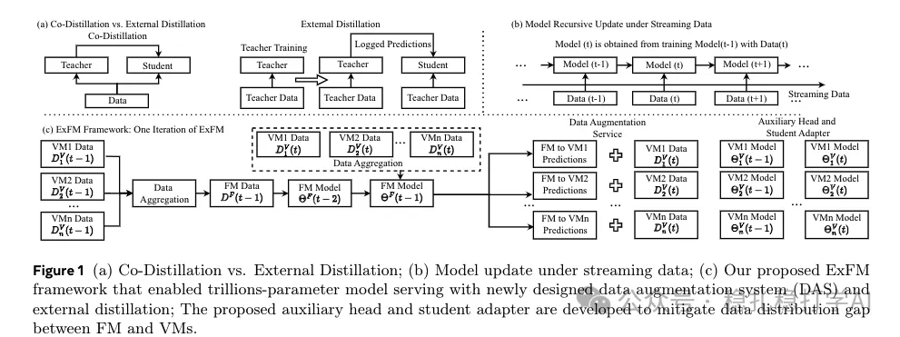

# Recommendation papers (2025.2.26): Meta ExFM: external distillation to serve a trillion-parameter foundation model for ads recommendation
> [中文版](2025-02-26-meta-exfm.md)

> Source: WeChat post https://mp.weixin.qq.com/s?__biz=MzkzNDYyNjM1NA==&mid=2247484196&idx=1&sn=712014b56ddfca6363d076862eccf06e&scene=21#wechat_redirect, published 2025-02-26.
> Split from the roundup "Recommendation papers (2025.2.26): two industrial-style LLM papers from Meta to help you stay ahead!"; same issue: [Meta ExFM external distillation](../ml-infra/2025-02-26-meta-exfm.full.en.md), [Meta DRAMA LLM-augmented dense retrieval](../llm4rec/2025-02-26-meta-drama.full.en.md).

External Large Foundation Model: How to Efficiently Serve Trillions of Parameters for Online Ads Recommendation

Link: https://arxiv.org/pdf/2502.17494

Company: Meta (ads)

Area: LLM

Overview: To make LLMs usable in ads recommendation, the most important problem is still how to train and serve efficiently on large-scale data. The core of this paper is external distillation: through one-way knowledge transfer, knowledge is extracted from a large foundation model (FM) trained on billions of samples to improve hundreds of models (VMs).

One large foundation model can serve many models, but because of the data distribution gap between the FM and the VMs and latency constraints, using the FM directly is not practical. To solve this, external distillation serves a large foundation model at trillion-parameter scale through the training data stream and model components. The data augmentation system (DAS) produces high-quality training data, improves the models' generalization, and reduces reliance on real-time FM inference.

External distillation transfers the FM's knowledge into the VMs through one-way knowledge transfer. Compared with co-distillation, external distillation simplifies training, avoids the complexity of interaction between the FM and the VMs, and reduces resource consumption.

Takeaways: LLM data augmentation matters a lot, and this has been widely shown, whether for training small LLMs or training a large LLM from scratch.

Application: production

Recommendation: worth reading

Figure 1 (a) Co-Distillation vs. External Distillation; (b) Model update under streaming data; (c) Our proposed ExFM framework that enabled trillions-parameter model serving with newly designed data augmentation system (DAS) and external distillation; The proposed auxiliary head and student adapter are developed to mitigate data distribution gap between FM and VMs.
