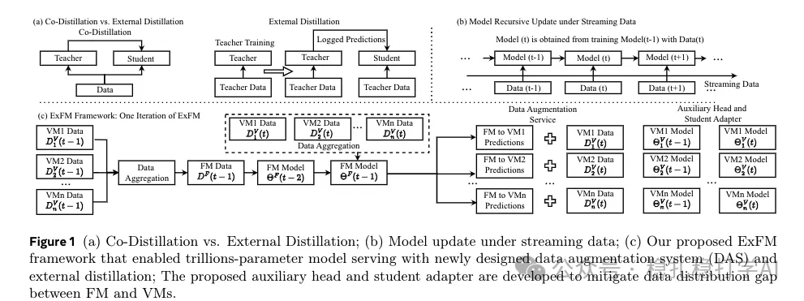

# 推荐算法(2025.2.26)：Meta外部蒸馏ExFM：万亿参数基础模型服务广告推荐

> 原文：https://mp.weixin.qq.com/s?__biz=MzkzNDYyNjM1NA==&mid=2247484196&idx=1&sn=712014b56ddfca6363d076862eccf06e&scene=21#wechat_redirect
> 作者：算法工程师刘明星（稳扎稳打学AI）| 发表于 2025-02-26
> 本文拆自《推荐算法paper（2025.2.26）meta两篇工业风的LLM最新研究成果，助你领先一步！》，同期 2 篇：[Meta ExFM 外部蒸馏](../ml-infra/2025-02-26-meta-exfm.md)、[Meta DRAMA LLM 增强稠密检索](../llm4rec/2025-02-26-meta-drama.md)。

关注我，每天为你精挑细选最优质、最新鲜的推荐算法paper，陪你一起保持进步、不断精进！

> [English version](2025-02-26-meta-exfm.full.en.md)

External Large Foundation Model: How to Efficiently Serve Trillions of Parameters for Online Ads Recommendation

网址：https://arxiv.org/pdf/2502.17494

公司：meta广告部门

方向：LLM

解读：为了让LLM能应用到广告推荐中，最重要的还是要解决大规模数据如何高效训练并服务的问题。本paper核心内容是外部蒸馏，通过单向知识传递，从一个在数十亿条样本上训练的大型基础模型（FM）中提取知识，来提升数百个模型（VMs）的效果。

一个大型基础模型可以为多个模型服务，但由于FM和VMs之间的数据分布差异及延迟限制，直接使用FM并不实用。为了解决这个问题，外部蒸馏（External Distillation）通过训练数据流和模型组件，实现在数万亿参数规模上服务大型基础模型。数据增强系统（DAS）生成了高质量的训练数据，增强了模型的泛化能力，同时减少了对实时FM推理的依赖。

外部蒸馏，通过单向知识传递，将FM的知识转移到VMs中。相比于共同蒸馏，外部蒸馏简化了训练过程，避免了FM和VMs之间交互的复杂性，减少了资源消耗。

心得：LLM数据增强的作用很重要，被普遍证明，不管是训练LLM小模型，还是从0训练LLM大模型。

应用：生产

推荐等级：推荐看看

Figure 1 (a) Co-Distillation vs. External Distillation; (b) Model update under streaming data; (c) Our proposed ExFM framework that enabled trillions-parameter model serving with newly designed data augmentation system (DAS) and external distillation; The proposed auxiliary head and student adapter are developed to mitigate data distribution gap between FM and VMs.
