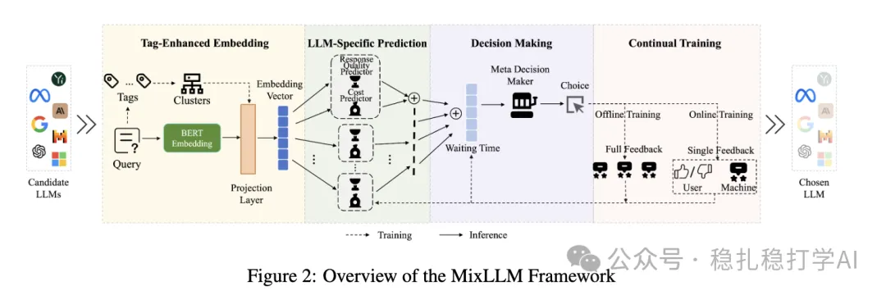

# Recommendation papers (2025.2.27): NEC MixLLM: dynamic LLM routing with a contextual bandit
> [中文版](2025-02-27-nec-mixllm-routing.md)

> Source: WeChat post https://mp.weixin.qq.com/s?__biz=MzkzNDYyNjM1NA==&mid=2247484205&idx=1&sn=2bf96b05ea4f2bd60b47d4b28923cb8f&scene=21#wechat_redirect, published 2025-02-27.
> Split from the roundup "Recommendation papers (2025.2.27) quick look! New tricks from Kuaishou and Meta! DeepSeek really applied"; same issue: [Kuaishou OneRec](../generative-recommendation/2025-02-27-kuaishou-onerec.full.en.md), [Meta training-free data augmentation](../llm4rec/2025-02-27-meta-training-free-augmentation.full.en.md), [NEC MixLLM dynamic routing](../ml-infra/2025-02-27-nec-mixllm-routing.full.en.md).

MixLLM: Dynamic Routing in LLM Serving

Link: https://arxiv.org/pdf/2502.18482

Company: NEC

Area:

Overview: The core idea is to treat multiple LLMs as different arms of a contextual multi-armed bandit, and, based on the contextual features of the user's query, dynamically pick the most suitable LLM to handle it, while taking cost, performance and latency into account.

Takeaways: A very interesting and very useful approach. Not only can it be used in production, we can also use it to build our own LLM selector instead of jumping between LLM apps. For other things too, when facing many options, the same recipe applies.

Credibility: production

Recommendation: read if you have time

Figure 2: Overview of the MixLLM Framework
