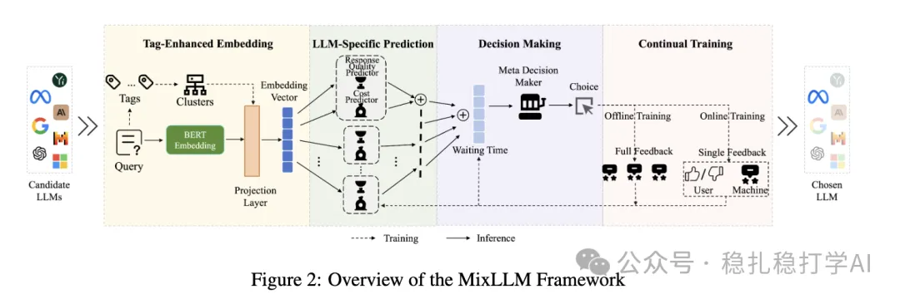

# 推荐算法(2025.2.27)：NEC MixLLM用上下文老虎机动态路由LLM

> 原文：https://mp.weixin.qq.com/s?__biz=MzkzNDYyNjM1NA==&mid=2247484205&idx=1&sn=2bf96b05ea4f2bd60b47d4b28923cb8f&scene=21#wechat_redirect
> 作者：算法工程师刘明星（稳扎稳打学AI）| 发表于 2025-02-27
> 本文拆自《推荐算法paper（2025.2.27）速看！快手、meta又出黑科技！deepseek真应用》，同期 3 篇：[快手 OneRec](../generative-recommendation/2025-02-27-kuaishou-onerec.md)、[Meta 免训练数据增强](../llm4rec/2025-02-27-meta-training-free-augmentation.md)、[NEC MixLLM 动态路由](../ml-infra/2025-02-27-nec-mixllm-routing.md)。

关注我，每天为你精挑细选最优质、最新鲜的推荐算法paper，陪你一起保持进步、不断精进！

> [English version](2025-02-27-nec-mixllm-routing.full.en.md)

MixLLM: Dynamic Routing in LLM Serving

网址：https://arxiv.org/pdf/2502.18482

公司：NEC

方向：

解读：核心思想是将多个LLM视为上下文多臂老虎机（contextual multi-armed bandit）中的不同臂，根据用户查询的上下文特征，动态选择最合适的LLM来处理该查询，同时考虑成本、性能和延迟等因素。

心得：这个很有趣、很有用的做法。不仪可用于生产，我们也可以用于搭建我们自己的大模型选择器，不用在各个大模型app上跳转。在其它事情上，如果面对很多可选项，也可以这样如法炮制。

可信度：生产

推荐等级：有时间看看

Figure 2: Overview of the MixLLM Framework
