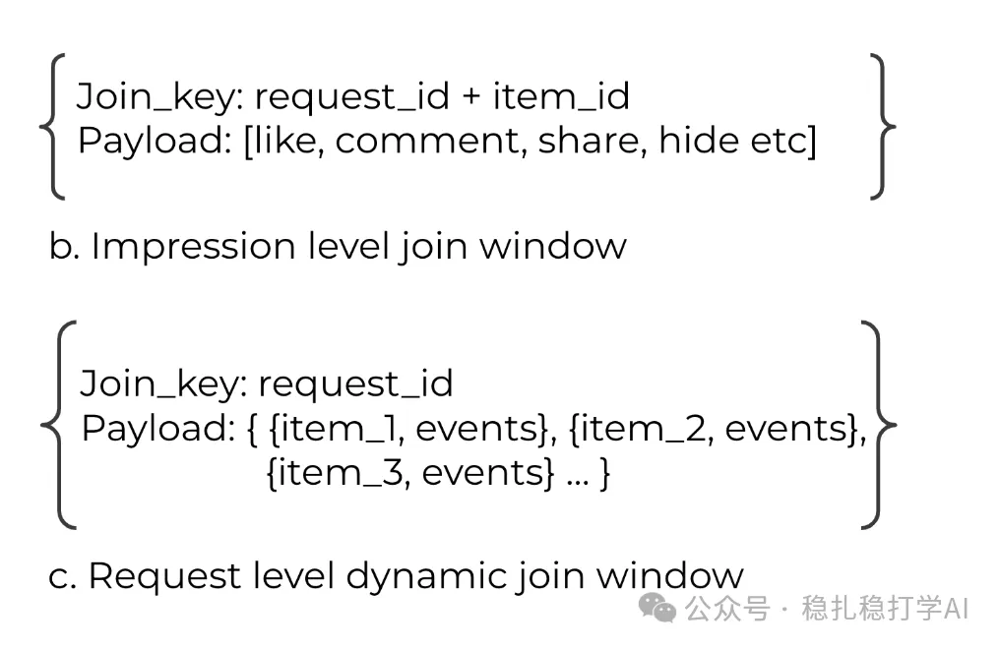

# Daily pick (2025.8.11): Meta rebuilds its sample format to ship generative recommendation

> [中文版](2025-08-11-meta-request-only.md)

1 Request-Only Optimization for Recommendation Systems

Link: https://arxiv.org/pdf/2508.05640

Company: Meta

Area: sample format

Overview:

To get generative recommendation models into production, the sample format is changed: each sample goes from one impression to one request.

Direct benefits:

(1) Less redundancy

This way, one request is a single user, so user information no longer has to be stored repeatedly, saving storage.

(2) Easier compression

A request sample can be split into two parts: the RO (Request-Only) part (user-side features) and the NRO (Non-Request-Only) part (item-side features), which makes columnar storage easy and raises the compression ratio.

Indirect benefits:

(1) HSTU model complexity goes up

In three ways: first, it allows HSTU to be fully deployed; second, the user behavior sequence gets longer; third, the model gets deeper.

HSTU has already proven its effectiveness; it just couldn't be fully deployed because it wasn't efficient enough. Longer sequences and bigger models improve model quality, which has been widely shown.

(2) Sample volume

Previously samples were subsampled; now the full set of samples can be used. More samples improve the model.

A/B: Meta got gains in retrieval, pre-ranking and ranking. Only retrieval is covered here; see the paper for the others. The main online consumption metric rose 4.77%.

Takeaways:

(1) Every company is pulling out all the stops to ship generative recommendation.

(2) This Meta work was bound to happen: they weren't using all their samples before, so they were bound to find a way to use them all.

Credibility: production

Recommendation: practically useful

